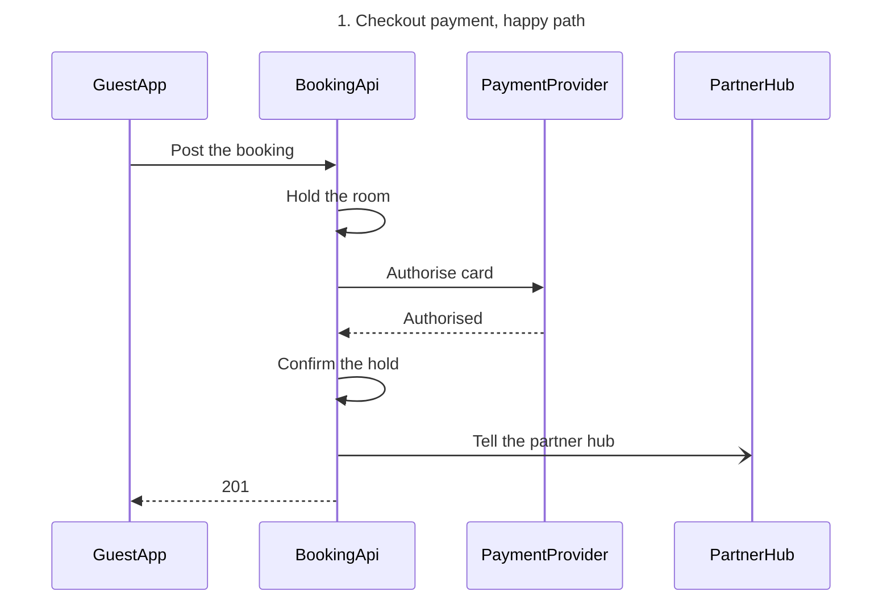
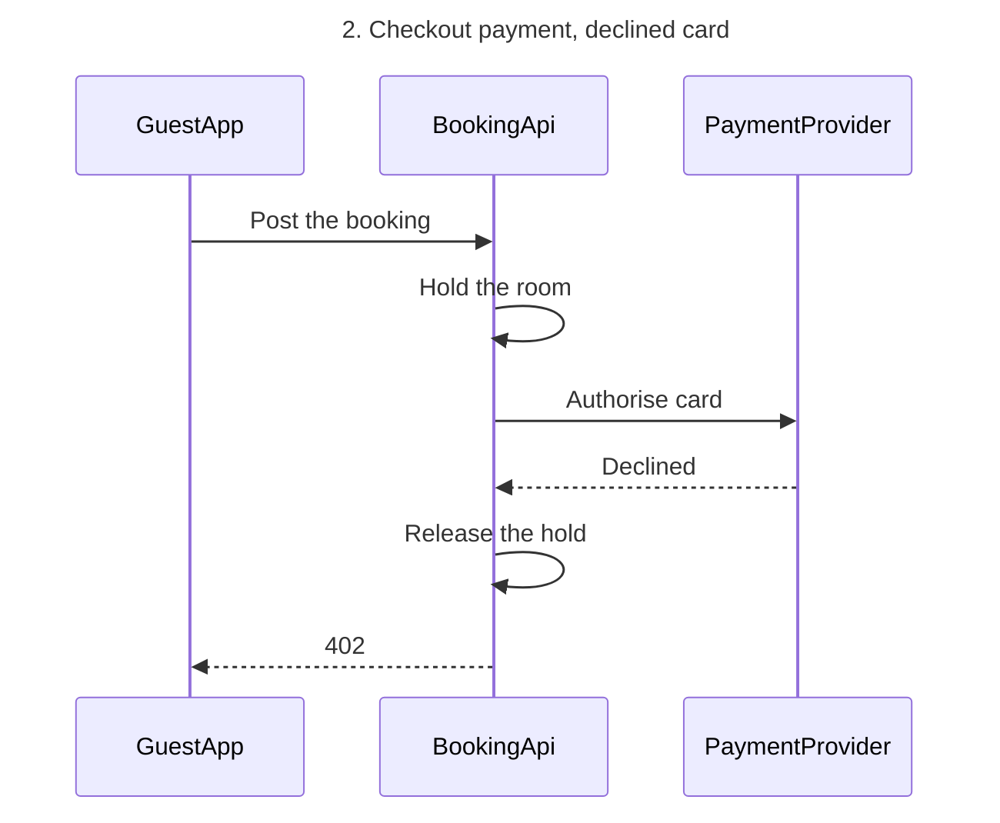

The check passed, and the file is empty, so no section shares either title and nothing already on it can change.

**Question:** in what order do the guest app, the booking API, the payment provider and the partner hub exchange messages when a guest pays at checkout?
**Outcome:** the payments team can read the checkout calls in order, with the status codes, for an authorised card and for a declined one.
**First glance:** Authorise card on both diagrams, the call that decides the checkout.
**Second glance:** Authorised on diagram 1 and Declined on diagram 2, the answers that send the booking API to confirm or release the hold.
**Last glance:** Tell the partner hub, which does not hold up the answer to the app, and the 201 and 402 replies that close each path.

**Sketch:** the checked model exactly as the check read it.





```text
  diagram 1, sequence: ok, 4 participants and 7 messages
  diagram 2, sequence: ok, 3 participants and 6 messages
PASSED 2 diagram(s) in model.md
```

Both diagrams also composed cleanly in the shipped FigJam default design, with 4 nodes and 7 connectors to read back on diagram 1 and 3 nodes and 6 connectors on diagram 2.

**The four critique questions**
* Where the eye goes first: Authorise card, and that is the message the board most needs read
* What it reads second: Authorised or Declined, which advances the first by showing what the call returned
* What a reader could miss: Tell the partner hub, which would hide that the hub hears of the booking without holding up the 201
* What the remove test would cut next: Hold the room, which stays because the hold is what Confirm the hold and Release the hold act on

**Plan:** Roamstay Product, as you named it. I did not call `whoami`, so the plan is your statement and not something I verified.
**File:** the existing FigJam file `<test-file-key>`, with no new file created.
**Writes:** two composed boards added as new sections, "1. Checkout payment, happy path" with 4 participants and 7 numbered messages, and "2. Checkout payment, declined card" with 3 participants and 6 numbered messages. Each has a title, subtitle, key and source line, at the Laptop reading distance. The labels use plain verbs plus 201 and 402, because the brief gives no paths.
**Left out:** the declined card, split into 2. Checkout payment, declined card. Retries, timeouts and partner hub failures, because the brief states none of them.
**Extensions:** none.
**Calls:** two `use_figma` calls, one per diagram, and one `get_figjam` read-back of the file. I already spent one `get_figjam` read and the `create_session` call. If the plan is Starter, or your seat is View or Collab, Figma caps tool calls at six a month, and the read-back could be refused. The reply would then say `Read-back: not possible` with that limit named.
**Rollback:** delete the two board sections the write returns, through `use_figma`, and only on a yes that names them.

Write both boards to this file?