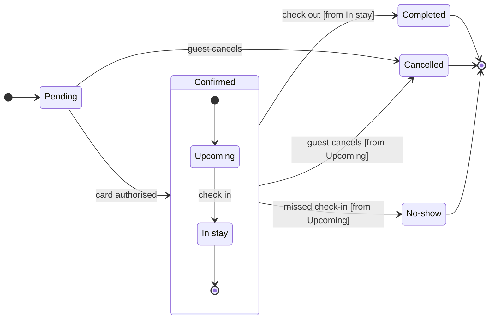

# FJ-026 turn 3 transcript

**User:** Yes, that reading is right.

**Tool call:** `Bash` `{"command": "S=$(mktemp -d) && echo \"$S\" && cat > \"$S/model.md\" <<'EOF'\n```mermaid\nstateDiagram-v2\n    %% title: Booking status\n    %% subtitle: Every status a Roamstay booking passes through, from the pending request to a completed, cancelled or missed stay, and what moves it on\n    %% source: Source: the Roamstay booking status description given in the request. Left out: payment failure, expiry, refunds, booking edits and cancellation after check-in.\n    %% focus: Cancelled\n    direction LR\n    state \"In stay\" as InStay\n    state \"No-show\" as NoShow\n    [*] --> Pending\n   `

**Tool call:** `mcp__figma-remote__create_session` `{"fileKey": "<test-file-key>", "description": "Add a Roamstay booking status state diagram as a new section on the existing FigJam board"}`

**Tool result:** `Bash`

```text
"/var/folders/3c/zfqcqsts0kn19cgblj82gqhm0000gn/T/tmp.rRoGJzbdgl\n  diagram 1, state: ok, 7 states and 12 transitions\nPASSED 1 diagram(s) in model.md"
```

**Tool result:** `mcp__figma-remote__create_session`

```text
"{\"sessionId\":\"f3c88f65-1a95-4cbe-8176-e499e58c1738\"}"
```

**Tool call:** `mcp__figma-remote__get_figjam` `{"fileKey": "<test-file-key>", "nodeId": "0:1", "sessionId": "f3c88f65-1a95-4cbe-8176-e499e58c1738", "includeImagesOfNodes": false}`

**Tool result:** `mcp__figma-remote__get_figjam`

```text
[{"type": "text", "text": "<canvas id=\"0:1\" name=\"Page 1\" x=\"0\" y=\"0\" width=\"0\" height=\"0\" />"}]
```

**Assistant:**

Gate reply, written before anything is drawn.

**Question:** which statuses exist and what moves a booking between them?
**Outcome:** support can read every booking status and spot the three a booking ends in.

**Glance lines**
* **First glance:** Pending, the light blue first state where every booking starts.
* **Second glance:** Upcoming and In stay, read with the Confirmed section around them.
* **Last glance:** Cancelled, marked by the focus line, then Completed and No-show. All three end states are drawn in light gray with a heavy outline.

**Sketch:** the checked model, exactly as the check read it.



```text
  diagram 1, state: ok, 7 states and 12 transitions
PASSED 1 diagram(s) in model.md
```

**Critique**
* **Eye first:** Pending, the first state the layout always shows. Cancelled, the state with two entries, carries the pink focus outline where it is drawn.
* **Reads second:** Upcoming and In stay inside Confirmed, which carry the booking from payment to the stay.
* **Could miss:** No-show. A reader who skips it would think only the guest can end a booking early, when the hotel can too.
* **Remove next:** In stay. It stays because check-out leaves from it.

**Plan and file**
* **Plan:** Roamstay Product, as you stated it. I haven't verified that the file belongs to this plan.
* **File:** `<test-file-key>`, which I read once and found empty. There is no same-titled section to avoid, so the board keeps the title "Booking status". It lands as a new section and changes nothing already on the file.

**Writes:** one composed board with 7 states and 12 transitions at the Laptop reading distance. It carries a title, a subtitle, a key and a source line, with the end states in light gray.
**Extensions:** none.
**Calls:** one `use_figma` and one `get_figjam` read-back. The read of the file is already spent. A Starter plan or a View or Collab seat allows six tool calls a month and read tools count, so check your allowance if you are on one.
**Rollback:** delete the one board section the write returns. That runs only on your separate yes to a question that names it.
**Left out:** payment failure, expiry, refunds, booking edits and cancellation after check-in, none of which your message states.

Write it?
