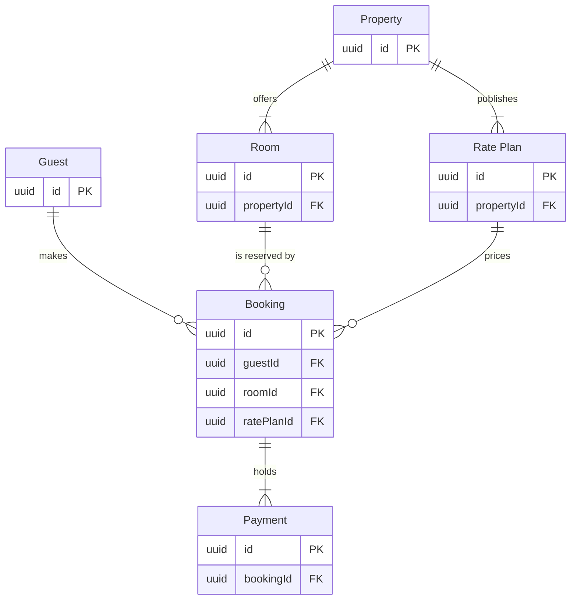

# FJ-027 turn 3 transcript

**User:** Yes, that reading is right.

**Tool call:** `Read` `{"file_path": "/private/var/folders/3c/zfqcqsts0kn19cgblj82gqhm0000gn/T/devin-compare-bench/FJ-027/sk-create-figjam/references/quality-rubric.md"}`

**Tool result:** `Read`

```text
"1\t---\n2\ttitle: \"FigJam Diagram Quality Rubric\"\n3\tdescription: \"The taste gate a FigJam model passes before the write gate, translated from sk-design-diagram's success criteria: type fit, the remove test, signal, the check, the board, the design rubric that scores a composed board and the reply.\"\n4\tcontextType: implementation\n5\timportance_tier: important\n6\ttrigger_phrases:\n7\t  - \"figjam quality rubric\"\n8\t  - \"diagram taste gate\"\n9\t  - \"remove test\"\n10\t  - \"figjam review checklist\"\n11\t  - \"figjam design rubric\"\n12\tversion: 1.0.13.0\n13\t---\n14\t\n15\t# FigJam Diagram Quality Rubric\n16\t\n17\tThe script checks what a script can see. This rubric is the rest: whether the diagram should exist, whether every node earns its place and whether the reader can trust what lands on the board. Walk it after the check passes and before the write gate.\n18\t\n19\t**Loading Condition:** CONDITIONAL, on every Flow route before the write gate\n20\t**Purpose:** The judgement pass between the pre-write check and the gate\n21\t**Scope:** The model, the provenance table, the planned extensions and, after the write, the board and the reply\n22\t\n23\t---\n24\t\n25\t## 1. TYPE FIT\n26\t\n27\t- [ ] The type answers the reader's question, as `references/flow-mode.md` Section 3 maps it\n28\t- [ ] A table, a list or a paragraph would not do the same job. If it would, say so and offer that instead\n29\t- [ ] The type's reference in `references/types/` was loaded and 
```

**Tool call:** `Bash` `{"command": "mktemp -d", "description": "Create scratch folder for the model"}`

**Tool result:** `Bash`

```text
"/var/folders/3c/zfqcqsts0kn19cgblj82gqhm0000gn/T/tmp.yyAok8HFTr"
```

**Tool call:** `Bash` `{"command": "D=/var/folders/3c/zfqcqsts0kn19cgblj82gqhm0000gn/T/tmp.yyAok8HFTr\ncat > $D/model.md <<'EOF'\n```mermaid\nerDiagram\n    %% title: Stays model\n    %% subtitle: The tables behind a stay and the keys that join them, split into the guest side and the partner side\n    %% source: Source: the stays schema note, as summarised in the request. Left out: the support-facing columns, not supplied.\n    %% zone: Guest side: Guest, Booking, Payment\n    %% zone: Partner side: Property, Room, RatePlan\n    %% focus: Booking\n    Guest ||--o{ Booking : makes\n    Booking ||--|{ Payment : holds\`

**Tool call:** `ToolSearch` `{"query": "select:mcp__figma-remote__create_session,mcp__figma-remote__get_figjam,mcp__figma-remote__use_figma", "max_results": 3}`

**Tool result:** `Bash`

```text
"  diagram 1, ER: ok, 6 entities and 6 relationships\nPASSED 1 diagram(s) in model.md"
```

**Tool result:** `ToolSearch`

```text
[{"type": "tool_reference", "tool_name": "mcp__figma-remote__create_session"}, {"type": "tool_reference", "tool_name": "mcp__figma-remote__get_figjam"}, {"type": "tool_reference", "tool_name": "mcp__figma-remote__use_figma"}]
```

**Tool call:** `mcp__figma-remote__create_session` `{"fileKey": "<test-file-key>", "description": "Add a Stays model ER board as a new section in the Roamstay Product FigJam file"}`

**Tool result:** `mcp__figma-remote__create_session`

```text
"{\"sessionId\":\"e755b8ef-aab2-45c1-998a-22de6388653c\"}"
```

**Tool call:** `mcp__figma-remote__get_figjam` `{"fileKey": "<test-file-key>", "nodeId": "0:1", "includeImagesOfNodes": false, "sessionId": "e755b8ef-aab2-45c1-998a-22de6388653c"}`

**Tool result:** `mcp__figma-remote__get_figjam`

```text
[{"type": "text", "text": "<canvas id=\"0:1\" name=\"Page 1\" x=\"0\" y=\"0\" width=\"0\" height=\"0\" />"}]
```

**Assistant:**

Check passed on the model below. Nothing is written yet.

The file `<test-file-key>` is empty (one page, no sections), so no section shares the title "Stays model".

Question: which entities exist, which fields join them and how many of each?
Outcome: the support team can see the six stay tables, how they join and which tables sit on the guest side and which on the partner side.
First glance: Booking, the table every other stay table joins.
Second glance: the three `FK` columns on Booking that tie it to the guest, the room and the rate plan.
Last glance: Property, the partner table that offers rooms and rate plans, and the key and source line.

Sketch, the checked model exactly as the check read it:



```text
  diagram 1, ER: ok, 6 entities and 6 relationships
PASSED 1 diagram(s) in model.md
```

Eye first: Booking, the table every other stay table joins, and it is the node the board most needs read.
Reads second: the three `FK` columns on Booking, which show what a booking needs before it exists.
Could miss: Payment, which would hide that one booking can carry many payments.
Remove next: Property, kept because it is where rooms and rate plans come from.

Plan: Roamstay Product. File: the existing FigJam file `<test-file-key>`.
Writes: one composed board as a new section, with 6 entities and 6 relationships in two zones (guest side and partner side), a title, a key and a source line, at the laptop reading distance.
Left out: the support-facing columns, because the schema note that lists them was not supplied. Every join key is drawn.
Extensions: none.
Calls: one `use_figma` and one `get_figjam` read-back. The file read and the session are already spent.
Rollback: delete the one board section the write returns, only on your yes to a question that names it.

Write it?
