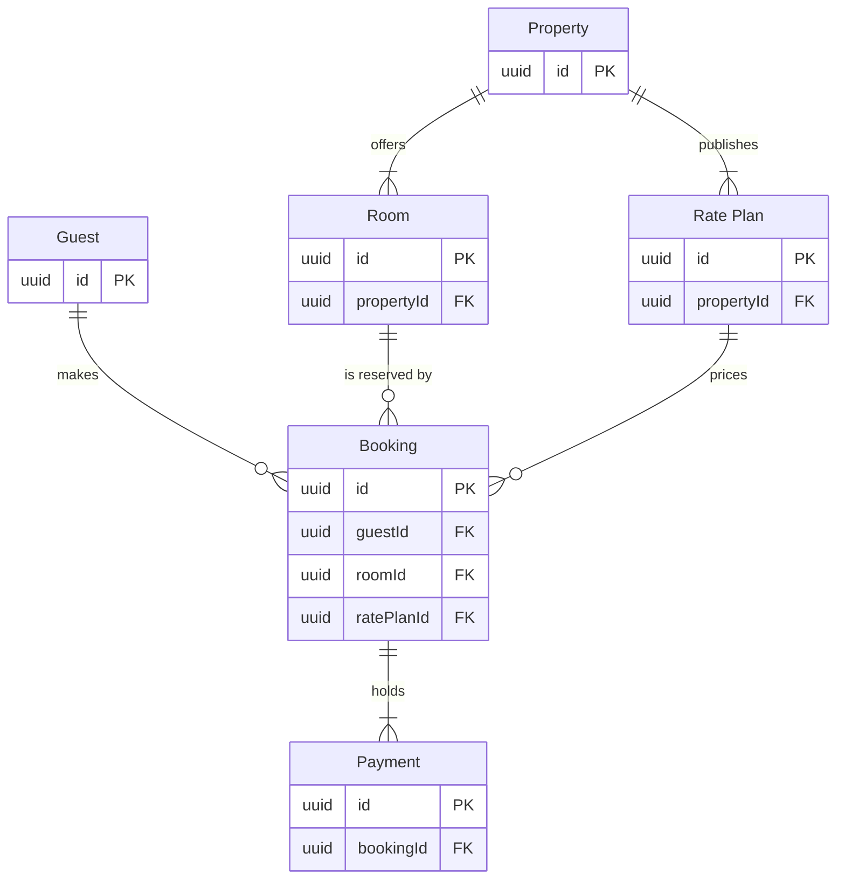

Check passed on the model below. Nothing is written yet.

The file `<test-file-key>` is empty (one page, no sections), so no section shares the title "Stays model".

Question: which entities exist, which fields join them and how many of each?
Outcome: the support team can see the six stay tables, how they join and which tables sit on the guest side and which on the partner side.
First glance: Booking, the table every other stay table joins.
Second glance: the three `FK` columns on Booking that tie it to the guest, the room and the rate plan.
Last glance: Property, the partner table that offers rooms and rate plans, and the key and source line.

Sketch, the checked model exactly as the check read it:



```text
  diagram 1, ER: ok, 6 entities and 6 relationships
PASSED 1 diagram(s) in model.md
```

Eye first: Booking, the table every other stay table joins, and it is the node the board most needs read.
Reads second: the three `FK` columns on Booking, which show what a booking needs before it exists.
Could miss: Payment, which would hide that one booking can carry many payments.
Remove next: Property, kept because it is where rooms and rate plans come from.

Plan: Roamstay Product. File: the existing FigJam file `<test-file-key>`.
Writes: one composed board as a new section, with 6 entities and 6 relationships in two zones (guest side and partner side), a title, a key and a source line, at the laptop reading distance.
Left out: the support-facing columns, because the schema note that lists them was not supplied. Every join key is drawn.
Extensions: none.
Calls: one `use_figma` and one `get_figjam` read-back. The file read and the session are already spent.
Rollback: delete the one board section the write returns, only on your yes to a question that names it.

Write it?