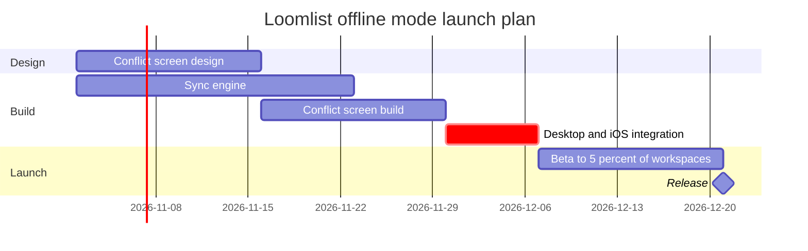

# FJ-028 turn 3 transcript

**User:** Yes, that reading is right.

**Tool call:** `ToolSearch` `{"query": "select:mcp__figma-remote__create_session,mcp__figma-remote__get_figjam,mcp__figma-remote__use_figma,mcp__figma-remote__get_screenshot", "max_results": 4}`

**Tool result:** `ToolSearch`

```text
[{"type": "tool_reference", "tool_name": "mcp__figma-remote__create_session"}, {"type": "tool_reference", "tool_name": "mcp__figma-remote__get_figjam"}, {"type": "tool_reference", "tool_name": "mcp__figma-remote__use_figma"}, {"type": "tool_reference", "tool_name": "mcp__figma-remote__get_screenshot"}]
```

**Tool call:** `Read` `{"file_path": "/private/var/folders/3c/zfqcqsts0kn19cgblj82gqhm0000gn/T/devin-compare-bench/FJ-028/sk-create-figjam/references/quality-rubric.md"}`

**Tool result:** `Read`

```text
"1\t---\n2\ttitle: \"FigJam Diagram Quality Rubric\"\n3\tdescription: \"The taste gate a FigJam model passes before the write gate, translated from sk-design-diagram's success criteria: type fit, the remove test, signal, the check, the board, the design rubric that scores a composed board and the reply.\"\n4\tcontextType: implementation\n5\timportance_tier: important\n6\ttrigger_phrases:\n7\t  - \"figjam quality rubric\"\n8\t  - \"diagram taste gate\"\n9\t  - \"remove test\"\n10\t  - \"figjam review checklist\"\n11\t  - \"figjam design rubric\"\n12\tversion: 1.0.13.0\n13\t---\n14\t\n15\t# FigJam Diagram Quality Rubric\n16\t\n17\tThe script checks what a script can see. This rubric is the rest: whether the diagram should exist, whether every node earns its place and whether the reader can trust what lands on the board. Walk it after the check passes and before the write gate.\n18\t\n19\t**Loading Condition:** CONDITIONAL, on every Flow route before the write gate\n20\t**Purpose:** The judgement pass between the pre-write check and the gate\n21\t**Scope:** The model, the provenance table, the planned extensions and, after the write, the board and the reply\n22\t\n23\t---\n24\t\n25\t## 1. TYPE FIT\n26\t\n27\t- [ ] The type answers the reader's question, as `references/flow-mode.md` Section 3 maps it\n28\t- [ ] A table, a list or a paragraph would not do the same job. If it would, say so and offer that instead\n29\t- [ ] The type's reference in `references/types/` was loaded and 
```

**Tool call:** `Read` `{"file_path": "/private/var/folders/3c/zfqcqsts0kn19cgblj82gqhm0000gn/T/devin-compare-bench/FJ-028/sk-create-figjam/assets/examples/gantt-loomlist-offline.md"}`

**Tool result:** `Read`

```text
"1\t---\n2\ttitle: \"Example - Gantt - Loomlist Offline Mode\"\n3\tdescription: \"A worked gantt chart on the fictional Loomlist workspace app: a planning doc turned into a phased launch plan with dependencies and a milestone, a playback, a gate message and the reply.\"\n4\tcontextType: general\n5\timportance_tier: normal\n6\ttrigger_phrases:\n7\t  - \"gantt example\"\n8\t  - \"loomlist offline mode plan\"\n9\tversion: 1.0.7.0\n10\t---\n11\t\n12\t# Example - Gantt - Loomlist Offline Mode\n13\t\n14\tLoomlist is a fictional workspace app used across the Product Owner fixtures. Every date and task here is invented for the example.\n15\t\n16\t---\n17\t\n18\t## 1. REQUEST\n19\t\n20\t```text\n21\tput the offline mode launch plan on a FigJam gantt chart, from the planning doc, for the release review\n22\t```\n23\t\n24\t| Doc line | Says | Class |\n25\t|---|---|---|\n26\t| 1 | Design starts 2 November with two weeks of conflict-screen design | approved direction |\n27\t| 2 | The sync engine takes three weeks from the same day | approved direction |\n28\t| 3 | The conflict screen build follows its design, two weeks | approved direction |\n29\t| 4 | Desktop and iOS integration starts when both builds are done, one week, and is the critical path | approved direction |\n30\t| 5 | A two-week beta for 5% of workspaces, then the release | approved direction |\n31\t| 6 | Android follows in the next quarter | proposal |\n32\t\n33\t---\n34\t\n35\t## 2. TYPE AND DIALS\n36\t\n37\t- **Reader ques
```

**Tool call:** `mcp__figma-remote__create_session` `{"fileKey": "<test-file-key>", "description": "Add a FigJam gantt section for the Loomlist offline mode launch plan to the existing Loomlist Product plan file. Read the file first, write only after the user's yes at the gate."}`

**Tool result:** `mcp__figma-remote__create_session`

```text
"{\"sessionId\":\"e1a98c27-7389-4d10-944b-846b064ee55b\"}"
```

**Tool call:** `Bash` `{"command": "S=$(mktemp -d) && echo \"$S\" > /dev/null && cat > \"$S/model.md\" <<'EOF'\n```mermaid\ngantt\n    title Loomlist offline mode launch plan\n    %% subtitle: From conflict screen design on 2 November 2026 to the release on 21 December 2026, for product and engineering leads\n    %% source: Sources: your launch plan request. Left out: Android, next quarter, not yet approved and undated.\n    %% focus: integrate\n    dateFormat YYYY-MM-DD\n    section Design\n    Conflict screen design :design, 2026-11-02, 2w\n    section Build\n    Sync engine :engine, 2026-11-02, 3w\n    Conflict s`

**Tool result:** `Bash`

```text
"SCRATCH=/var/folders/3c/zfqcqsts0kn19cgblj82gqhm0000gn/T/tmp.gOr3W1YU6R\n  diagram 1, gantt: ok, 6 tasks in 3 sections\nPASSED 1 diagram(s) in model.md\nexit 0"
```

**Assistant:**

Check passed. Now the composer dry run and the pre-gate read of the target file.

**Tool call:** `Bash` `{"command": "S=/var/folders/3c/zfqcqsts0kn19cgblj82gqhm0000gn/T/tmp.gOr3W1YU6R && python3 -I sk-create-figjam/scripts/compose_board.py \"$S/model.md\" --diagram 1 --out \"$S/board.js\"; echo \"exit $?\"; wc -c \"$S/board.js\"", "description": "Compose board code from checked model"}`

**Tool result:** `Bash`

```text
"COMPOSED diagram 1, 6 tasks in 3 sections: 6 nodes and 5 connectors to read back, 18178 characters in /var/folders/3c/zfqcqsts0kn19cgblj82gqhm0000gn/T/tmp.gOr3W1YU6R/board.js, drawn in the design FigJam default\nexit 0\n   18178 /var/folders/3c/zfqcqsts0kn19cgblj82gqhm0000gn/T/tmp.gOr3W1YU6R/board.js"
```

**Tool call:** `mcp__figma-remote__get_figjam` `{"fileKey": "<test-file-key>", "nodeId": "0:1", "includeImagesOfNodes": false, "sessionId": "e1a98c27-7389-4d10-944b-846b064ee55b"}`

**Tool result:** `mcp__figma-remote__get_figjam`

```text
[{"type": "text", "text": "<canvas id=\"0:1\" name=\"Page 1\" x=\"0\" y=\"0\" width=\"0\" height=\"0\" />"}]
```

**Assistant:**

Gate for the write. I read the file once: it has one page and nothing on it, so no section shares this board's title and nothing existing can be touched.

**Question:** Which Loomlist offline mode launch tasks are active when, and what gates the 21 December 2026 release?
**Outcome:** Product and engineering leads can see the order of the work, the critical path and where the release lands, and decide whether the plan and date hold.
**First glance:** Desktop and iOS integration, the critical bar that holds the release
**Second glance:** Conflict screen design, Sync engine and Conflict screen build, the three tasks integration waits for
**Last glance:** Beta to 5 percent of workspaces and the Release milestone at the end

**Sketch:** the checked model, with the check's output as it printed.



```text
  diagram 1, gantt: ok, 6 tasks in 3 sections
PASSED 1 diagram(s) in model.md
```

**Eye first:** Desktop and iOS integration. It is the only critical bar, and it is the one the board most needs read.
**Reads second:** the two build bars and the design bar feeding it, with the arrows showing that integration waits for both builds.
**Could miss:** that the sync engine ends a week before the screen build. That gap is its slack, and a reader who misses it will think both builds bind equally.
**Remove next:** Beta to 5 percent of workspaces. It stays because the release waits on it.

**Plan:** Loomlist Product, as you named it. I cannot verify the plan from the file key, so I take your word for it.
**File:** the existing FigJam file <test-file-key>, as a new section beside its current content. No new file is created.
**Writes:** one composed board with 3 sections, 5 tasks, 1 milestone and 5 dependency arrows on one axis, with a title, a key and a source line, at Laptop distance, in the file's default design.
**Left out:** Android, next quarter, not yet approved and undated
**Extensions:** none
**Calls:** one `use_figma` write and one `get_figjam` read-back. The pre-write read is already spent, and the file held nothing to compare afterwards. On a Starter plan or a View or Collab seat, the monthly allowance of six tool calls counts these.
**Rollback:** delete the one board section the write returns, only on your yes to a question that names it.

Write it?
