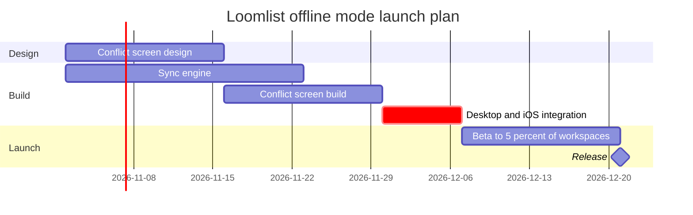

Gate for the write. I read the file once: it has one page and nothing on it, so no section shares this board's title and nothing existing can be touched.

**Question:** Which Loomlist offline mode launch tasks are active when, and what gates the 21 December 2026 release?
**Outcome:** Product and engineering leads can see the order of the work, the critical path and where the release lands, and decide whether the plan and date hold.
**First glance:** Desktop and iOS integration, the critical bar that holds the release
**Second glance:** Conflict screen design, Sync engine and Conflict screen build, the three tasks integration waits for
**Last glance:** Beta to 5 percent of workspaces and the Release milestone at the end

**Sketch:** the checked model, with the check's output as it printed.



```text
  diagram 1, gantt: ok, 6 tasks in 3 sections
PASSED 1 diagram(s) in model.md
```

**Eye first:** Desktop and iOS integration. It is the only critical bar, and it is the one the board most needs read.
**Reads second:** the two build bars and the design bar feeding it, with the arrows showing that integration waits for both builds.
**Could miss:** that the sync engine ends a week before the screen build. That gap is its slack, and a reader who misses it will think both builds bind equally.
**Remove next:** Beta to 5 percent of workspaces. It stays because the release waits on it.

**Plan:** Loomlist Product, as you named it. I cannot verify the plan from the file key, so I take your word for it.
**File:** the existing FigJam file <test-file-key>, as a new section beside its current content. No new file is created.
**Writes:** one composed board with 3 sections, 5 tasks, 1 milestone and 5 dependency arrows on one axis, with a title, a key and a source line, at Laptop distance, in the file's default design.
**Left out:** Android, next quarter, not yet approved and undated
**Extensions:** none
**Calls:** one `use_figma` write and one `get_figjam` read-back. The pre-write read is already spent, and the file held nothing to compare afterwards. On a Starter plan or a View or Collab seat, the monthly allowance of six tool calls counts these.
**Rollback:** delete the one board section the write returns, only on your yes to a question that names it.

Write it?