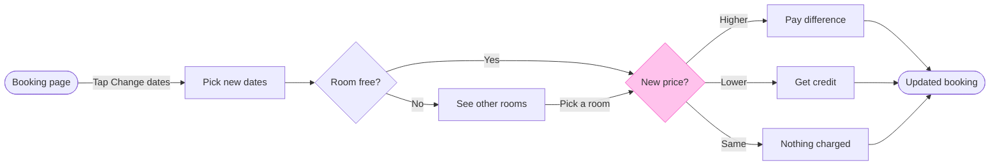

# FJ-036 turn 4 transcript

**User:** Yes, that reading is right.

**Tool call:** `Read` `{"file_path": "/private/var/folders/3c/zfqcqsts0kn19cgblj82gqhm0000gn/T/devin-compare-bench/FJ-036/sk-create-figjam/references/quality-rubric.md"}`

**Tool result:** `Read`

```text
"1\t---\n2\ttitle: \"FigJam Diagram Quality Rubric\"\n3\tdescription: \"The taste gate a FigJam model passes before the write gate, translated from sk-design-diagram's success criteria: type fit, the remove test, signal, the check, the board, the design rubric that scores a composed board and the reply.\"\n4\tcontextType: implementation\n5\timportance_tier: important\n6\ttrigger_phrases:\n7\t  - \"figjam quality rubric\"\n8\t  - \"diagram taste gate\"\n9\t  - \"remove test\"\n10\t  - \"figjam review checklist\"\n11\t  - \"figjam design rubric\"\n12\tversion: 1.0.13.0\n13\t---\n14\t\n15\t# FigJam Diagram Quality Rubric\n16\t\n17\tThe script checks what a script can see. This rubric is the rest: whether the diagram should exist, whether every node earns its place and whether the reader can trust what lands on the board. Walk it after the check passes and before the write gate.\n18\t\n19\t**Loading Condition:** CONDITIONAL, on every Flow route before the write gate\n20\t**Purpose:** The judgement pass between the pre-write check and the gate\n21\t**Scope:** The model, the provenance table, the planned extensions and, after the write, the board and the reply\n22\t\n23\t---\n24\t\n25\t## 1. TYPE FIT\n26\t\n27\t- [ ] The type answers the reader's question, as `references/flow-mode.md` Section 3 maps it\n28\t- [ ] A table, a list or a paragraph would not do the same job. If it would, say so and offer that instead\n29\t- [ ] The type's reference in `references/types/` was loaded and 
```

**Tool call:** `ToolSearch` `{"query": "select:mcp__figma-remote__get_figjam,mcp__figma-remote__create_session,mcp__figma-remote__use_figma,mcp__figma-remote__whoami", "max_results": 4}`

**Tool result:** `ToolSearch`

```text
[{"type": "tool_reference", "tool_name": "mcp__figma-remote__get_figjam"}, {"type": "tool_reference", "tool_name": "mcp__figma-remote__create_session"}, {"type": "tool_reference", "tool_name": "mcp__figma-remote__use_figma"}, {"type": "tool_reference", "tool_name": "mcp__figma-remote__whoami"}]
```

**Tool call:** `Bash` `{"command": "mktemp -d", "description": "Create scratch folder for model"}`

**Tool result:** `Bash`

```text
"/var/folders/3c/zfqcqsts0kn19cgblj82gqhm0000gn/T/tmp.sW4asy1MaB"
```

**Tool call:** `Bash` `{"command": "cat > /var/folders/3c/zfqcqsts0kn19cgblj82gqhm0000gn/T/tmp.sW4asy1MaB/model.md <<'EOF'\n```mermaid\nflowchart LR\n    %% title: Change booking dates\n    %% subtitle: From the booking page to the updated booking, for the product and design team\n    %% source: Sources: the request description, read as current app behavior. Left out: failed payment, change-window rules, host approval and cancellation.\n    %% goal: done\n    start([Booking page]) -->|Tap Change dates| pick[Pick new dates]\n    pick --> free{Room free?}\n    free -->|Yes| price{New price?}\n    free -->|No| rooms[Se`

**Tool call:** `mcp__figma-remote__create_session` `{"fileKey": "<test-file-key>", "description": "Read the existing FigJam file before adding a Change booking dates user flow board as a new section"}`

**Tool result:** `Bash`

```text
"  diagram 1, user flow: ok, 9 nodes and 11 connectors, widest rank 3 steps, longest path 7 steps, 1.2 connectors per step, labels average 15 characters, 0 crossing pairs\nLabel: Pay the difference may leave 'difference' alone on its last line, so shorten it, or reword it in the source's words, when that keeps the meaning\nLabel: Difference credited may leave 'credited' alone on its last line, so shorten it, or reword it in the source's words, when that keeps the meaning\nLabel: Updated booking shown leaves 'shown' alone on its last line, so shorten it, or reword it in the source's words, when that keeps the meaning\nGlance: New price? (accent) > Booking page > Pick new dates > Room free? > See other rooms > Pay the difference > Difference credited > Nothing charged > Updated booking shown (goal)\nRow: the line from See other rooms to New price? bends off its row, so name the break at the gate and offer a model that keeps the row straight\nPASSED 1 diagram(s) in model.md"
```

**Tool result:** `mcp__figma-remote__create_session`

```text
"{\"sessionId\":\"4e85da12-0ee5-4891-aea2-4a10c24d0287\"}"
```

**Tool call:** `Bash` `{"command": "M=/var/folders/3c/zfqcqsts0kn19cgblj82gqhm0000gn/T/tmp.sW4asy1MaB/model.md && sed -i '' -e 's/\\[Pay the difference\\]/[Pay difference]/' -e 's/\\[Difference credited\\]/[Get credit]/' -e 's/(\\[Updated booking shown\\])/([Updated booking])/' $M && python3 sk-create-figjam/scripts/flow_check.py $M", "description": "Edit labels and rerun the check"}`

**Tool result:** `Bash`

```text
"  diagram 1, user flow: ok, 9 nodes and 11 connectors, widest rank 3 steps, longest path 7 steps, 1.2 connectors per step, labels average 13 characters, 0 crossing pairs\nGlance: New price? (accent) > Booking page > Pick new dates > Room free? > See other rooms > Pay difference > Get credit > Nothing charged > Updated booking (goal)\nRow: the line from See other rooms to New price? bends off its row, so name the break at the gate and offer a model that keeps the row straight\nPASSED 1 diagram(s) in model.md"
```

**Tool call:** `mcp__figma-remote__get_figjam` `{"fileKey": "<test-file-key>", "nodeId": "0:1", "sessionId": "4e85da12-0ee5-4891-aea2-4a10c24d0287", "includeImagesOfNodes": false}`

**Tool result:** `mcp__figma-remote__get_figjam`

```text
[{"type": "text", "text": "<canvas id=\"0:1\" name=\"Page 1\" x=\"0\" y=\"0\" width=\"0\" height=\"0\" />"}]
```

**Tool call:** `Bash` `{"command": "D=/var/folders/3c/zfqcqsts0kn19cgblj82gqhm0000gn/T/tmp.sW4asy1MaB && python3 sk-create-figjam/scripts/compose_board.py $D/model.md --diagram 1 --out $D/board.js; cat $D/model.md", "description": "Compose the board code and show the model"}`

**Tool result:** `Bash`

```text
"COMPOSED diagram 1, 9 nodes and 11 connectors, widest rank 3 steps, longest path 7 steps, 1.2 connectors per step, labels average 13 characters, 0 crossing pairs: 9 nodes and 11 connectors to read back, 41970 characters in /var/folders/3c/zfqcqsts0kn19cgblj82gqhm0000gn/T/tmp.sW4asy1MaB/board.js, drawn in the design FigJam default\n```mermaid\nflowchart LR\n    %% title: Change booking dates\n    %% subtitle: From the booking page to the updated booking, for the product and design team\n    %% source: Sources: the request description, read as current app behavior. Left out: failed payment, change-window rules, host approval and cancellation.\n    %% goal: done\n    start([Booking page]) -->|Tap Change dates| pick[Pick new dates]\n    pick --> free{Room free?}\n    free -->|Yes| price{New price?}\n    free -->|No| rooms[See other rooms]\n    rooms -->|Pick a room| price\n    price -->|Higher| pay[Pay difference]\n    price -->|Lower| credit[Get credit]\n    price -->|Same| nothing[Nothing charged]\n    pay --> done([Updated booking])\n    credit --> done\n    nothing --> done\n    style price fill:#FFC2EC,stroke:#F849C1\n```"
```

**Assistant:**

This is the write gate. Nothing has been written yet.

**What changed since the outline**
* The model has 11 connectors, not the 12 I said earlier.
* The check flagged three labels where FigJam would leave one word alone on the last line. I shortened them: "Pay difference", "Get credit" and "Updated booking". "Get credit" and "Pay difference" are your words. "Updated booking" drops "shown" from the end node.
* The check also flagged one bend. The line from "See other rooms" to "New price?" leaves the main row, because that step sits beside the row and rejoins it. I recommend keeping it, since the alternative would hide the room-not-free branch.

**Sketch, as the check read it**



`PASSED 1 diagram(s) in model.md`, and the composer printed `COMPOSED diagram 1, 9 nodes and 11 connectors, 0 crossing pairs`, drawn in the design FigJam default.

**The three glances**
* First: New price? with its three exits
* Second: Booking page, Pick new dates, Room free?, See other rooms, then the three outcomes in turn, ending on Updated booking
* Last: the key and the source line

**The four critique questions**
* Where the eye goes first: the pink New price? diamond. That is the node the board most needs read, because it is where the guest's route splits three ways.
* What it reads second: the main row from Booking page to Room free?, then the outcomes. This advances the first glance, because it shows how a guest reaches the price check.
* What a reader could miss: the "Pick a room" line from See other rooms back into New price?, because it bends off the main row. Missing it makes the No branch look like a dead end, so the label sits on the line.
* What the remove test would cut next: "Nothing charged". It stays, because your message lists three price outcomes and a reader comparing against the app would look for the third.

**Left out:** failed payment, change-window rules, host approval and cancellation, because your message doesn't describe them.

**The write**
* Target: the existing FigJam file `<test-file-key>`, in the Roamstay Product plan as you stated. I haven't verified the plan from the file. I read the file once and its page is empty, so nothing on it can be affected and no same-titled section exists.
* Written: one new section titled "Change booking dates", holding the 9 nodes, 11 connectors, a key and the source line. No notes or extensions, and no new file.
* Calls: one `use_figma` call to compose, then one `get_figjam` read-back. If the plan is a Starter plan or the seat is View or Collab, the file read already used one of its six monthly calls and this write will use two more.
* Rollback: delete that one section, found by its returned id or its tag. I would only do that after you say yes to a question that names it.

Shall I write the board into that file?
