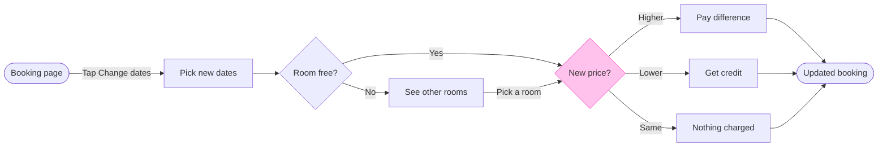

This is the write gate. Nothing has been written yet.

**What changed since the outline**
* The model has 11 connectors, not the 12 I said earlier.
* The check flagged three labels where FigJam would leave one word alone on the last line. I shortened them: "Pay difference", "Get credit" and "Updated booking". "Get credit" and "Pay difference" are your words. "Updated booking" drops "shown" from the end node.
* The check also flagged one bend. The line from "See other rooms" to "New price?" leaves the main row, because that step sits beside the row and rejoins it. I recommend keeping it, since the alternative would hide the room-not-free branch.

**Sketch, as the check read it**

`PASSED 1 diagram(s) in model.md`, and the composer printed `COMPOSED diagram 1, 9 nodes and 11 connectors, 0 crossing pairs`, drawn in the design FigJam default.

**The three glances**
* First: New price? with its three exits
* Second: Booking page, Pick new dates, Room free?, See other rooms, then the three outcomes in turn, ending on Updated booking
* Last: the key and the source line

**The four critique questions**
* Where the eye goes first: the pink New price? diamond. That is the node the board most needs read, because it is where the guest's route splits three ways.
* What it reads second: the main row from Booking page to Room free?, then the outcomes. This advances the first glance, because it shows how a guest reaches the price check.
* What a reader could miss: the "Pick a room" line from See other rooms back into New price?, because it bends off the main row. Missing it makes the No branch look like a dead end, so the label sits on the line.
* What the remove test would cut next: "Nothing charged". It stays, because your message lists three price outcomes and a reader comparing against the app would look for the third.

**Left out:** failed payment, change-window rules, host approval and cancellation, because your message doesn't describe them.

**The write**
* Target: the existing FigJam file `<test-file-key>`, in the Roamstay Product plan as you stated. I haven't verified the plan from the file. I read the file once and its page is empty, so nothing on it can be affected and no same-titled section exists.
* Written: one new section titled "Change booking dates", holding the 9 nodes, 11 connectors, a key and the source line. No notes or extensions, and no new file.
* Calls: one `use_figma` call to compose, then one `get_figjam` read-back. If the plan is a Starter plan or the seat is View or Collab, the file read already used one of its six monthly calls and this write will use two more.
* Rollback: delete that one section, found by its returned id or its tag. I would only do that after you say yes to a question that names it.

Shall I write the board into that file?