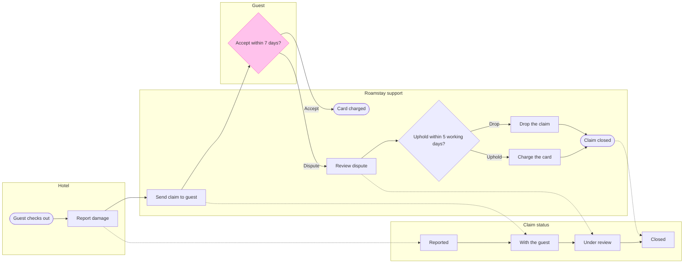

# FJ-049 turn 3 transcript

**User:** Yes, that reading is right.

**Tool call:** `Read` `{"file_path": "/private/var/folders/3c/zfqcqsts0kn19cgblj82gqhm0000gn/T/devin-compare-bench/FJ-049/sk-create-figjam/assets/examples/process-fernhouse-commission.md"}`

**Tool result:** `Read`

```text
"1\t---\n2\ttitle: \"Example - Process - Fernhouse Commission\"\n3\tdescription: \"A worked laned process with a status lane and detail cards on the fictional Fernhouse store: a client and a maker move one planter commission through its statuses, from the order to the approved planter.\"\n4\tcontextType: general\n5\timportance_tier: normal\n6\ttrigger_phrases:\n7\t  - \"status lane example\"\n8\t  - \"detail cards example\"\n9\t  - \"fernhouse commission process\"\n10\tversion: 1.0.0.0\n11\t---\n12\t\n13\t# Example - Process - Fernhouse Commission\n14\t\n15\tFernhouse is a fictional store used across the Product Owner fixtures. Every name, step and rule here is invented for the example.\n16\t\n17\t---\n18\t\n19\t## 1. REQUEST\n20\t\n21\t```text\n22\tmake a FigJam board of how a made-to-order planter moves between the client and the maker, with the status the commission is in at each step, from the commission spec, and keep the spec's detail on the steps\n23\t```\n24\t\n25\t| Spec line | Says | Class |\n26\t|---|---|---|\n27\t| 2.1 | The client places a commission through the order form. Its status is Requested | current behavior |\n28\t| 2.2 | The maker confirms the commission within two working days: size, wood, finish and delivery or fitting. Its status moves to Confirmed | current behavior |\n29\t| 2.3 | The maker builds the planter. Its status moves to In the making | current behavior |\n30\t| 2.4 | A delivered planter ships in a wooden crate with a tracking link. A fitte
```

**Tool call:** `Read` `{"file_path": "/private/var/folders/3c/zfqcqsts0kn19cgblj82gqhm0000gn/T/devin-compare-bench/FJ-049/sk-create-figjam/references/quality-rubric.md"}`

**Tool call:** `ToolSearch` `{"query": "select:mcp__figma-remote__get_figjam,mcp__figma-remote__create_session,mcp__figma-remote__use_figma,mcp__figma-remote__get_screenshot", "max_results": 4}`

**Tool result:** `ToolSearch`

```text
[{"type": "tool_reference", "tool_name": "mcp__figma-remote__get_figjam"}, {"type": "tool_reference", "tool_name": "mcp__figma-remote__create_session"}, {"type": "tool_reference", "tool_name": "mcp__figma-remote__use_figma"}, {"type": "tool_reference", "tool_name": "mcp__figma-remote__get_screenshot"}]
```

**Tool result:** `Read`

```text
"1\t---\n2\ttitle: \"FigJam Diagram Quality Rubric\"\n3\tdescription: \"The taste gate a FigJam model passes before the write gate, translated from sk-design-diagram's success criteria: type fit, the remove test, signal, the check, the board, the design rubric that scores a composed board and the reply.\"\n4\tcontextType: implementation\n5\timportance_tier: important\n6\ttrigger_phrases:\n7\t  - \"figjam quality rubric\"\n8\t  - \"diagram taste gate\"\n9\t  - \"remove test\"\n10\t  - \"figjam review checklist\"\n11\t  - \"figjam design rubric\"\n12\tversion: 1.0.13.0\n13\t---\n14\t\n15\t# FigJam Diagram Quality Rubric\n16\t\n17\tThe script checks what a script can see. This rubric is the rest: whether the diagram should exist, whether every node earns its place and whether the reader can trust what lands on the board. Walk it after the check passes and before the write gate.\n18\t\n19\t**Loading Condition:** CONDITIONAL, on every Flow route before the write gate\n20\t**Purpose:** The judgement pass between the pre-write check and the gate\n21\t**Scope:** The model, the provenance table, the planned extensions and, after the write, the board and the reply\n22\t\n23\t---\n24\t\n25\t## 1. TYPE FIT\n26\t\n27\t- [ ] The type answers the reader's question, as `references/flow-mode.md` Section 3 maps it\n28\t- [ ] A table, a list or a paragraph would not do the same job. If it would, say so and offer that instead\n29\t- [ ] The type's reference in `references/types/` was loaded and 
```

**Tool call:** `mcp__figma-remote__create_session` `{"fileKey": "<test-file-key>", "description": "Add a FigJam process board of the Roamstay damage claim (hotel, guest, support) as a new section in the existing file"}`

**Tool call:** `Bash` `{"command": "mktemp -d /tmp/flowXXXXXX", "description": "Create scratch folder for the model"}`

**Tool result:** `mcp__figma-remote__create_session`

```text
"{\"sessionId\":\"83386548-f5fa-4354-8483-4e378c767324\"}"
```

**Tool result:** `Bash`

```text
"/tmp/flowekT4Sk"
```

**Tool call:** `mcp__figma-remote__get_figjam` `{"fileKey": "<test-file-key>", "nodeId": "0:1", "includeImagesOfNodes": false, "sessionId": "83386548-f5fa-4354-8483-4e378c767324"}`

**Tool result:** `mcp__figma-remote__get_figjam`

```text
[{"type": "text", "text": "<canvas id=\"0:1\" name=\"Page 1\" x=\"0\" y=\"0\" width=\"0\" height=\"0\" />"}]
```

**Tool call:** `Write` `{"file_path": "/tmp/flowekT4Sk/model.md", "content": "```mermaid\n%% type: process\nflowchart LR\n    %% title: Roamstay damage claim\n    %% subtitle: From the hotel's damage report after check-out to a closed claim, for support and product staff\n    %% source: Source: Roamstay claims policy. Left out: the under-25-euro waiver, not live.\n    %% goal: closed\n    %% status: status\n    %% level: faithful\n    %% detail: report | After check-out | Adds photos and a repair quote\n    %% detail: send | Sends photos and quote to the guest | Guest has 7 days to reply\n    %% detail: review | Read`

**Tool result:** `Write`

```text
"File created successfully at: /tmp/flowekT4Sk/model.md (file state is current in your context \u2014 no need to Read it back)"
```

**Tool call:** `Bash` `{"command": "cd /private/var/folders/3c/zfqcqsts0kn19cgblj82gqhm0000gn/T/devin-compare-bench/FJ-049/sk-create-figjam && python3 scripts/flow_check.py /tmp/flowekT4Sk/model.md", "description": "Run the pre-write check on the model"}`

**Tool result (error):** `Bash`

```text
"Exit code 1\n  diagram 1, process: %% detail on chargeAccepted, a stadium: only a step [Label] carries a body\nFAILED 1 of 1 diagram(s) in model.md"
```

**Tool call:** `Bash` `{"command": "cd /tmp/flowekT4Sk && sed -i '/detail: chargeAccepted/d;/detail: chargeUpheld/d;s/chargeAccepted(\\[Card charged\\])/chargeAccepted([Card on file charged])/;s/chargeUpheld\\[Charge the card\\]/chargeUpheld[Charge the card on file]/' model.md && cd /private/var/folders/3c/zfqcqsts0kn19cgblj82gqhm0000gn/T/devin-compare-bench/FJ-049/sk-create-figjam && python3 scripts/flow_check.py /tmp/flowekT4Sk/model.md", "description": "Fix the model and rerun the check"}`

**Tool result (error):** `Bash`

```text
"Exit code 1\nsed: 1: \"model.md\n\": invalid command code m"
```

**Tool call:** `Bash` `{"command": "cd /tmp/flowekT4Sk && sed -i '' -e '/detail: chargeAccepted/d' -e '/detail: chargeUpheld/d' -e 's/chargeAccepted(\\[Card charged\\])/chargeAccepted([Card on file charged])/' -e 's/chargeUpheld\\[Charge the card\\]/chargeUpheld[Charge the card on file]/' model.md && cd /private/var/folders/3c/zfqcqsts0kn19cgblj82gqhm0000gn/T/devin-compare-bench/FJ-049/sk-create-figjam && python3 scripts/flow_check.py /tmp/flowekT4Sk/model.md", "description": "Fix the model and rerun the check"}`

**Tool result:** `Bash`

```text
"  diagram 1, process: ok, 14 nodes and 17 connectors, widest rank 2 steps, longest path 8 steps, 1.0 connectors per step, labels average 18 characters, 0 crossing pairs\nLabel: Card on file charged leaves 'charged' alone on its last line, so shorten it, or reword it in the source's words, when that keeps the meaning\nLabel: Charge the card on file may leave 'file' alone on its last line, so shorten it, or reword it in the source's words, when that keeps the meaning\nLabel: Accept within 7 days? leaves 'days?' alone on its last line, so shorten it, or reword it in the source's words, when that keeps the meaning\nGlance: Accept within 7 days? (accent) > Guest checks out > Report damage > Reported > Send claim to guest > With the guest > Review dispute > Card on file charged > Under review > Uphold within 5 working days? > Charge the card on file > Drop the claim > Claim closed (goal) > Closed\nPASSED 1 diagram(s) in model.md\n[This command modified 1 file you've previously read: ../../../../../../../../../tmp/flowekT4Sk/model.md. Call Read before editing.]"
```

**Assistant:**

The check passed. I'm rewording three labels to clear the wrap warnings, then rechecking.

**Tool call:** `Bash` `{"command": "cd /tmp/flowekT4Sk && sed -i '' -e 's/Card on file charged/Card charged/' -e 's/Charge the card on file/Charge the card/' -e 's/Accept within 7 days?/Accept in 7 days?/' model.md && cd /private/var/folders/3c/zfqcqsts0kn19cgblj82gqhm0000gn/T/devin-compare-bench/FJ-049/sk-create-figjam && python3 scripts/flow_check.py /tmp/flowekT4Sk/model.md", "description": "Reword labels and rerun the check"}`

**Tool result:** `Bash`

```text
"  diagram 1, process: ok, 14 nodes and 17 connectors, widest rank 2 steps, longest path 8 steps, 1.0 connectors per step, labels average 16 characters, 0 crossing pairs\nLabel: Accept in 7 days? leaves 'days?' alone on its last line, so shorten it, or reword it in the source's words, when that keeps the meaning\nGlance: Accept in 7 days? (accent) > Guest checks out > Report damage > Reported > Send claim to guest > With the guest > Review dispute > Card charged > Under review > Uphold within 5 working days? > Charge the card > Drop the claim > Claim closed (goal) > Closed\nPASSED 1 diagram(s) in model.md\n[This command modified 1 file you've previously read: ../../../../../../../../../tmp/flowekT4Sk/model.md. Call Read before editing.]"
```

**Tool call:** `Bash` `{"command": "cd /tmp/flowekT4Sk && sed -i '' -e 's/Accept in 7 days?/Accept within 7 days?/' model.md && cd /private/var/folders/3c/zfqcqsts0kn19cgblj82gqhm0000gn/T/devin-compare-bench/FJ-049/sk-create-figjam && python3 scripts/flow_check.py /tmp/flowekT4Sk/model.md | tail -2 && python3 scripts/compose_board.py /tmp/flowekT4Sk/model.md --diagram 1 --out /tmp/flowekT4Sk/code.js && cat /tmp/flowekT4Sk/model.md", "description": "Restore label, recheck and compose the board code"}`

**Tool result:** `Bash`

```text
"Glance: Accept within 7 days? (accent) > Guest checks out > Report damage > Reported > Send claim to guest > With the guest > Review dispute > Card charged > Under review > Uphold within 5 working days? > Charge the card > Drop the claim > Claim closed (goal) > Closed\nPASSED 1 diagram(s) in model.md\nCOMPOSED diagram 1, 14 nodes and 17 connectors, widest rank 2 steps, longest path 8 steps, 1.0 connectors per step, labels average 16 characters, 0 crossing pairs: 14 nodes and 17 connectors to read back, 43104 characters in /tmp/flowekT4Sk/code.js, drawn in the design FigJam default\n```mermaid\n%% type: process\nflowchart LR\n    %% title: Roamstay damage claim\n    %% subtitle: From the hotel's damage report after check-out to a closed claim, for support and product staff\n    %% source: Source: Roamstay claims policy. Left out: the under-25-euro waiver, not live.\n    %% goal: closed\n    %% status: status\n    %% level: faithful\n    %% detail: report | After check-out | Adds photos and a repair quote\n    %% detail: send | Sends photos and quote to the guest | Guest has 7 days to reply\n    %% detail: review | Reads the photos and the guest's reply\n    subgraph status [\"Claim status\"]\n        reported[Reported]\n        withGuest[With the guest]\n        underReview[Under review]\n        claimClosed[Closed]\n    end\n    subgraph hotel [\"Hotel\"]\n        checkout([Guest checks out])\n        report[Report damage]\n    end\n    subgraph support [\"Roamstay support\"
```

**Assistant:**

**Gate**

Question the board answers: which step is a Roamstay damage claim at, who owes the next move and what status does it hold?
Outcome: support and product staff can place any claim on the board and name its next move and status.

**Glance lines**
* First glance: Accept within 7 days?, the guest's decision and the pink-outlined accent
* Second glance, in the order the check printed: Guest checks out > Report damage > Reported > Send claim to guest > With the guest > Review dispute > Card charged > Under review > Uphold within 5 working days? > Charge the card > Drop the claim > Claim closed
* Last glance: the Closed status, the key and the source line

**Sketch**



```text
  diagram 1, process: ok, 14 nodes and 17 connectors, widest rank 2 steps, longest path 8 steps, 1.0 connectors per step, labels average 16 characters, 0 crossing pairs
Label: Accept within 7 days? leaves 'days?' alone on its last line, so shorten it, or reword it in the source's words, when that keeps the meaning
PASSED 1 diagram(s) in model.md
```

The composer also printed `COMPOSED` for the board, in the FigJam default design.

**The four critique questions**
* Where the eye goes first: the pink-outlined Accept within 7 days?, which is the decision you asked to highlight.
* What it reads second: the main row from Guest checks out to Claim closed, which shows the steps that lead into and out of the guest's choice.
* What a reader could miss: the accepted path stops at Card charged with no status move, so a reader may take an accepted claim to still be With the guest. The policy gives it no status, and a `Finding:` line will say so.
* What the remove test would cut next: Guest checks out, the start. It stays because it anchors "after check-out" and gives Report damage a way in.

The wrap warning on Accept within 7 days? stays. "Accept in 7 days?" wraps the same way, and 7 days is the policy's number.

**The write**
* File: the existing FigJam file `<test-file-key>`, which you say sits in the Roamstay Product plan. No new file or plan call is needed, and I have not checked the plan myself.
* Existing content: its one page is empty, so nothing on it changes and no section shares the title.
* What lands: one board section titled Roamstay damage claim, with 14 nodes, 17 connectors, 4 lanes counting the status lane, a key and the source line. No extensions.
* Calls: 1 `use_figma` and 1 `get_figjam` read-back. `create_session` and the one `get_figjam` read of the file are already spent. Read tools count against a Starter plan's six calls a month.
* Rollback: delete the one board section the write returns, only on your separate yes to a question that names it.

**Left out**
* The waiver for claims under 25 euros, because it is not live
* An outcome for a guest who does not reply within 7 days, because the policy does not say
* A status or close step for an accepted claim after the charge, because the policy does not say

Shall I write this board into that file?
