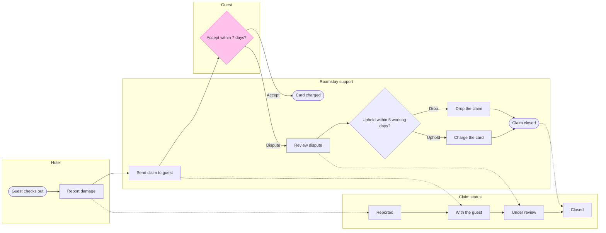

**Gate**

Question the board answers: which step is a Roamstay damage claim at, who owes the next move and what status does it hold?
Outcome: support and product staff can place any claim on the board and name its next move and status.

**Glance lines**
* First glance: Accept within 7 days?, the guest's decision and the pink-outlined accent
* Second glance, in the order the check printed: Guest checks out > Report damage > Reported > Send claim to guest > With the guest > Review dispute > Card charged > Under review > Uphold within 5 working days? > Charge the card > Drop the claim > Claim closed
* Last glance: the Closed status, the key and the source line

**Sketch**



```text
  diagram 1, process: ok, 14 nodes and 17 connectors, widest rank 2 steps, longest path 8 steps, 1.0 connectors per step, labels average 16 characters, 0 crossing pairs
Label: Accept within 7 days? leaves 'days?' alone on its last line, so shorten it, or reword it in the source's words, when that keeps the meaning
PASSED 1 diagram(s) in model.md
```

The composer also printed `COMPOSED` for the board, in the FigJam default design.

**The four critique questions**
* Where the eye goes first: the pink-outlined Accept within 7 days?, which is the decision you asked to highlight.
* What it reads second: the main row from Guest checks out to Claim closed, which shows the steps that lead into and out of the guest's choice.
* What a reader could miss: the accepted path stops at Card charged with no status move, so a reader may take an accepted claim to still be With the guest. The policy gives it no status, and a `Finding:` line will say so.
* What the remove test would cut next: Guest checks out, the start. It stays because it anchors "after check-out" and gives Report damage a way in.

The wrap warning on Accept within 7 days? stays. "Accept in 7 days?" wraps the same way, and 7 days is the policy's number.

**The write**
* File: the existing FigJam file `<test-file-key>`, which you say sits in the Roamstay Product plan. No new file or plan call is needed, and I have not checked the plan myself.
* Existing content: its one page is empty, so nothing on it changes and no section shares the title.
* What lands: one board section titled Roamstay damage claim, with 14 nodes, 17 connectors, 4 lanes counting the status lane, a key and the source line. No extensions.
* Calls: 1 `use_figma` and 1 `get_figjam` read-back. `create_session` and the one `get_figjam` read of the file are already spent. Read tools count against a Starter plan's six calls a month.
* Rollback: delete the one board section the write returns, only on your separate yes to a question that names it.

**Left out**
* The waiver for claims under 25 euros, because it is not live
* An outcome for a guest who does not reply within 7 days, because the policy does not say
* A status or close step for an accepted claim after the charge, because the policy does not say

Shall I write this board into that file?