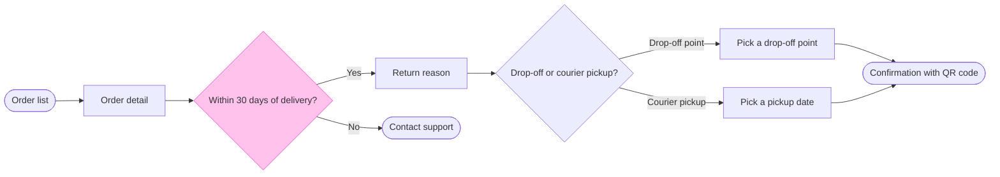

# FJ-022 turn 3 transcript

**User:** Yes, that reading is right.

**Tool call:** `ToolSearch` `{"query": "select:mcp__figma-remote__create_session,mcp__figma-remote__get_figjam,mcp__figma-remote__use_figma", "max_results": 5}`

**Tool result:** `ToolSearch`

```text
[{"type": "tool_reference", "tool_name": "mcp__figma-remote__create_session"}, {"type": "tool_reference", "tool_name": "mcp__figma-remote__get_figjam"}, {"type": "tool_reference", "tool_name": "mcp__figma-remote__use_figma"}]
```

**Tool call:** `Read` `{"file_path": "/private/var/folders/3c/zfqcqsts0kn19cgblj82gqhm0000gn/T/devin-compare-bench/FJ-022/sk-create-figjam/references/quality-rubric.md"}`

**Tool result:** `Read`

```text
"1\t---\n2\ttitle: \"FigJam Diagram Quality Rubric\"\n3\tdescription: \"The taste gate a FigJam model passes before the write gate, translated from sk-design-diagram's success criteria: type fit, the remove test, signal, the check, the board, the design rubric that scores a composed board and the reply.\"\n4\tcontextType: implementation\n5\timportance_tier: important\n6\ttrigger_phrases:\n7\t  - \"figjam quality rubric\"\n8\t  - \"diagram taste gate\"\n9\t  - \"remove test\"\n10\t  - \"figjam review checklist\"\n11\t  - \"figjam design rubric\"\n12\tversion: 1.0.13.0\n13\t---\n14\t\n15\t# FigJam Diagram Quality Rubric\n16\t\n17\tThe script checks what a script can see. This rubric is the rest: whether the diagram should exist, whether every node earns its place and whether the reader can trust what lands on the board. Walk it after the check passes and before the write gate.\n18\t\n19\t**Loading Condition:** CONDITIONAL, on every Flow route before the write gate\n20\t**Purpose:** The judgement pass between the pre-write check and the gate\n21\t**Scope:** The model, the provenance table, the planned extensions and, after the write, the board and the reply\n22\t\n23\t---\n24\t\n25\t## 1. TYPE FIT\n26\t\n27\t- [ ] The type answers the reader's question, as `references/flow-mode.md` Section 3 maps it\n28\t- [ ] A table, a list or a paragraph would not do the same job. If it would, say so and offer that instead\n29\t- [ ] The type's reference in `references/types/` was loaded and 
```

**Tool call:** `Bash` `{"command": "mktemp -d", "description": "Create scratch folder for the model"}`

**Tool result:** `Bash`

```text
"/var/folders/3c/zfqcqsts0kn19cgblj82gqhm0000gn/T/tmp.qnanNK00Qb"
```

**Tool call:** `Write` `{"file_path": "/var/folders/3c/zfqcqsts0kn19cgblj82gqhm0000gn/T/tmp.qnanNK00Qb/model.md", "content": "```mermaid\nflowchart LR\n    %% title: Start a return\n    %% subtitle: From the order list to a confirmed return, for the product and design team\n    %% source: Sources: the Fernhouse app and the returns doc. Left out: free pickup over 100 euros, a proposal under review.\n    %% zone: Find the order: orders, detail\n    %% zone: Check and choose: window, support, reason, method\n    %% zone: Hand over: dropoff, courier, confirm\n    %% about: Find the order | Starts: the order list | Ends: `

**Tool result:** `Write`

```text
"File created successfully at: /var/folders/3c/zfqcqsts0kn19cgblj82gqhm0000gn/T/tmp.qnanNK00Qb/model.md (file state is current in your context \u2014 no need to Read it back)"
```

**Tool call:** `mcp__figma-remote__create_session` `{"fileKey": "<test-file-key>", "description": "Add a user flow board, Start a return, as a new section in the existing Fernhouse FigJam file"}`

**Tool result:** `mcp__figma-remote__create_session`

```text
"{\"sessionId\":\"6ef21432-262b-4298-b16f-0272afa1ec90\"}"
```

**Tool call:** `Bash` `{"command": "python3 sk-create-figjam/scripts/flow_check.py /var/folders/3c/zfqcqsts0kn19cgblj82gqhm0000gn/T/tmp.qnanNK00Qb/model.md", "description": "Run the pre-write check on the model"}`

**Tool result (error):** `Bash`

```text
"Exit code 1\n  diagram 1, user flow: %% detail on confirm, a stadium: only a step [Label] carries a body\nFAILED 1 of 1 diagram(s) in model.md"
```

**Tool call:** `mcp__figma-remote__get_figjam` `{"fileKey": "<test-file-key>", "nodeId": "0:1", "sessionId": "6ef21432-262b-4298-b16f-0272afa1ec90", "includeImagesOfNodes": false}`

**Tool result:** `mcp__figma-remote__get_figjam`

```text
[{"type": "text", "text": "<canvas id=\"0:1\" name=\"Page 1\" x=\"0\" y=\"0\" width=\"0\" height=\"0\" />"}]
```

**Tool call:** `Bash` `{"command": "cd /var/folders/3c/zfqcqsts0kn19cgblj82gqhm0000gn/T/tmp.qnanNK00Qb && python3 - <<'E'\np='model.md'\ns=open(p).read()\ns=s.replace(\"    %% detail: confirm | QR code to scan at the drop-off point | or hand to the courier | Also sent by email\\n\",\"\")\ns=s.replace(\"Ends: the QR code and the email\",\"Ends: the QR code, also sent by email | Good to know: scan the QR code or hand it to the courier\")\ns=s.replace(\"([Confirmation])\",\"([Confirmation with QR code])\")\nopen(p,'w').write(s)\nE\ncd /private/var/folders/3c/zfqcqsts0kn19cgblj82gqhm0000gn/T/devin-compare-bench/FJ-022 &`

**Tool result:** `Bash`

```text
"  diagram 1, user flow: ok, 9 nodes and 9 connectors, widest rank 2 steps, longest path 7 steps, 1.0 connectors per step, labels average 19 characters, 0 crossing pairs\nGlance: Within 30 days of delivery? (accent) > Order list > Order detail > Return reason > Contact support > Drop-off or courier pickup? > Pick a drop-off point > Pick a pickup date > Confirmation with QR code (goal)\nPASSED 1 diagram(s) in model.md"
```

**Tool call:** `Bash` `{"command": "python3 sk-create-figjam/scripts/compose_board.py /var/folders/3c/zfqcqsts0kn19cgblj82gqhm0000gn/T/tmp.qnanNK00Qb/model.md --diagram 1 --out /var/folders/3c/zfqcqsts0kn19cgblj82gqhm0000gn/T/tmp.qnanNK00Qb/board1.js", "description": "Compose the checked model into board code"}`

**Tool result:** `Bash`

```text
"COMPOSED diagram 1, 9 nodes and 9 connectors, widest rank 2 steps, longest path 7 steps, 1.0 connectors per step, labels average 19 characters, 0 crossing pairs: 9 nodes and 9 connectors to read back, 44826 characters in /var/folders/3c/zfqcqsts0kn19cgblj82gqhm0000gn/T/tmp.qnanNK00Qb/board1.js, drawn in the design FigJam default"
```

**Assistant:**

The model passed the check and the board code composed, so this is the write gate.

**Purpose:** the board answers which screens a Fernhouse customer passes through to start a return, and where they choose. The product and design team should be able to check the return path against the app and see the one rule that sends customers away.

**Glance lines**
- **First:** the 30-day decision, "Within 30 days of delivery?", drawn with the pink outline.
- **Second:** Order list, Order detail, Return reason, Contact support, "Drop-off or courier pickup?", the two pick screens and then Confirmation with QR code, the goal.
- **Last:** the key and the source line.

**Sketch**, the checked model exactly as read:



`PASSED 1 diagram(s) in model.md`. The check printed `ok, 9 nodes and 9 connectors, widest rank 2 steps, longest path 7 steps, 1.0 connectors per step, labels average 19 characters, 0 crossing pairs`.

**Critique**
- **Where the eye goes first:** the pink 30-day decision, and it is the node the board most needs read, because it is the only rule that sends a customer away.
- **What it reads second:** the main row from Order list to the confirmation, with Contact support beside it. That advances the first glance by showing both outcomes of the rule.
- **What a reader could miss:** the screen bodies and zone notes. Missing them costs the four reasons, the 5 nearest points and the 3 working days, which the screen names do not show.
- **What the remove test would cut next:** Return reason, because nothing branches there. It stays because the doc lists it and it is where the four reasons live.

**Changes from the playback**
- **Labels:** the two pick screens are now "Pick a drop-off point" and "Pick a pickup date", so the labels do not repeat their exit labels. The goal is "Confirmation with QR code".
- **Email:** a end shape cannot carry a body, so the QR code and the email sit in the Hand over zone note instead of the node.

**Left out:** free pickup over 100 euros, a proposal under review.

**The write**
- **File:** the existing FigJam file `<test-file-key>`, in the Fernhouse Product plan as you stated. I did not confirm the plan, because an existing file needs no plan lookup. I read the file once and its page is empty, so no section shares the title.
- **What it adds:** one section titled "Start a return" with 9 nodes, 9 connectors, 4 labelled decision exits, 3 zones, the key and the source line. Nothing already on the file changes, and there are no extensions.
- **Calls:** two more, one `use_figma` to compose the board and one `get_figjam` to read it back. If the plan is Starter, Figma counts those against its six calls a month.
- **Rollback:** delete the one section the write returns, which removes everything drawn in it. That runs only on a yes that names the section.

Do you want me to write the Start a return board into file `<test-file-key>` on those terms?
