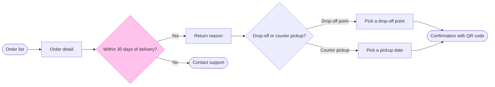

The model passed the check and the board code composed, so this is the write gate.

**Purpose:** the board answers which screens a Fernhouse customer passes through to start a return, and where they choose. The product and design team should be able to check the return path against the app and see the one rule that sends customers away.

**Glance lines**
- **First:** the 30-day decision, "Within 30 days of delivery?", drawn with the pink outline.
- **Second:** Order list, Order detail, Return reason, Contact support, "Drop-off or courier pickup?", the two pick screens and then Confirmation with QR code, the goal.
- **Last:** the key and the source line.

**Sketch**, the checked model exactly as read:

`PASSED 1 diagram(s) in model.md`. The check printed `ok, 9 nodes and 9 connectors, widest rank 2 steps, longest path 7 steps, 1.0 connectors per step, labels average 19 characters, 0 crossing pairs`.

**Critique**
- **Where the eye goes first:** the pink 30-day decision, and it is the node the board most needs read, because it is the only rule that sends a customer away.
- **What it reads second:** the main row from Order list to the confirmation, with Contact support beside it. That advances the first glance by showing both outcomes of the rule.
- **What a reader could miss:** the screen bodies and zone notes. Missing them costs the four reasons, the 5 nearest points and the 3 working days, which the screen names do not show.
- **What the remove test would cut next:** Return reason, because nothing branches there. It stays because the doc lists it and it is where the four reasons live.

**Changes from the playback**
- **Labels:** the two pick screens are now "Pick a drop-off point" and "Pick a pickup date", so the labels do not repeat their exit labels. The goal is "Confirmation with QR code".
- **Email:** a end shape cannot carry a body, so the QR code and the email sit in the Hand over zone note instead of the node.

**Left out:** free pickup over 100 euros, a proposal under review.

**The write**
- **File:** the existing FigJam file `<test-file-key>`, in the Fernhouse Product plan as you stated. I did not confirm the plan, because an existing file needs no plan lookup. I read the file once and its page is empty, so no section shares the title.
- **What it adds:** one section titled "Start a return" with 9 nodes, 9 connectors, 4 labelled decision exits, 3 zones, the key and the source line. Nothing already on the file changes, and there are no extensions.
- **Calls:** two more, one `use_figma` to compose the board and one `get_figjam` to read it back. If the plan is Starter, Figma counts those against its six calls a month.
- **Rollback:** delete the one section the write returns, which removes everything drawn in it. That runs only on a yes that names the section.

Do you want me to write the Start a return board into file `<test-file-key>` on those terms?