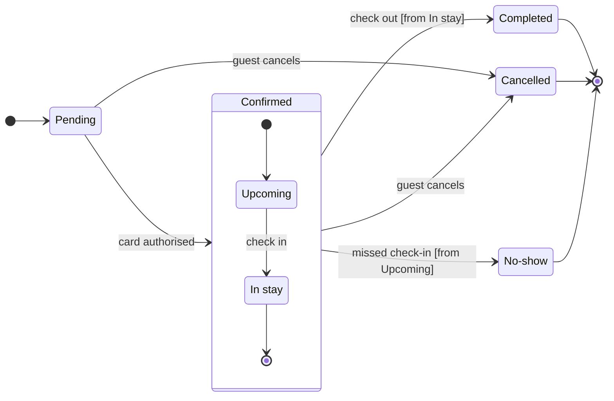

# FJ-026 turn 3 transcript

**User:** Yes, that reading is right.

**Tool call:** `Read` `{"file_path": "/private/var/folders/3c/zfqcqsts0kn19cgblj82gqhm0000gn/T/devin-compare-bench/FJ-026/sk-create-figjam/references/quality-rubric.md"}`

**Tool result:** `Read`

```text
"1\t---\n2\ttitle: \"FigJam Diagram Quality Rubric\"\n3\tdescription: \"The taste gate a FigJam model passes before the write gate, translated from sk-design-diagram's success criteria: type fit, the remove test, signal, the check, the board, the design rubric that scores a composed board and the reply.\"\n4\tcontextType: implementation\n5\timportance_tier: important\n6\ttrigger_phrases:\n7\t  - \"figjam quality rubric\"\n8\t  - \"diagram taste gate\"\n9\t  - \"remove test\"\n10\t  - \"figjam review checklist\"\n11\t  - \"figjam design rubric\"\n12\tversion: 1.0.13.0\n13\t---\n14\t\n15\t# FigJam Diagram Quality Rubric\n16\t\n17\tThe script checks what a script can see. This rubric is the rest: whether the diagram should exist, whether every node earns its place and whether the reader can trust what lands on the board. Walk it after the check passes and before the write gate.\n18\t\n19\t**Loading Condition:** CONDITIONAL, on every Flow route before the write gate\n20\t**Purpose:** The judgement pass between the pre-write check and the gate\n21\t**Scope:** The model, the provenance table, the planned extensions and, after the write, the board and the reply\n22\t\n23\t---\n24\t\n25\t## 1. TYPE FIT\n26\t\n27\t- [ ] The type answers the reader's question, as `references/flow-mode.md` Section 3 maps it\n28\t- [ ] A table, a list or a paragraph would not do the same job. If it would, say so and offer that instead\n29\t- [ ] The type's reference in `references/types/` was loaded and 
```

**Tool call:** `Read` `{"file_path": "/private/var/folders/3c/zfqcqsts0kn19cgblj82gqhm0000gn/T/devin-compare-bench/FJ-026/sk-create-figjam/assets/templates/state.md"}`

**Tool result:** `Read`

```text
"1\t---\n2\ttitle: \"FigJam State Templates\"\n3\tdescription: \"State patterns that pass the pre-write check: a lifecycle, a composite with its own entry and a guarded choice.\"\n4\tcontextType: general\n5\timportance_tier: important\n6\ttrigger_phrases:\n7\t  - \"state templates\"\n8\t  - \"figjam state pattern\"\n9\tversion: 1.0.0.0\n10\t---\n11\t\n12\t# FigJam State Templates\n13\t\n14\tCopy/apply patterns for a state model. Each pattern passes `scripts/flow_check.py`, and `references/types/state.md` holds the rules.\n15\t\n16\t**Loading Condition:** CONDITIONAL, with `references/types/state.md`\n17\t**Purpose:** Starting points for a state diagram\n18\t**Scope:** Three patterns. The provenance table and the reply shape are in `assets/flow-templates.md`\n19\t\n20\t---\n21\t\n22\t## 1. USAGE\n23\t\n24\t- States are nouns or adjectives and labels are the events that move between them\n25\t- A long state name goes in a description, `Pending: Waiting for payment`, so the id stays one word\n26\t- No note and no style line, which would grow phantom states on the board\n27\t\n28\t---\n29\t\n30\t## 2. PATTERNS\n31\t\n32\t### Lifecycle\n33\t\n34\t```mermaid\n35\tstateDiagram-v2\n36\t    direction LR\n37\t    [*] --> Draft\n38\t    Draft --> InReview: submit\n39\t    InReview --> Draft: request changes\n40\t    InReview --> Published: approve\n41\t    Published --> Archived: archive\n42\t    Archived --> [*]\n43\t```\n44\t\n45\t### Composite with its own entry\n46\t\n47\t```mermaid
```

**Tool call:** `ToolSearch` `{"query": "select:mcp__figma-remote__create_session,mcp__figma-remote__get_figjam,mcp__figma-remote__use_figma,mcp__figma-remote__whoami", "max_results": 4}`

**Tool result:** `ToolSearch`

```text
[{"type": "tool_reference", "tool_name": "mcp__figma-remote__create_session"}, {"type": "tool_reference", "tool_name": "mcp__figma-remote__get_figjam"}, {"type": "tool_reference", "tool_name": "mcp__figma-remote__use_figma"}, {"type": "tool_reference", "tool_name": "mcp__figma-remote__whoami"}]
```

**Tool call:** `Bash` `{"command": "cd /private/var/folders/3c/zfqcqsts0kn19cgblj82gqhm0000gn/T/devin-compare-bench/FJ-026/sk-create-figjam && D=$(mktemp -d) && echo \"$D\" && cat > \"$D/model.md\" <<'EOF'\n```mermaid\nstateDiagram-v2\n    %% title: Booking status\n    %% subtitle: Every status a Roamstay booking passes through, from Pending to Completed, Cancelled or No-show, and what moves it on\n    %% source: Source: the Roamstay booking doc. Left out: what happens when Pending passes 15 minutes, which the doc does not say.\n    %% focus: Cancelled because a late cancel keeps a night\n    %% level: balanced\n   `

**Tool call:** `mcp__figma-remote__create_session` `{"fileKey": "<test-file-key>", "description": "Add a Roamstay booking status state diagram as a new section in the existing FigJam file"}`

**Tool result:** `Bash`

```text
"/var/folders/3c/zfqcqsts0kn19cgblj82gqhm0000gn/T/tmp.a5rR5oIqrW\n  diagram 1, state: ok, 7 states and 12 transitions\nPASSED 1 diagram(s) in model.md"
```

**Tool result:** `mcp__figma-remote__create_session`

```text
"{\"sessionId\":\"c98fe961-0ef4-401a-b97a-a84c8617535f\"}"
```

**Tool call:** `mcp__figma-remote__get_figjam` `{"fileKey": "<test-file-key>", "nodeId": "0:1", "sessionId": "c98fe961-0ef4-401a-b97a-a84c8617535f", "includeImagesOfNodes": false}`

**Tool result:** `mcp__figma-remote__get_figjam`

```text
[{"type": "text", "text": "<canvas id=\"0:1\" name=\"Page 1\" x=\"0\" y=\"0\" width=\"0\" height=\"0\" />"}]
```

**Tool call:** `Bash` `{"command": "D=/var/folders/3c/zfqcqsts0kn19cgblj82gqhm0000gn/T/tmp.a5rR5oIqrW && python3 scripts/compose_board.py \"$D/model.md\" --diagram 1 --out \"$D/code.js\"", "description": "Compose board code from checked model"}`

**Tool result:** `Bash`

```text
"COMPOSED diagram 1, 7 states and 12 transitions: 12 nodes and 12 connectors to read back, 44619 characters in /var/folders/3c/zfqcqsts0kn19cgblj82gqhm0000gn/T/tmp.a5rR5oIqrW/code.js, drawn in the design FigJam default"
```

**Assistant:**

Question: which statuses does a Roamstay booking have, what moves it between them, and which ones are final?
Outcome: support can read every booking status and spot the statuses a booking ends in.

**First glance:** Pending, the light blue first state where every booking starts.
**Second glance:** Upcoming and In stay, the states inside the Confirmed section, read with the section that frames them.
**Last glance:** Cancelled, marked by the pink focus outline where it is drawn, then Completed and No-show, the other end states, each in light gray.

Sketch, the checked model in full:



```text
  diagram 1, state: ok, 7 states and 12 transitions
PASSED 1 diagram(s) in model.md
```

The composer also printed `COMPOSED`: 7 states and 12 transitions, 12 nodes and 12 connectors to read back, in the FigJam default design.

**Eye first:** Pending, because the layout always shows the first state first. Cancelled is the state the request cares most about, so the focus outline marks it where it is drawn. That is the node the board most needs read, since it is the one with a money rule.
**Reads second:** Upcoming and In stay inside Confirmed, which carry the booking from card authorisation to the stay.
**Could miss:** the `[from Upcoming]` guard on the No-show move. Without it, a reader could think a guest can be marked No-show during the stay, so the 6-hour rule in the No-show body repeats the timing.
**Remove next:** In stay, which stays because check-out leaves from it and it carries the room-charge rule.

**Plan:** Roamstay Product. **File:** `<test-file-key>`, which is empty, so no section shares the title "Booking status".
**Writes:** one new section titled "Booking status" with 7 states and 12 transitions, the three end states in light gray, a title, a key and a source line, at the Laptop reading distance. Nothing else on the file changes.
**Extensions:** none.
**Calls:** one `use_figma` and one `get_figjam` read-back. The session and the one pre-write `get_figjam` read are already spent, and no `create_new_file` or `whoami` is needed.
**Rollback:** delete the one section the write returns, through `use_figma`, and only on your yes to a question that names it. The file itself stays.
**Left out:** what happens when Pending passes 15 minutes, because the doc doesn't say.

Write it to the file?
