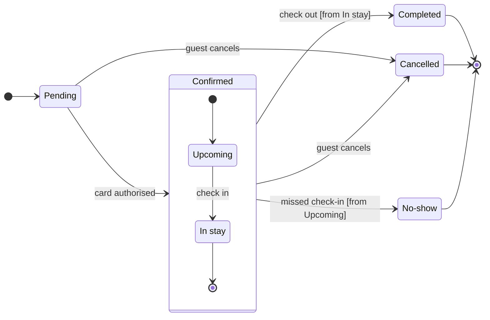

Question: which statuses does a Roamstay booking have, what moves it between them, and which ones are final?
Outcome: support can read every booking status and spot the statuses a booking ends in.

**First glance:** Pending, the light blue first state where every booking starts.
**Second glance:** Upcoming and In stay, the states inside the Confirmed section, read with the section that frames them.
**Last glance:** Cancelled, marked by the pink focus outline where it is drawn, then Completed and No-show, the other end states, each in light gray.

Sketch, the checked model in full:



```text
  diagram 1, state: ok, 7 states and 12 transitions
PASSED 1 diagram(s) in model.md
```

The composer also printed `COMPOSED`: 7 states and 12 transitions, 12 nodes and 12 connectors to read back, in the FigJam default design.

**Eye first:** Pending, because the layout always shows the first state first. Cancelled is the state the request cares most about, so the focus outline marks it where it is drawn. That is the node the board most needs read, since it is the one with a money rule.
**Reads second:** Upcoming and In stay inside Confirmed, which carry the booking from card authorisation to the stay.
**Could miss:** the `[from Upcoming]` guard on the No-show move. Without it, a reader could think a guest can be marked No-show during the stay, so the 6-hour rule in the No-show body repeats the timing.
**Remove next:** In stay, which stays because check-out leaves from it and it carries the room-charge rule.

**Plan:** Roamstay Product. **File:** `<test-file-key>`, which is empty, so no section shares the title "Booking status".
**Writes:** one new section titled "Booking status" with 7 states and 12 transitions, the three end states in light gray, a title, a key and a source line, at the Laptop reading distance. Nothing else on the file changes.
**Extensions:** none.
**Calls:** one `use_figma` and one `get_figjam` read-back. The session and the one pre-write `get_figjam` read are already spent, and no `create_new_file` or `whoami` is needed.
**Rollback:** delete the one section the write returns, through `use_figma`, and only on your yes to a question that names it. The file itself stays.
**Left out:** what happens when Pending passes 15 minutes, because the doc doesn't say.

Write it to the file?