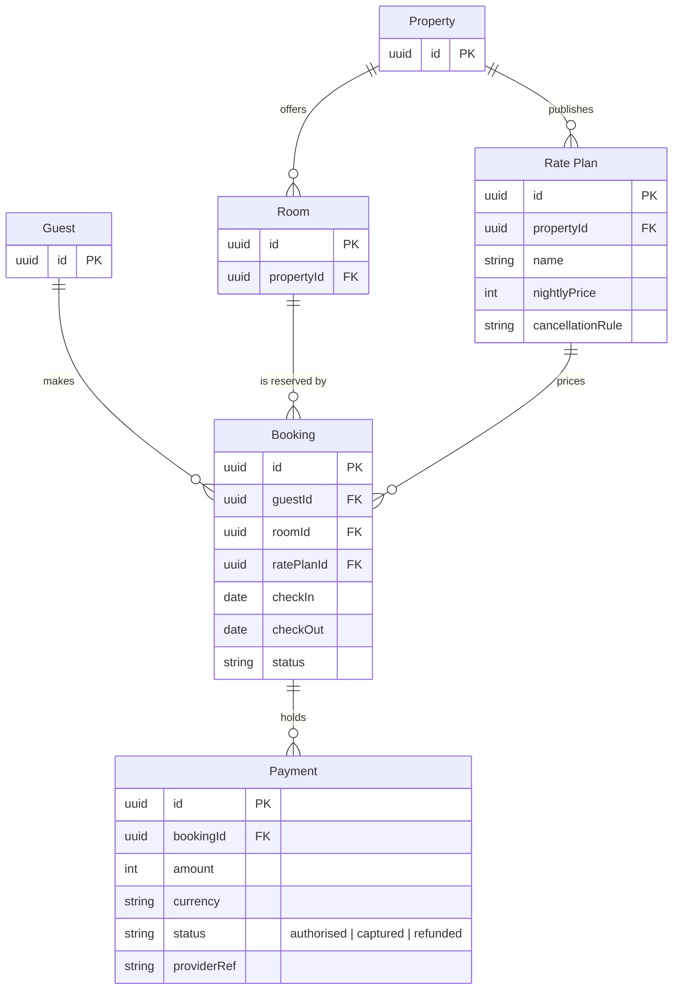

# FJ-027 turn 3 transcript

**User:** Yes, go ahead.

**Tool call:** `Read` `{"file_path": "/private/var/folders/3c/zfqcqsts0kn19cgblj82gqhm0000gn/T/devin-compare-bench/FJ-027/sk-create-figjam/references/quality-rubric.md"}`

**Tool result:** `Read`

```text
"1\t---\n2\ttitle: \"FigJam Diagram Quality Rubric\"\n3\tdescription: \"The taste gate a FigJam model passes before the write gate, translated from sk-design-diagram's success criteria: type fit, the remove test, signal, the check, the board, the design rubric that scores a composed board and the reply.\"\n4\tcontextType: implementation\n5\timportance_tier: important\n6\ttrigger_phrases:\n7\t  - \"figjam quality rubric\"\n8\t  - \"diagram taste gate\"\n9\t  - \"remove test\"\n10\t  - \"figjam review checklist\"\n11\t  - \"figjam design rubric\"\n12\tversion: 1.0.13.0\n13\t---\n14\t\n15\t# FigJam Diagram Quality Rubric\n16\t\n17\tThe script checks what a script can see. This rubric is the rest: whether the diagram should exist, whether every node earns its place and whether the reader can trust what lands on the board. Walk it after the check passes and before the write gate.\n18\t\n19\t**Loading Condition:** CONDITIONAL, on every Flow route before the write gate\n20\t**Purpose:** The judgement pass between the pre-write check and the gate\n21\t**Scope:** The model, the provenance table, the planned extensions and, after the write, the board and the reply\n22\t\n23\t---\n24\t\n25\t## 1. TYPE FIT\n26\t\n27\t- [ ] The type answers the reader's question, as `references/flow-mode.md` Section 3 maps it\n28\t- [ ] A table, a list or a paragraph would not do the same job. If it would, say so and offer that instead\n29\t- [ ] The type's reference in `references/types/` was loaded and 
```

**Tool call:** `ToolSearch` `{"query": "select:mcp__figma-remote__create_session,mcp__figma-remote__get_figjam,mcp__figma-remote__use_figma", "max_results": 5}`

**Tool result:** `ToolSearch`

```text
[{"type": "tool_reference", "tool_name": "mcp__figma-remote__create_session"}, {"type": "tool_reference", "tool_name": "mcp__figma-remote__get_figjam"}, {"type": "tool_reference", "tool_name": "mcp__figma-remote__use_figma"}]
```

**Tool call:** `Bash` `{"command": "mktemp -d", "description": "Create scratch folder for the model"}`

**Tool result:** `Bash`

```text
"/var/folders/3c/zfqcqsts0kn19cgblj82gqhm0000gn/T/tmp.JhtsUy1xLN"
```

**Tool call:** `Write` `{"file_path": "/var/folders/3c/zfqcqsts0kn19cgblj82gqhm0000gn/T/tmp.JhtsUy1xLN/model.md", "content": "```mermaid\nerDiagram\n    %% title: Stays model\n    %% subtitle: The tables behind a stay, split into the guest side and the partner side, for Guest Support\n    %% source: Source: the Roamstay stays schema note. Left out: columns for guests, properties and rooms, which the note does not name.\n    %% zone: Guest side: Guest, Booking, Payment\n    %% zone: Partner side: Property, Room, RatePlan\n    %% focus: Booking\n    Guest ||--o{ Booking : makes\n    Booking ||--o{ Payment : holds\n    `

**Tool result:** `Write`

```text
"File created successfully at: /var/folders/3c/zfqcqsts0kn19cgblj82gqhm0000gn/T/tmp.JhtsUy1xLN/model.md (file state is current in your context \u2014 no need to Read it back)"
```

**Tool call:** `mcp__figma-remote__create_session` `{"fileKey": "<test-file-key>", "description": "Add a Stays model ER board as a new section in the Roamstay Product FigJam file"}`

**Tool result:** `mcp__figma-remote__create_session`

```text
"{\"sessionId\":\"f448a43f-7f30-435d-a3e1-292faaba2f36\"}"
```

**Tool call:** `Bash` `{"command": "cd /private/var/folders/3c/zfqcqsts0kn19cgblj82gqhm0000gn/T/devin-compare-bench/FJ-027/sk-create-figjam && python3 scripts/flow_check.py /var/folders/3c/zfqcqsts0kn19cgblj82gqhm0000gn/T/tmp.JhtsUy1xLN/model.md 2>&1 | tail -20", "description": "Run the pre-write check on the model"}`

**Tool result:** `Bash`

```text
"  diagram 1, ER: %% focus: Booking gives no reason: write %% focus: <id> because <reason>, so the key says why the eye is sent there\nFAILED 1 of 1 diagram(s) in model.md"
```

**Tool call:** `mcp__figma-remote__get_figjam` `{"fileKey": "<test-file-key>", "nodeId": "0:1", "sessionId": "f448a43f-7f30-435d-a3e1-292faaba2f36", "includeImagesOfNodes": false}`

**Tool result:** `mcp__figma-remote__get_figjam`

```text
[{"type": "text", "text": "<canvas id=\"0:1\" name=\"Page 1\" x=\"0\" y=\"0\" width=\"0\" height=\"0\" />"}]
```

**Tool call:** `Edit` `{"replace_all": false, "file_path": "/var/folders/3c/zfqcqsts0kn19cgblj82gqhm0000gn/T/tmp.JhtsUy1xLN/model.md", "old_string": "    %% focus: Booking\n", "new_string": "    %% focus: Booking because every other table joins it\n"}`

**Tool result:** `Edit`

```text
"The file /var/folders/3c/zfqcqsts0kn19cgblj82gqhm0000gn/T/tmp.JhtsUy1xLN/model.md has been updated successfully. (file state is current in your context \u2014 no need to Read it back)"
```

**Tool call:** `Bash` `{"command": "python3 scripts/flow_check.py /var/folders/3c/zfqcqsts0kn19cgblj82gqhm0000gn/T/tmp.JhtsUy1xLN/model.md 2>&1 | tail -20 && python3 scripts/compose_board.py /var/folders/3c/zfqcqsts0kn19cgblj82gqhm0000gn/T/tmp.JhtsUy1xLN/model.md --diagram 1 --out /var/folders/3c/zfqcqsts0kn19cgblj82gqhm0000gn/T/tmp.JhtsUy1xLN/board.js 2>&1 | tail -10", "description": "Re-run the check and compose the board code"}`

**Tool result:** `Bash`

```text
"  diagram 1, ER: ok, 6 entities and 6 relationships\nPASSED 1 diagram(s) in model.md\nCOMPOSED diagram 1, 6 entities and 6 relationships: 6 nodes and 6 connectors to read back, 44193 characters in /var/folders/3c/zfqcqsts0kn19cgblj82gqhm0000gn/T/tmp.JhtsUy1xLN/board.js, drawn in the design FigJam default"
```

**Assistant:**

I've checked the model and composed the board code, and now I'm sending you the write gate. The file's page is empty, so the new section can't collide with an existing one.

**Question:** which tables make up the stays model, which keys join them, and which columns hold a booking's dates and status, a payment's amount and status, and a rate plan's price and cancellation rule?
**Outcome:** Guest Support agents can find where a booking keeps its dates and status, where a payment keeps its amount, status and provider reference, and how a payment traces back to a room and a rate plan.
**First glance:** the Booking card, because every other table joins it.
**Second glance:** the keys on Booking that tie it to the guest, the room and the rate plan, then the amount, currency, status and provider reference on Payment.
**Last glance:** the Guest, Property and Room cards, which carry keys only, then the key and the source line.

**Sketch:** the checked model exactly as the check read it.



```text
  diagram 1, ER: ok, 6 entities and 6 relationships
PASSED 1 diagram(s) in model.md
```

**Eye first:** Booking, which is the table the board most needs read.
**Reads second:** the three foreign keys on Booking, which show what a booking needs before it exists.
**Could miss:** the three payment states, because they sit in a column comment. Missing them costs a support agent the difference between authorised and captured money.
**Remove next:** Guest, which stays because it is where every booking starts.

**Plan:** Roamstay Product, as you stated it. **File:** <test-file-key>, as a new section beside what it holds. The page is empty, so nothing already there changes.
**Writes:** one composed board with 6 entities, 6 relationships and 22 attributes in two zones, guest side and partner side, with a title, a key and a source line, at Laptop distance.
**Left out:** columns for guests, properties and rooms, because the schema note names none.
**Extensions:** none.
**Calls:** one `use_figma` to compose and one `get_figjam` to read it back. The `create_session` and the `get_figjam` read of the file are already spent. If the plan is Starter, those count toward its six calls a month.
**Rollback:** delete the one board section the write returns, which I would do only on its own yes.

Write it?
