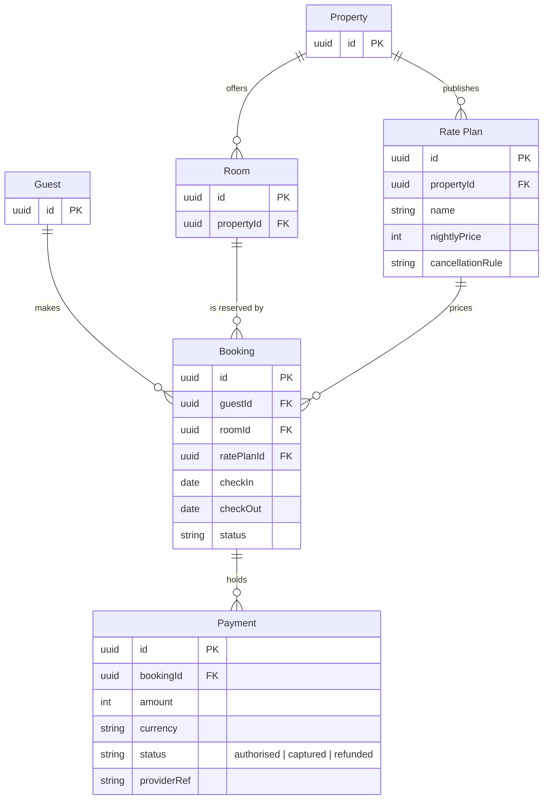

I've checked the model and composed the board code, and now I'm sending you the write gate. The file's page is empty, so the new section can't collide with an existing one.

**Question:** which tables make up the stays model, which keys join them, and which columns hold a booking's dates and status, a payment's amount and status, and a rate plan's price and cancellation rule?
**Outcome:** Guest Support agents can find where a booking keeps its dates and status, where a payment keeps its amount, status and provider reference, and how a payment traces back to a room and a rate plan.
**First glance:** the Booking card, because every other table joins it.
**Second glance:** the keys on Booking that tie it to the guest, the room and the rate plan, then the amount, currency, status and provider reference on Payment.
**Last glance:** the Guest, Property and Room cards, which carry keys only, then the key and the source line.

**Sketch:** the checked model exactly as the check read it.



```text
  diagram 1, ER: ok, 6 entities and 6 relationships
PASSED 1 diagram(s) in model.md
```

**Eye first:** Booking, which is the table the board most needs read.
**Reads second:** the three foreign keys on Booking, which show what a booking needs before it exists.
**Could miss:** the three payment states, because they sit in a column comment. Missing them costs a support agent the difference between authorised and captured money.
**Remove next:** Guest, which stays because it is where every booking starts.

**Plan:** Roamstay Product, as you stated it. **File:** <test-file-key>, as a new section beside what it holds. The page is empty, so nothing already there changes.
**Writes:** one composed board with 6 entities, 6 relationships and 22 attributes in two zones, guest side and partner side, with a title, a key and a source line, at Laptop distance.
**Left out:** columns for guests, properties and rooms, because the schema note names none.
**Extensions:** none.
**Calls:** one `use_figma` to compose and one `get_figjam` to read it back. The `create_session` and the `get_figjam` read of the file are already spent. If the plan is Starter, those count toward its six calls a month.
**Rollback:** delete the one board section the write returns, which I would do only on its own yes.

Write it?