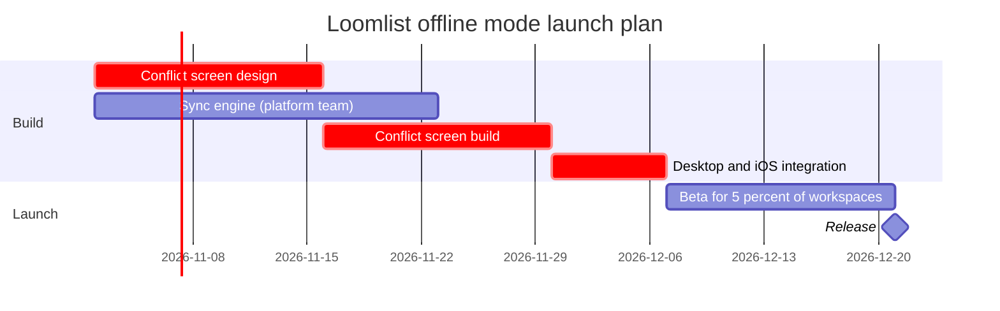

# FJ-028 turn 3 transcript

**User:** Yes, that reading is right.

**Tool call:** `Read` `{"file_path": "/private/var/folders/3c/zfqcqsts0kn19cgblj82gqhm0000gn/T/devin-compare-bench/FJ-028/sk-create-figjam/assets/examples/gantt-loomlist-offline.md"}`

**Tool result:** `Read`

```text
"1\t---\n2\ttitle: \"Example - Gantt - Loomlist Offline Mode\"\n3\tdescription: \"A worked gantt chart on the fictional Loomlist workspace app: a planning doc turned into a phased launch plan with dependencies and a milestone, a playback, a gate message and the reply.\"\n4\tcontextType: general\n5\timportance_tier: normal\n6\ttrigger_phrases:\n7\t  - \"gantt example\"\n8\t  - \"loomlist offline mode plan\"\n9\tversion: 1.0.7.0\n10\t---\n11\t\n12\t# Example - Gantt - Loomlist Offline Mode\n13\t\n14\tLoomlist is a fictional workspace app used across the Product Owner fixtures. Every date and task here is invented for the example.\n15\t\n16\t---\n17\t\n18\t## 1. REQUEST\n19\t\n20\t```text\n21\tput the offline mode launch plan on a FigJam gantt chart, from the planning doc, for the release review\n22\t```\n23\t\n24\t| Doc line | Says | Class |\n25\t|---|---|---|\n26\t| 1 | Design starts 2 November with two weeks of conflict-screen design | approved direction |\n27\t| 2 | The sync engine takes three weeks from the same day | approved direction |\n28\t| 3 | The conflict screen build follows its design, two weeks | approved direction |\n29\t| 4 | Desktop and iOS integration starts when both builds are done, one week, and is the critical path | approved direction |\n30\t| 5 | A two-week beta for 5% of workspaces, then the release | approved direction |\n31\t| 6 | Android follows in the next quarter | proposal |\n32\t\n33\t---\n34\t\n35\t## 2. TYPE AND DIALS\n36\t\n37\t- **Reader ques
```

**Tool call:** `Read` `{"file_path": "/private/var/folders/3c/zfqcqsts0kn19cgblj82gqhm0000gn/T/devin-compare-bench/FJ-028/sk-create-figjam/references/quality-rubric.md"}`

**Tool result:** `Read`

```text
"1\t---\n2\ttitle: \"FigJam Diagram Quality Rubric\"\n3\tdescription: \"The taste gate a FigJam model passes before the write gate, translated from sk-design-diagram's success criteria: type fit, the remove test, signal, the check, the board, the design rubric that scores a composed board and the reply.\"\n4\tcontextType: implementation\n5\timportance_tier: important\n6\ttrigger_phrases:\n7\t  - \"figjam quality rubric\"\n8\t  - \"diagram taste gate\"\n9\t  - \"remove test\"\n10\t  - \"figjam review checklist\"\n11\t  - \"figjam design rubric\"\n12\tversion: 1.0.13.0\n13\t---\n14\t\n15\t# FigJam Diagram Quality Rubric\n16\t\n17\tThe script checks what a script can see. This rubric is the rest: whether the diagram should exist, whether every node earns its place and whether the reader can trust what lands on the board. Walk it after the check passes and before the write gate.\n18\t\n19\t**Loading Condition:** CONDITIONAL, on every Flow route before the write gate\n20\t**Purpose:** The judgement pass between the pre-write check and the gate\n21\t**Scope:** The model, the provenance table, the planned extensions and, after the write, the board and the reply\n22\t\n23\t---\n24\t\n25\t## 1. TYPE FIT\n26\t\n27\t- [ ] The type answers the reader's question, as `references/flow-mode.md` Section 3 maps it\n28\t- [ ] A table, a list or a paragraph would not do the same job. If it would, say so and offer that instead\n29\t- [ ] The type's reference in `references/types/` was loaded and 
```

**Tool call:** `ToolSearch` `{"query": "select:mcp__figma-remote__create_session,mcp__figma-remote__get_figjam,mcp__figma-remote__use_figma,mcp__figma-remote__get_screenshot", "max_results": 5}`

**Tool result:** `ToolSearch`

```text
[{"type": "tool_reference", "tool_name": "mcp__figma-remote__create_session"}, {"type": "tool_reference", "tool_name": "mcp__figma-remote__get_figjam"}, {"type": "tool_reference", "tool_name": "mcp__figma-remote__use_figma"}, {"type": "tool_reference", "tool_name": "mcp__figma-remote__get_screenshot"}]
```

**Tool call:** `mcp__figma-remote__create_session` `{"fileKey": "<test-file-key>", "description": "Add a gantt board for the Loomlist offline mode launch plan as a new section in this FigJam file"}`

**Tool result:** `mcp__figma-remote__create_session`

```text
"{\"sessionId\":\"a8373fd5-4c3a-4dbc-97ad-802662bb7cc3\"}"
```

**Tool call:** `Bash` `{"command": "d=$(mktemp -d) && cat > \"$d/model.md\" <<'EOF'\n```mermaid\ngantt\n    title Loomlist offline mode launch plan\n    %% subtitle: From the 2 Nov 2026 start of design and the sync engine to the 21 Dec 2026 release, for product and engineering leads\n    %% source: Source: the offline mode launch plan. Conflict screen design covers the merge view and the undo banner. Left out: Android next quarter, not approved and undated.\n    %% focus: integrate because both builds must finish first\n    dateFormat YYYY-MM-DD\n    section Build\n    Conflict screen design :crit, design, 2026-11-0`

**Tool result:** `Bash`

```text
"/var/folders/3c/zfqcqsts0kn19cgblj82gqhm0000gn/T/tmp.EBMYm77d3F\n  diagram 1, gantt: ok, 6 tasks in 2 sections\nPASSED 1 diagram(s) in model.md"
```

**Tool call:** `Bash` `{"command": "d=/var/folders/3c/zfqcqsts0kn19cgblj82gqhm0000gn/T/tmp.EBMYm77d3F; cd /private/var/folders/3c/zfqcqsts0kn19cgblj82gqhm0000gn/T/devin-compare-bench/FJ-028 && python3 sk-create-figjam/scripts/compose_board.py \"$d/model.md\" --diagram 1 --out \"$d/board1.js\"; wc -c \"$d/board1.js\"", "description": "Compose the board code from the checked model"}`

**Tool result:** `Bash`

```text
"COMPOSED diagram 1, 6 tasks in 2 sections: 6 nodes and 5 connectors to read back, 19344 characters in /var/folders/3c/zfqcqsts0kn19cgblj82gqhm0000gn/T/tmp.EBMYm77d3F/board1.js, drawn in the design FigJam default\n   19344 /var/folders/3c/zfqcqsts0kn19cgblj82gqhm0000gn/T/tmp.EBMYm77d3F/board1.js"
```

**Tool call:** `mcp__figma-remote__get_figjam` `{"fileKey": "<test-file-key>", "nodeId": "0:1", "sessionId": "a8373fd5-4c3a-4dbc-97ad-802662bb7cc3", "includeImagesOfNodes": false}`

**Tool result:** `mcp__figma-remote__get_figjam`

```text
[{"type": "text", "text": "<canvas id=\"0:1\" name=\"Page 1\" x=\"0\" y=\"0\" width=\"0\" height=\"0\" />"}]
```

**Assistant:**

Gate. Nothing is written yet.

**Question:** which Loomlist offline mode tasks are active when, and what gates the release?
**Outcome:** the product and engineering leads can see that the 21 Dec 2026 release is set by the design, screen build and integration chain, and that the sync engine has one week of slack.
**First glance:** Desktop and iOS integration, because both builds must finish before it starts.
**Second glance:** Conflict screen design and Conflict screen build, the two critical bars that lead into it, then Sync engine, the other build it waits for.
**Last glance:** Beta for 5 percent of workspaces, the Release milestone, the key and the source line.

**Sketch**, the checked model exactly as the check read it:



```text
  diagram 1, gantt: ok, 6 tasks in 2 sections
PASSED 1 diagram(s) in model.md
```

The check counts the milestone as a task, so its 6 is 5 tasks and the Release milestone.

**Critique of the sketch**
* Eye first: Desktop and iOS integration, and it is the bar the board most needs read
* Reads second: the critical outlines on Conflict screen design and Conflict screen build, then Sync engine, which shows what integration waits for
* Could miss: that Sync engine ends a week before integration starts, so a reader could take it as gating. The cost is a wrong call about where to add people
* Remove next: Beta for 5 percent of workspaces, kept because the release waits on it

**Plan:** Loomlist Product. **File:** the existing FigJam file `<test-file-key>`, which you named. I read it before this gate and its page is empty, so no section shares the title and nothing on it can change.
**Writes:** one composed board as a new section, with 2 sections, 5 tasks, 1 milestone and 5 dependency arrows on one axis, plus a title, a key and a source line, at Laptop distance.
**Left out:** Android next quarter, an unapproved proposal with no date.
**Extensions:** none. The design scope sits in the source line, and the platform team owner and the desktop and iOS scope sit in the task names.
**Calls:** one `use_figma` and one `get_figjam` read-back. The session and the pre-gate read are already spent. Figma caps Starter plans and View or Collab seats at six tool calls a month, so check your allowance if you are on one.
**Rollback:** delete the one board section the write returns, which removes everything drawn inside it. That delete runs only on its own yes.

Write it?
