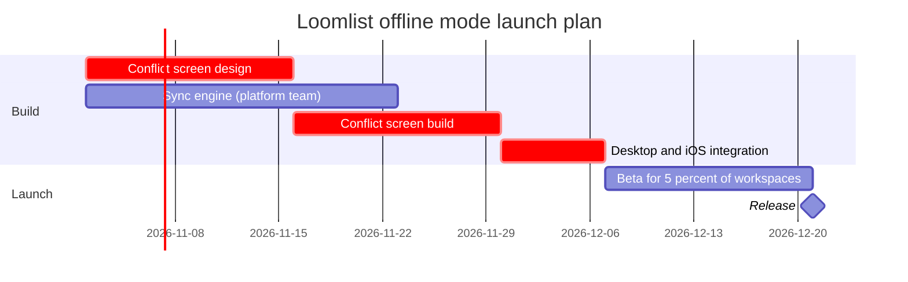

Gate. Nothing is written yet.

**Question:** which Loomlist offline mode tasks are active when, and what gates the release?
**Outcome:** the product and engineering leads can see that the 21 Dec 2026 release is set by the design, screen build and integration chain, and that the sync engine has one week of slack.
**First glance:** Desktop and iOS integration, because both builds must finish before it starts.
**Second glance:** Conflict screen design and Conflict screen build, the two critical bars that lead into it, then Sync engine, the other build it waits for.
**Last glance:** Beta for 5 percent of workspaces, the Release milestone, the key and the source line.

**Sketch**, the checked model exactly as the check read it:



```text
  diagram 1, gantt: ok, 6 tasks in 2 sections
PASSED 1 diagram(s) in model.md
```

The check counts the milestone as a task, so its 6 is 5 tasks and the Release milestone.

**Critique of the sketch**
* Eye first: Desktop and iOS integration, and it is the bar the board most needs read
* Reads second: the critical outlines on Conflict screen design and Conflict screen build, then Sync engine, which shows what integration waits for
* Could miss: that Sync engine ends a week before integration starts, so a reader could take it as gating. The cost is a wrong call about where to add people
* Remove next: Beta for 5 percent of workspaces, kept because the release waits on it

**Plan:** Loomlist Product. **File:** the existing FigJam file `<test-file-key>`, which you named. I read it before this gate and its page is empty, so no section shares the title and nothing on it can change.
**Writes:** one composed board as a new section, with 2 sections, 5 tasks, 1 milestone and 5 dependency arrows on one axis, plus a title, a key and a source line, at Laptop distance.
**Left out:** Android next quarter, an unapproved proposal with no date.
**Extensions:** none. The design scope sits in the source line, and the platform team owner and the desktop and iOS scope sit in the task names.
**Calls:** one `use_figma` and one `get_figjam` read-back. The session and the pre-gate read are already spent. Figma caps Starter plans and View or Collab seats at six tool calls a month, so check your allowance if you are on one.
**Rollback:** delete the one board section the write returns, which removes everything drawn inside it. That delete runs only on its own yes.

Write it?