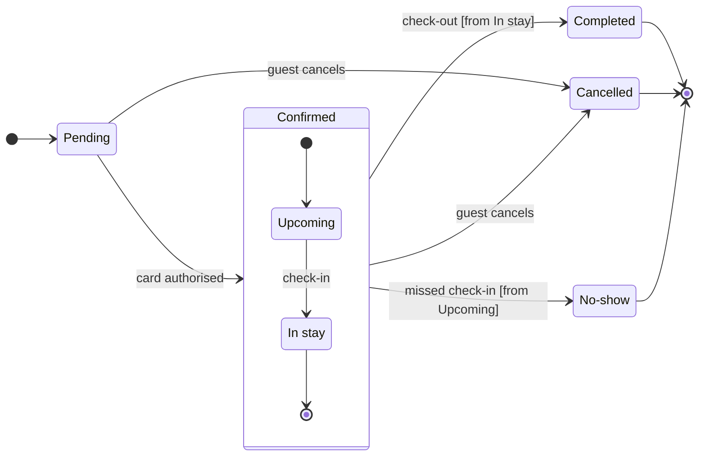

# FJ-032 turn 4 transcript

**User:** Yes, go ahead.

**Tool call:** `ToolSearch` `{"query": "select:mcp__figma-remote__create_session,mcp__figma-remote__get_figjam,mcp__figma-remote__use_figma", "max_results": 5}`

**Tool result:** `ToolSearch`

```text
[{"type": "tool_reference", "tool_name": "mcp__figma-remote__create_session"}, {"type": "tool_reference", "tool_name": "mcp__figma-remote__get_figjam"}, {"type": "tool_reference", "tool_name": "mcp__figma-remote__use_figma"}]
```

**Tool call:** `Read` `{"file_path": "/private/var/folders/3c/zfqcqsts0kn19cgblj82gqhm0000gn/T/devin-compare-bench/FJ-032/sk-create-figjam/assets/templates/state.md"}`

**Tool result:** `Read`

```text
"1\t---\n2\ttitle: \"FigJam State Templates\"\n3\tdescription: \"State patterns that pass the pre-write check: a lifecycle, a composite with its own entry and a guarded choice.\"\n4\tcontextType: general\n5\timportance_tier: important\n6\ttrigger_phrases:\n7\t  - \"state templates\"\n8\t  - \"figjam state pattern\"\n9\tversion: 1.0.0.0\n10\t---\n11\t\n12\t# FigJam State Templates\n13\t\n14\tCopy/apply patterns for a state model. Each pattern passes `scripts/flow_check.py`, and `references/types/state.md` holds the rules.\n15\t\n16\t**Loading Condition:** CONDITIONAL, with `references/types/state.md`\n17\t**Purpose:** Starting points for a state diagram\n18\t**Scope:** Three patterns. The provenance table and the reply shape are in `assets/flow-templates.md`\n19\t\n20\t---\n21\t\n22\t## 1. USAGE\n23\t\n24\t- States are nouns or adjectives and labels are the events that move between them\n25\t- A long state name goes in a description, `Pending: Waiting for payment`, so the id stays one word\n26\t- No note and no style line, which would grow phantom states on the board\n27\t\n28\t---\n29\t\n30\t## 2. PATTERNS\n31\t\n32\t### Lifecycle\n33\t\n34\t```mermaid\n35\tstateDiagram-v2\n36\t    direction LR\n37\t    [*] --> Draft\n38\t    Draft --> InReview: submit\n39\t    InReview --> Draft: request changes\n40\t    InReview --> Published: approve\n41\t    Published --> Archived: archive\n42\t    Archived --> [*]\n43\t```\n44\t\n45\t### Composite with its own entry\n46\t\n47\t```mermaid
```

**Tool call:** `Read` `{"file_path": "/private/var/folders/3c/zfqcqsts0kn19cgblj82gqhm0000gn/T/devin-compare-bench/FJ-032/sk-create-figjam/assets/examples/state-roamstay-booking.md"}`

**Tool result:** `Read`

```text
"1\t---\n2\ttitle: \"Example - State - Roamstay Booking\"\n3\tdescription: \"A worked state diagram on the fictional Roamstay booking marketplace: a booking's status field drawn from a product doc, its end states coloured by the composer, a playback, a gate message and the reply.\"\n4\tcontextType: general\n5\timportance_tier: normal\n6\ttrigger_phrases:\n7\t  - \"state example\"\n8\t  - \"roamstay booking states\"\n9\tversion: 1.0.9.0\n10\t---\n11\t\n12\t# Example - State - Roamstay Booking\n13\t\n14\tRoamstay is a fictional booking marketplace used across the Product Owner fixtures. Every state and rule here is invented for the example.\n15\t\n16\t---\n17\t\n18\t## 1. REQUEST\n19\t\n20\t```text\n21\t$figjam the booking status lifecycle from the bookings doc, and colour the end states so support can spot them\n22\t```\n23\t\n24\t| Doc line | Says | Class |\n25\t|---|---|---|\n26\t| 2.1 | A booking starts as Pending until the card is authorised | current behavior |\n27\t| 2.2 | Confirmed covers Upcoming and In stay. Check-in moves Upcoming to In stay | current behavior |\n28\t| 2.3 | Check-out ends the stay as Completed | current behavior |\n29\t| 2.4 | A guest can cancel while Pending or Confirmed | current behavior |\n30\t| 2.5 | The hotel marks No-show the day after a missed check-in | current behavior |\n31\t\n32\t---\n33\t\n34\t## 2. TYPE AND DIALS\n35\t\n36\t- **Reader question:** which statuses exist and what moves a booking between them? A state diagram\n37\t- **Detai
```

**Tool call:** `Read` `{"file_path": "/private/var/folders/3c/zfqcqsts0kn19cgblj82gqhm0000gn/T/devin-compare-bench/FJ-032/sk-create-figjam/references/quality-rubric.md"}`

**Tool result:** `Read`

```text
"1\t---\n2\ttitle: \"FigJam Diagram Quality Rubric\"\n3\tdescription: \"The taste gate a FigJam model passes before the write gate, translated from sk-design-diagram's success criteria: type fit, the remove test, signal, the check, the board, the design rubric that scores a composed board and the reply.\"\n4\tcontextType: implementation\n5\timportance_tier: important\n6\ttrigger_phrases:\n7\t  - \"figjam quality rubric\"\n8\t  - \"diagram taste gate\"\n9\t  - \"remove test\"\n10\t  - \"figjam review checklist\"\n11\t  - \"figjam design rubric\"\n12\tversion: 1.0.13.0\n13\t---\n14\t\n15\t# FigJam Diagram Quality Rubric\n16\t\n17\tThe script checks what a script can see. This rubric is the rest: whether the diagram should exist, whether every node earns its place and whether the reader can trust what lands on the board. Walk it after the check passes and before the write gate.\n18\t\n19\t**Loading Condition:** CONDITIONAL, on every Flow route before the write gate\n20\t**Purpose:** The judgement pass between the pre-write check and the gate\n21\t**Scope:** The model, the provenance table, the planned extensions and, after the write, the board and the reply\n22\t\n23\t---\n24\t\n25\t## 1. TYPE FIT\n26\t\n27\t- [ ] The type answers the reader's question, as `references/flow-mode.md` Section 3 maps it\n28\t- [ ] A table, a list or a paragraph would not do the same job. If it would, say so and offer that instead\n29\t- [ ] The type's reference in `references/types/` was loaded and 
```

**Tool call:** `mcp__figma-remote__create_session` `{"fileKey": "<test-file-key>", "description": "Add a Roamstay booking status lifecycle state diagram to the existing retro FigJam board"}`

**Tool call:** `Bash` `{"command": "mktemp -d", "description": "Create scratch folder for model"}`

**Tool result:** `mcp__figma-remote__create_session`

```text
"{\"sessionId\":\"26715057-8b12-49c3-bd07-b5b760152024\"}"
```

**Tool result:** `Bash`

```text
"/var/folders/3c/zfqcqsts0kn19cgblj82gqhm0000gn/T/tmp.37hXgs353N"
```

**Tool call:** `Write` `{"file_path": "/var/folders/3c/zfqcqsts0kn19cgblj82gqhm0000gn/T/tmp.37hXgs353N/model.md", "content": "```mermaid\nstateDiagram-v2\n    %% title: Roamstay booking status lifecycle\n    %% subtitle: From Pending to Completed, Cancelled or No-show, for the retro team\n    %% source: Sources: the request and three booking doc lines. Left out: the exit after 15 minutes, refund amounts, payment retries and the failed-card path.\n    %% level: balanced\n    %% detail: Pending | Up to 15 minutes while the card is checked\n    %% detail: NoShow | Hotel marks it | From 6 hours after check-in time\n    %`

**Tool result:** `Write`

```text
"File created successfully at: /var/folders/3c/zfqcqsts0kn19cgblj82gqhm0000gn/T/tmp.37hXgs353N/model.md (file state is current in your context \u2014 no need to Read it back)"
```

**Tool call:** `mcp__figma-remote__get_figjam` `{"fileKey": "<test-file-key>", "nodeId": "0:1", "sessionId": "26715057-8b12-49c3-bd07-b5b760152024"}`

**Tool result:** `mcp__figma-remote__get_figjam`

```text
[{"type": "text", "text": "<canvas id=\"0:1\" name=\"Page 1\" x=\"0\" y=\"0\" width=\"0\" height=\"0\">\n  <section id=\"1:2\" name=\"Sprint retro\" x=\"0\" y=\"0\" width=\"1200\" height=\"600\">\n    <sticky id=\"1:3\" x=\"80\" y=\"120\" color=\"STICKY_GRAY_UI3\" author=\"\" width=\"240\" height=\"240\">Went well: release on time</sticky>\n    <sticky id=\"1:7\" x=\"440\" y=\"120\" color=\"STICKY_GRAY_UI3\" author=\"\" width=\"240\" height=\"240\">Went well: fewer bugs</sticky>\n    <sticky id=\"1:11\" x=\"800\" y=\"120\" color=\"STICKY_GRAY_UI3\" author=\"\" width=\"240\" height=\"240\">Improve: flaky tests</sticky>\n    <sticky id=\"1:15\" x=\"80\" y=\"360\" color=\"STICKY_GRAY_UI3\" author=\"\" width=\"240\" height=\"240\">Improve: long reviews</sticky>\n    <sticky id=\"1:19\" x=\"440\" y=\"360\" color=\"STICKY_GRAY_UI3\" author=\"\" width=\"240\" height=\"240\">Action: pair on reviews</sticky>\n    <sticky id=\"1:23\" x=\"800\" y=\"360\" color=\"STICKY_GRAY_UI3\" author=\"\" width=\"240\" height=\"240\">Action: fix the test runner</sticky>\n  </section>\n</canvas>"}, {"type": "image", "source": {"type": "base64", "media_type": "image/png", "data": "iVBORw0KGgoAAAANSUhEUgAABAAAAAIQCAYAAAAfGxwiAAAACXBIWXMAAAsTAAALEwEAmpwYAAAAAXNSR0IArs4c6QAAAARnQU1BAACxjwv8YQUAAAAOdEVYdFNvZnR3YXJlAEZpZ21hnrGWYwAAfZlJREFUeAHt3UmsdFtd//+6l3PhgpdfIiTqQAc2AzVRBzqwGehAjdGBbeLA3om9UbGPsZvYwsSAwEAkwEASAwxAA0wwERjAAJhgQjOgCZAAUS5cLvdB/v9Pyefweb6sXafWrtqrnvOs9yt5nnNOnTq79t5V67v6tR74wAc+8LldwwMPPHD
```

**Tool call:** `Bash` `{"command": "cd /private/var/folders/3c/zfqcqsts0kn19cgblj82gqhm0000gn/T/devin-compare-bench/FJ-032/sk-create-figjam && python3 -I scripts/flow_check.py /var/folders/3c/zfqcqsts0kn19cgblj82gqhm0000gn/T/tmp.37hXgs353N/model.md; echo exit=$?", "description": "Run pre-write check on the state model"}`

**Tool result:** `Bash`

```text
"  diagram 1, state: ok, 7 states and 12 transitions\nPASSED 1 diagram(s) in model.md\nexit=0"
```

**Tool call:** `Bash` `{"command": "python3 -I scripts/compose_board.py /var/folders/3c/zfqcqsts0kn19cgblj82gqhm0000gn/T/tmp.37hXgs353N/model.md --diagram 1 --out /var/folders/3c/zfqcqsts0kn19cgblj82gqhm0000gn/T/tmp.37hXgs353N/board1.js; echo exit=$?", "description": "Compose the board code from the checked model"}`

**Tool result:** `Bash`

```text
"COMPOSED diagram 1, 7 states and 12 transitions: 12 nodes and 12 connectors to read back, 44541 characters in /var/folders/3c/zfqcqsts0kn19cgblj82gqhm0000gn/T/tmp.37hXgs353N/board1.js, drawn in the design FigJam default\nexit=0"
```

**Assistant:**

I ran the check and composed the code, and the gate is the only step left before any write.

Question: Which statuses can a Roamstay booking be in, and what moves it between them?
Outcome: the retro team agrees what each status means and what moves a booking between them.
First glance: Pending, the light blue first state where every booking starts.
Second glance: Upcoming and In stay, the states inside Confirmed, read with the section that frames them.
Last glance: Completed, Cancelled and No-show, the end states in light gray, with the 6 hour note on No-show and the first-night note on Cancelled.

Sketch, exactly as checked:



`  diagram 1, state: ok, 7 states and 12 transitions`
`PASSED 1 diagram(s) in model.md`

Eye first: Pending, the first state the layout always shows, and no state is marked because the request names none.
Reads second: Upcoming and In stay, which carry a booking from a confirmed card to the stay.
Could miss: the No-show note, which would hide that the hotel marks it only from 6 hours after check-in, so support tells guests the wrong thing.
Remove next: In stay, kept because check-out leaves from it.

File: your retro board `<test-file-key>`. It holds one section, "Sprint retro", with six stickies and no section titled "Roamstay booking status lifecycle", so the new board keeps that title.
Writes: one composed board of 7 states and 12 transitions, with a title, a key and a source line, at the Meeting screen distance. It lands as a new section 400 pixels to the right of "Sprint retro", and nothing already there changes.
Left out: the exit after 15 minutes without an authorised card, refund amounts, payment retries and the failed-card path.
Extensions: none.
Calls: one `use_figma` and one `get_figjam` read-back. I will also read the board once more to compare it with the read I took just now. I have already used `create_session` and one `get_figjam`. On a Starter plan or a View or Collab seat, Figma allows six tool calls a month and read tools count, so this write may use most of what is left.
Rollback: delete the one new board section, by its returned id, but only on your yes to a question that names it.

Write it?
