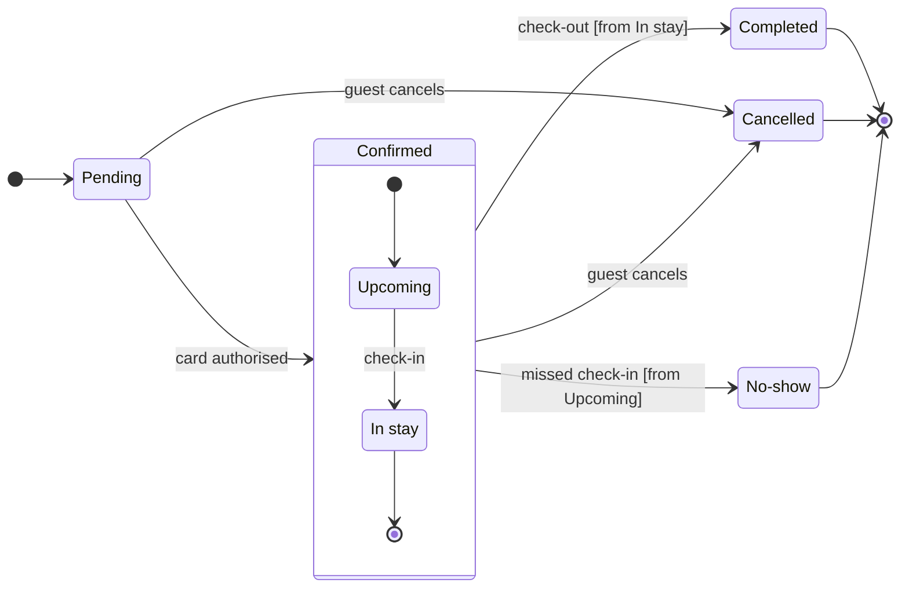

I ran the check and composed the code, and the gate is the only step left before any write.

Question: Which statuses can a Roamstay booking be in, and what moves it between them?
Outcome: the retro team agrees what each status means and what moves a booking between them.
First glance: Pending, the light blue first state where every booking starts.
Second glance: Upcoming and In stay, the states inside Confirmed, read with the section that frames them.
Last glance: Completed, Cancelled and No-show, the end states in light gray, with the 6 hour note on No-show and the first-night note on Cancelled.

Sketch, exactly as checked:

`  diagram 1, state: ok, 7 states and 12 transitions`
`PASSED 1 diagram(s) in model.md`

Eye first: Pending, the first state the layout always shows, and no state is marked because the request names none.
Reads second: Upcoming and In stay, which carry a booking from a confirmed card to the stay.
Could miss: the No-show note, which would hide that the hotel marks it only from 6 hours after check-in, so support tells guests the wrong thing.
Remove next: In stay, kept because check-out leaves from it.

File: your retro board `<test-file-key>`. It holds one section, "Sprint retro", with six stickies and no section titled "Roamstay booking status lifecycle", so the new board keeps that title.
Writes: one composed board of 7 states and 12 transitions, with a title, a key and a source line, at the Meeting screen distance. It lands as a new section 400 pixels to the right of "Sprint retro", and nothing already there changes.
Left out: the exit after 15 minutes without an authorised card, refund amounts, payment retries and the failed-card path.
Extensions: none.
Calls: one `use_figma` and one `get_figjam` read-back. I will also read the board once more to compare it with the read I took just now. I have already used `create_session` and one `get_figjam`. On a Starter plan or a View or Collab seat, Figma allows six tool calls a month and read tools count, so this write may use most of what is left.
Rollback: delete the one new board section, by its returned id, but only on your yes to a question that names it.

Write it?