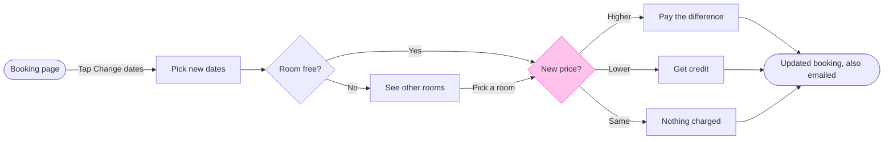

# FJ-036 turn 4 transcript

**User:** Yes, that reading is right.

**Tool call:** `Read` `{"file_path": "/private/var/folders/3c/zfqcqsts0kn19cgblj82gqhm0000gn/T/devin-compare-bench/FJ-036/sk-create-figjam/references/quality-rubric.md"}`

**Tool result:** `Read`

```text
"1\t---\n2\ttitle: \"FigJam Diagram Quality Rubric\"\n3\tdescription: \"The taste gate a FigJam model passes before the write gate, translated from sk-design-diagram's success criteria: type fit, the remove test, signal, the check, the board, the design rubric that scores a composed board and the reply.\"\n4\tcontextType: implementation\n5\timportance_tier: important\n6\ttrigger_phrases:\n7\t  - \"figjam quality rubric\"\n8\t  - \"diagram taste gate\"\n9\t  - \"remove test\"\n10\t  - \"figjam review checklist\"\n11\t  - \"figjam design rubric\"\n12\tversion: 1.0.13.0\n13\t---\n14\t\n15\t# FigJam Diagram Quality Rubric\n16\t\n17\tThe script checks what a script can see. This rubric is the rest: whether the diagram should exist, whether every node earns its place and whether the reader can trust what lands on the board. Walk it after the check passes and before the write gate.\n18\t\n19\t**Loading Condition:** CONDITIONAL, on every Flow route before the write gate\n20\t**Purpose:** The judgement pass between the pre-write check and the gate\n21\t**Scope:** The model, the provenance table, the planned extensions and, after the write, the board and the reply\n22\t\n23\t---\n24\t\n25\t## 1. TYPE FIT\n26\t\n27\t- [ ] The type answers the reader's question, as `references/flow-mode.md` Section 3 maps it\n28\t- [ ] A table, a list or a paragraph would not do the same job. If it would, say so and offer that instead\n29\t- [ ] The type's reference in `references/types/` was loaded and 
```

**Tool call:** `ToolSearch` `{"query": "select:mcp__figma-remote__create_session,mcp__figma-remote__get_figjam,mcp__figma-remote__use_figma,mcp__figma-remote__whoami", "max_results": 4}`

**Tool result:** `ToolSearch`

```text
[{"type": "tool_reference", "tool_name": "mcp__figma-remote__create_session"}, {"type": "tool_reference", "tool_name": "mcp__figma-remote__get_figjam"}, {"type": "tool_reference", "tool_name": "mcp__figma-remote__use_figma"}, {"type": "tool_reference", "tool_name": "mcp__figma-remote__whoami"}]
```

**Tool call:** `Bash` `{"command": "mktemp -d", "description": "Create scratch folder for model"}`

**Tool result:** `Bash`

```text
"/var/folders/3c/zfqcqsts0kn19cgblj82gqhm0000gn/T/tmp.nf2q5r7cyv"
```

**Tool call:** `Write` `{"file_path": "/var/folders/3c/zfqcqsts0kn19cgblj82gqhm0000gn/T/tmp.nf2q5r7cyv/model.md", "content": "```mermaid\nflowchart LR\n    %% title: Change booking dates\n    %% subtitle: From the booking page to the updated booking, for a teammate learning the feature\n    %% source: Sources: the request and the Roamstay help article. Left out: cancellation or refund, a failed card charge, hotel-side steps, screen layouts.\n    %% level: balanced\n    %% goal: updated\n    booking([Booking page]) -->|Tap Change dates| pick[Pick new dates]\n    pick --> free{Room free?}\n    free -->|Yes| price{New p`

**Tool result:** `Write`

```text
"File created successfully at: /var/folders/3c/zfqcqsts0kn19cgblj82gqhm0000gn/T/tmp.nf2q5r7cyv/model.md (file state is current in your context \u2014 no need to Read it back)"
```

**Tool call:** `Bash` `{"command": "python3 sk-create-figjam/scripts/flow_check.py /var/folders/3c/zfqcqsts0kn19cgblj82gqhm0000gn/T/tmp.nf2q5r7cyv/model.md 2>&1 | head -60", "description": "Run pre-write check on model"}`

**Tool result:** `Bash`

```text
"  diagram 1, user flow: %% detail on updated, a stadium: only a step [Label] carries a body\nFAILED 1 of 1 diagram(s) in model.md"
```

**Tool call:** `Bash` `{"command": "M=/var/folders/3c/zfqcqsts0kn19cgblj82gqhm0000gn/T/tmp.nf2q5r7cyv/model.md && sed -i '' -e '/%% detail: updated/d' -e 's/\\[Updated booking shown\\]/[\"Updated booking, also emailed\"]/g' $M && python3 sk-create-figjam/scripts/flow_check.py $M 2>&1 | head -60", "description": "Fix end label and rerun check"}`

**Tool result:** `Bash`

```text
"  diagram 1, user flow: ok, 9 nodes and 11 connectors, widest rank 3 steps, longest path 7 steps, 1.2 connectors per step, labels average 15 characters, 0 crossing pairs\nGlance: New price? (accent) > Booking page > Pick new dates > Room free? > See other rooms > Pay the difference > Get credit > Nothing charged > Updated booking, also emailed (goal)\nRow: the line from See other rooms to New price? bends off its row, so name the break at the gate and offer a model that keeps the row straight\nPASSED 1 diagram(s) in model.md\n[This command modified 1 file you've previously read: ../../../../../../../../var/folders/3c/zfqcqsts0kn19cgblj82gqhm0000gn/T/tmp.nf2q5r7cyv/model.md. Call Read before editing.]"
```

**Tool call:** `Bash` `{"command": "D=/var/folders/3c/zfqcqsts0kn19cgblj82gqhm0000gn/T/tmp.nf2q5r7cyv && python3 sk-create-figjam/scripts/compose_board.py $D/model.md --diagram 1 --out $D/board.js 2>&1 | head -20", "description": "Compose board code from checked model"}`

**Tool result:** `Bash`

```text
"COMPOSED diagram 1, 9 nodes and 11 connectors, widest rank 3 steps, longest path 7 steps, 1.2 connectors per step, labels average 15 characters, 0 crossing pairs: 9 nodes and 11 connectors to read back, 44254 characters in /var/folders/3c/zfqcqsts0kn19cgblj82gqhm0000gn/T/tmp.nf2q5r7cyv/board.js, drawn in the design FigJam default"
```

**Tool call:** `mcp__figma-remote__create_session` `{"fileKey": "<test-file-key>", "description": "Add a user flow board for Roamstay change booking dates as a new section in this FigJam file"}`

**Tool result:** `mcp__figma-remote__create_session`

```text
"{\"sessionId\":\"d50c6ab1-0f4d-4c16-9b40-22fc4fed2f93\"}"
```

**Assistant:**

The model passed the check and composed. Next I'm reading the target file once, so the read-back has something to compare with and I can see whether a section already shares the board's title.

**Tool call:** `mcp__figma-remote__get_figjam` `{"fileKey": "<test-file-key>", "nodeId": "0:1", "sessionId": "d50c6ab1-0f4d-4c16-9b40-22fc4fed2f93", "includeImagesOfNodes": false}`

**Tool result:** `mcp__figma-remote__get_figjam`

```text
[{"type": "text", "text": "<canvas id=\"0:1\" name=\"Page 1\" x=\"0\" y=\"0\" width=\"0\" height=\"0\" />"}]
```

**Assistant:**

The file is empty, so nothing is on it to move and no section shares the title. The board will be the first thing on the page.

**Sketch**



```text
  diagram 1, user flow: ok, 9 nodes and 11 connectors, widest rank 3 steps, longest path 7 steps, 1.2 connectors per step, labels average 15 characters, 0 crossing pairs
Glance: New price? (accent) > Booking page > Pick new dates > Room free? > See other rooms > Pay the difference > Get credit > Nothing charged > Updated booking, also emailed (goal)
Row: the line from See other rooms to New price? bends off its row, so name the break at the gate and offer a model that keeps the row straight
PASSED 1 diagram(s) in model.md
```

The composer also passed it: 9 nodes and 11 connectors to read back, drawn in the default FigJam design.

**One change from the playback.** The end node can't carry a body, so the email moved into its label, "Updated booking, also emailed". Everything else is as agreed.

**Glance lines**
* First: the New price? decision, in the accent
* Second: the row from Booking page through Pick new dates, Room free? and See other rooms, then the three outcomes (Pay the difference, Get credit, Nothing charged) to the goal
* Last: the key and the source line

**Four critique questions**
* Where the eye goes first: New price?, which is the node the board most needs read, because the three money outcomes branch from it
* What it reads second: the steps before it, then the three outcomes. That advances the first glance by showing what leads to the decision and what each exit costs or returns
* What a reader could miss: the line from See other rooms to New price?, labelled "Pick a room", bends off the main row. A reader could miss that picking another room leads to the price check, which is the assumed reading
* Next cut under the remove test: Nothing charged. It stays because the same-price case is one of the three outcomes you named

**Left out:** cancellation or refund, a failed card charge, hotel-side steps and screen layouts, as you agreed. The bend above is named rather than fixed, because straightening it would mean dropping the "Pick a room" step you accepted.

**What will be written**
* Target: file <test-file-key>, as one new section titled "Change booking dates". I can't confirm from the key that the file sits in the Roamstay Product plan, so I'm taking that from you
* Planned extensions: none
* Calls: one `use_figma` call to compose the board, then one `get_figjam` read-back. That makes two more calls, after the session and the read of the file already spent. On a Starter plan or a View or Collab seat, Figma allows six tool calls a month, and reads count against it
* Rollback: delete the one section the write returns, through `use_figma`, and only on a yes that names it. Nothing else on the file changes, and it held nothing

Do you want me to write this board to file <test-file-key>?
