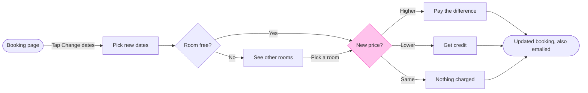

The file is empty, so nothing is on it to move and no section shares the title. The board will be the first thing on the page.

**Sketch**



```text
  diagram 1, user flow: ok, 9 nodes and 11 connectors, widest rank 3 steps, longest path 7 steps, 1.2 connectors per step, labels average 15 characters, 0 crossing pairs
Glance: New price? (accent) > Booking page > Pick new dates > Room free? > See other rooms > Pay the difference > Get credit > Nothing charged > Updated booking, also emailed (goal)
Row: the line from See other rooms to New price? bends off its row, so name the break at the gate and offer a model that keeps the row straight
PASSED 1 diagram(s) in model.md
```

The composer also passed it: 9 nodes and 11 connectors to read back, drawn in the default FigJam design.

**One change from the playback.** The end node can't carry a body, so the email moved into its label, "Updated booking, also emailed". Everything else is as agreed.

**Glance lines**
* First: the New price? decision, in the accent
* Second: the row from Booking page through Pick new dates, Room free? and See other rooms, then the three outcomes (Pay the difference, Get credit, Nothing charged) to the goal
* Last: the key and the source line

**Four critique questions**
* Where the eye goes first: New price?, which is the node the board most needs read, because the three money outcomes branch from it
* What it reads second: the steps before it, then the three outcomes. That advances the first glance by showing what leads to the decision and what each exit costs or returns
* What a reader could miss: the line from See other rooms to New price?, labelled "Pick a room", bends off the main row. A reader could miss that picking another room leads to the price check, which is the assumed reading
* Next cut under the remove test: Nothing charged. It stays because the same-price case is one of the three outcomes you named

**Left out:** cancellation or refund, a failed card charge, hotel-side steps and screen layouts, as you agreed. The bend above is named rather than fixed, because straightening it would mean dropping the "Pick a room" step you accepted.

**What will be written**
* Target: file <test-file-key>, as one new section titled "Change booking dates". I can't confirm from the key that the file sits in the Roamstay Product plan, so I'm taking that from you
* Planned extensions: none
* Calls: one `use_figma` call to compose the board, then one `get_figjam` read-back. That makes two more calls, after the session and the read of the file already spent. On a Starter plan or a View or Collab seat, Figma allows six tool calls a month, and reads count against it
* Rollback: delete the one section the write returns, through `use_figma`, and only on a yes that names it. Nothing else on the file changes, and it held nothing

Do you want me to write this board to file <test-file-key>?