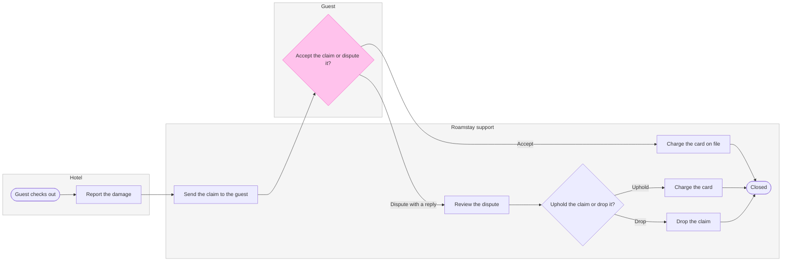

# FJ-049 turn 3 transcript

**User:** Yes, that reading is right.

**Tool call:** `Read` `{"file_path": "/private/var/folders/3c/zfqcqsts0kn19cgblj82gqhm0000gn/T/devin-compare-bench/FJ-049/sk-create-figjam/references/types/process.md"}`

**Tool result:** `Read`

```text
"1\t---\n2\ttitle: \"FigJam Type - Process\"\n3\tdescription: \"A business process or decision flow drawn as a FigJam flowchart, with optional actor lanes, a status lane, detail cards, stores and data in or out, held to sk-design-diagram's process budget.\"\n4\tcontextType: implementation\n5\timportance_tier: important\n6\ttrigger_phrases:\n7\t  - \"figjam process flow\"\n8\t  - \"decision flowchart figjam\"\n9\t  - \"figjam swimlane\"\n10\t  - \"process lanes\"\n11\t  - \"approval flow figjam\"\n12\tversion: 1.0.7.0\n13\t---\n14\t\n15\t# FigJam Type - Process\n16\t\n17\tA process is work that moves through steps, decisions and often several people or teams: a refund, an approval, a release, an onboarding checklist, a decision tree. It is a flowchart marked `%% type: process`, so the check holds it to process rules rather than user-flow rules.\n18\t\n19\t**Loading Condition:** CONDITIONAL, when the Flow route draws a process or decision flowchart\n20\t**Purpose:** The grammar, rules, budget and read-back for a process\n21\t**Pairs With:** `assets/templates/process.md`\n22\t\n23\t---\n24\t\n25\t## 1. WHEN TO USE\n26\t\n27\t**The reader's question:** who does what, in which order, and where does the work change hands?\n28\t\n29\t- A process across teams or roles, drawn with one lane per actor\n30\t- A decision tree or a pipeline with no actors, drawn without lanes\n31\t- A process that reads from or writes to a store, or takes data in and hands data out\n32\t\n33\tUse a user fl
```

**Tool call:** `Read` `{"file_path": "/private/var/folders/3c/zfqcqsts0kn19cgblj82gqhm0000gn/T/devin-compare-bench/FJ-049/sk-create-figjam/references/quality-rubric.md"}`

**Tool result:** `Read`

```text
"1\t---\n2\ttitle: \"FigJam Diagram Quality Rubric\"\n3\tdescription: \"The taste gate a FigJam model passes before the write gate, translated from sk-design-diagram's success criteria: type fit, the remove test, signal, the check, the board, the design rubric that scores a composed board and the reply.\"\n4\tcontextType: implementation\n5\timportance_tier: important\n6\ttrigger_phrases:\n7\t  - \"figjam quality rubric\"\n8\t  - \"diagram taste gate\"\n9\t  - \"remove test\"\n10\t  - \"figjam review checklist\"\n11\t  - \"figjam design rubric\"\n12\tversion: 1.0.13.0\n13\t---\n14\t\n15\t# FigJam Diagram Quality Rubric\n16\t\n17\tThe script checks what a script can see. This rubric is the rest: whether the diagram should exist, whether every node earns its place and whether the reader can trust what lands on the board. Walk it after the check passes and before the write gate.\n18\t\n19\t**Loading Condition:** CONDITIONAL, on every Flow route before the write gate\n20\t**Purpose:** The judgement pass between the pre-write check and the gate\n21\t**Scope:** The model, the provenance table, the planned extensions and, after the write, the board and the reply\n22\t\n23\t---\n24\t\n25\t## 1. TYPE FIT\n26\t\n27\t- [ ] The type answers the reader's question, as `references/flow-mode.md` Section 3 maps it\n28\t- [ ] A table, a list or a paragraph would not do the same job. If it would, say so and offer that instead\n29\t- [ ] The type's reference in `references/types/` was loaded and 
```

**Tool call:** `ToolSearch` `{"query": "select:mcp__figma-remote__get_figjam,mcp__figma-remote__create_session,mcp__figma-remote__use_figma,mcp__figma-remote__get_screenshot", "max_results": 4}`

**Tool result:** `ToolSearch`

```text
[{"type": "tool_reference", "tool_name": "mcp__figma-remote__get_figjam"}, {"type": "tool_reference", "tool_name": "mcp__figma-remote__create_session"}, {"type": "tool_reference", "tool_name": "mcp__figma-remote__use_figma"}, {"type": "tool_reference", "tool_name": "mcp__figma-remote__get_screenshot"}]
```

**Tool call:** `Read` `{"file_path": "/private/var/folders/3c/zfqcqsts0kn19cgblj82gqhm0000gn/T/devin-compare-bench/FJ-049/sk-create-figjam/assets/templates/process.md"}`

**Tool result:** `Read`

```text
"1\t---\n2\ttitle: \"FigJam Process Templates\"\n3\tdescription: \"Process patterns that pass the pre-write check: a decision tree, a laned process with its handoff step in focus, a laned process with a status lane and detail cards, and a pipeline with a store and data in and out.\"\n4\tcontextType: general\n5\timportance_tier: important\n6\ttrigger_phrases:\n7\t  - \"process templates\"\n8\t  - \"laned process pattern\"\n9\t  - \"decision tree pattern\"\n10\tversion: 1.0.4.0\n11\t---\n12\t\n13\t# FigJam Process Templates\n14\t\n15\tCopy/apply patterns for a process model. Each pattern passes `scripts/flow_check.py`, and `references/types/process.md` holds the rules.\n16\t\n17\t**Loading Condition:** CONDITIONAL, with `references/types/process.md`\n18\t**Purpose:** Starting points for a process or decision flowchart\n19\t**Scope:** Four patterns. The provenance table and the reply shape are in `assets/flow-templates.md`\n20\t\n21\t---\n22\t\n23\t## 1. USAGE\n24\t\n25\t- Keep the `%% type: process` line first, or the check reads the block as a user flow\n26\t- Name a lane after the actor, `subgraph agent [\"CS agent\"]`, and keep its id short and camelCase\n27\t- A lane takes the neutral pair or no style, and the one accent goes on the focal step, such as the step that hands work to the next lane. The composer draws that step in focus. A `linkStyle` passes the check and changes nothing on a composed board\n28\t- `-.->` marks a step that is optional or proposed. A log write tha
```

**Tool call:** `mcp__figma-remote__create_session` `{"fileKey": "<test-file-key>", "description": "Read the FigJam file, then add a Roamstay damage claim process board as a new section after approval"}`

**Tool call:** `Bash` `{"command": "mktemp -d", "description": "Create scratch folder for model"}`

**Tool result:** `mcp__figma-remote__create_session`

```text
"{\"sessionId\":\"1f2e2762-45c3-4604-a9b9-863c965517bd\"}"
```

**Tool result:** `Bash`

```text
"/var/folders/3c/zfqcqsts0kn19cgblj82gqhm0000gn/T/tmp.IZDFBEXLkL"
```

**Tool call:** `Write` `{"file_path": "/var/folders/3c/zfqcqsts0kn19cgblj82gqhm0000gn/T/tmp.IZDFBEXLkL/model.md", "content": "```mermaid\n%% type: process\nflowchart LR\n    %% title: Roamstay damage claim\n    %% subtitle: From the hotel's report to a closed claim, for support\n    %% source: Source: the Roamstay claims policy. Left out: the waiver under 25 euros, not yet live, and a guest who does not reply in 7 days, which the policy does not state.\n    %% goal: closed\n    %% level: faithful\n    %% detail: report | Status: Reported | After check-out | Sends photos and a repair quote | Quote must be from a liste`

**Tool result:** `Write`

```text
"File created successfully at: /var/folders/3c/zfqcqsts0kn19cgblj82gqhm0000gn/T/tmp.IZDFBEXLkL/model.md (file state is current in your context \u2014 no need to Read it back)"
```

**Tool call:** `mcp__figma-remote__get_figjam` `{"fileKey": "<test-file-key>", "nodeId": "0:1", "sessionId": "1f2e2762-45c3-4604-a9b9-863c965517bd", "includeImagesOfNodes": false}`

**Tool result:** `mcp__figma-remote__get_figjam`

```text
[{"type": "text", "text": "<canvas id=\"0:1\" name=\"Page 1\" x=\"0\" y=\"0\" width=\"0\" height=\"0\" />"}]
```

**Assistant:**

The file is empty, so no board shares the title. Now the check.

**Tool call:** `Bash` `{"command": "cd /private/var/folders/3c/zfqcqsts0kn19cgblj82gqhm0000gn/T/devin-compare-bench/FJ-049/sk-create-figjam && python3 scripts/flow_check.py /var/folders/3c/zfqcqsts0kn19cgblj82gqhm0000gn/T/tmp.IZDFBEXLkL/model.md 2>&1 | head -60", "description": "Run the pre-write check on the model"}`

**Tool result:** `Bash`

```text
"  diagram 1, process: node report has no way in: only a stadium starts a flow\nFAILED 1 of 1 diagram(s) in model.md"
```

**Tool call:** `Bash` `{"command": "cd /var/folders/3c/zfqcqsts0kn19cgblj82gqhm0000gn/T/tmp.IZDFBEXLkL && python3 - <<'E'\np='model.md';s=open(p).read()\ns=s.replace(\" | After check-out | Sends photos\",\" | Sends photos\")\ns=s.replace(\"        report[Report the damage]\\n\",\"        start([Guest checks out])\\n        report[Report the damage]\\n\")\ns=s.replace(\"    report --> send\\n\",\"    start --> report\\n    report --> send\\n\")\nopen(p,'w').write(s)\nE\ncd /private/var/folders/3c/zfqcqsts0kn19cgblj82gqhm0000gn/T/devin-compare-bench/FJ-049/sk-create-figjam && python3 scripts/flow_check.py /var/folders`

**Tool result:** `Bash`

```text
"  diagram 1, process: ok, 10 nodes and 11 connectors, widest rank 2 steps, longest path 8 steps, 1.1 connectors per step, labels average 17 characters, 0 crossing pairs\nLabel: Uphold or drop? leaves 'drop?' alone on its last line, so shorten it, or reword it in the source's words, when that keeps the meaning\nLabel: Accept or dispute? leaves 'dispute?' alone on its last line, so shorten it, or reword it in the source's words, when that keeps the meaning\nGlance: Accept or dispute? (accent) > Guest checks out > Report the damage > Send the claim to the guest > Review the dispute > Charge the card on file > Uphold or drop? > Drop the claim > Charge the card > Closed (goal)\nPASSED 1 diagram(s) in model.md"
```

**Tool call:** `Bash` `{"command": "cd /var/folders/3c/zfqcqsts0kn19cgblj82gqhm0000gn/T/tmp.IZDFBEXLkL && sed -e 's/Uphold or drop?/Uphold the claim or drop it?/' -e 's/Accept or dispute?/Accept the claim or dispute it?/' model.md > m2.md && cd /private/var/folders/3c/zfqcqsts0kn19cgblj82gqhm0000gn/T/devin-compare-bench/FJ-049/sk-create-figjam && python3 scripts/flow_check.py /var/folders/3c/zfqcqsts0kn19cgblj82gqhm0000gn/T/tmp.IZDFBEXLkL/m2.md 2>&1 | head", "description": "Test longer decision wording against the check"}`

**Tool result:** `Bash`

```text
"  diagram 1, process: ok, 10 nodes and 11 connectors, widest rank 2 steps, longest path 8 steps, 1.1 connectors per step, labels average 20 characters, 0 crossing pairs\nGlance: Accept the claim or dispute it? (accent) > Guest checks out > Report the damage > Send the claim to the guest > Review the dispute > Charge the card on file > Uphold the claim or drop it? > Drop the claim > Charge the card > Closed (goal)\nPASSED 1 diagram(s) in m2.md"
```

**Tool call:** `Bash` `{"command": "T=/var/folders/3c/zfqcqsts0kn19cgblj82gqhm0000gn/T/tmp.IZDFBEXLkL && mv $T/m2.md $T/model.md && python3 scripts/compose_board.py $T/model.md --diagram 1 --out $T/board1.js 2>&1 | head; python3 scripts/flow_check.py $T/model.md | tail -1; wc -c $T/board1.js", "description": "Compose the board code to scratch and recheck"}`

**Tool result:** `Bash`

```text
"COMPOSED diagram 1, 10 nodes and 11 connectors, widest rank 2 steps, longest path 8 steps, 1.1 connectors per step, labels average 20 characters, 0 crossing pairs: 10 nodes and 11 connectors to read back, 45103 characters in /var/folders/3c/zfqcqsts0kn19cgblj82gqhm0000gn/T/tmp.IZDFBEXLkL/board1.js, drawn in the design FigJam default\nPASSED 1 diagram(s) in model.md\n   45103 /var/folders/3c/zfqcqsts0kn19cgblj82gqhm0000gn/T/tmp.IZDFBEXLkL/board1.js"
```

**Assistant:**

**The sketch, as the check read it**



`PASSED 1 diagram(s) in model.md`, read as a process with 10 nodes, 11 connectors, 0 crossing pairs. The code composes at 45,103 characters, inside the one call it takes.

**Two changes from the playback**
* I added a start node, "Guest checks out", in the hotel lane. The check requires a stadium start, and the policy says the hotel reports "after check-out". The count is now 10 nodes and 11 connectors
* The two decisions now read "Accept the claim or dispute it?" and "Uphold the claim or drop it?". The shorter wording left one word alone on a line

**Glance lines**
* First: "Accept the claim or dispute it?", in the Guest lane, pink and keyed "In focus: the guest decides here"
* Second: the path to the close, from "Guest checks out" through the support steps to "Closed", which holds the statuses
* Last: the key and the source line

**The four critique questions**
* Where the eye goes first: the pink decision, which is the node the board most needs read, since it is the one place the guest chooses
* What it reads second: the lane cards, which show what each side does and what status the claim holds. They advance the first glance because they show what each choice leads to
* What a reader could miss: the 7-day limit sits in the Guest lane note, so a reader who skips the note loses the deadline. The cost is a support agent not knowing when a silent claim is overdue. The policy gives no outcome for that, which is why it sits under `Left out:`
* What the remove test would cut next: "Drop the claim". It stays because it is one of the two decided-dispute exits and its card says the claim still ends Closed

**What the write does**
* File: `<test-file-key>`, the existing FigJam file you named in the Roamstay Product plan. The read I took found it empty, so no board there shares this title, and nothing on it can change
* Written: one board section titled "Roamstay damage claim", with the lanes, 10 nodes, 11 connectors, a key and the source line
* Extensions: none
* Calls: one `use_figma` call to compose and one `get_figjam` call to read back. This file held nothing before the write, so no comparison read is needed. If the file sits on a Starter plan, the six calls a month apply, and I have used two so far
* Rollback: delete that one board section through `use_figma`, and only on a reply from you that names it

Left out: the waiver for claims under 25 euros (a rule not yet live), and a guest who does not reply within 7 days (the policy states no outcome)

Do I write the board into this file?
