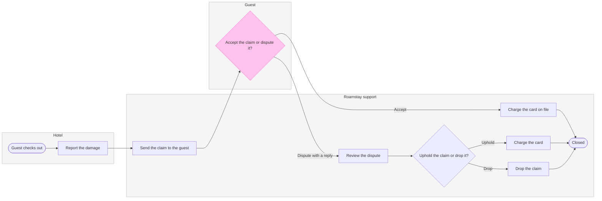

**The sketch, as the check read it**

`PASSED 1 diagram(s) in model.md`, read as a process with 10 nodes, 11 connectors, 0 crossing pairs. The code composes at 45,103 characters, inside the one call it takes.

**Two changes from the playback**
* I added a start node, "Guest checks out", in the hotel lane. The check requires a stadium start, and the policy says the hotel reports "after check-out". The count is now 10 nodes and 11 connectors
* The two decisions now read "Accept the claim or dispute it?" and "Uphold the claim or drop it?". The shorter wording left one word alone on a line

**Glance lines**
* First: "Accept the claim or dispute it?", in the Guest lane, pink and keyed "In focus: the guest decides here"
* Second: the path to the close, from "Guest checks out" through the support steps to "Closed", which holds the statuses
* Last: the key and the source line

**The four critique questions**
* Where the eye goes first: the pink decision, which is the node the board most needs read, since it is the one place the guest chooses
* What it reads second: the lane cards, which show what each side does and what status the claim holds. They advance the first glance because they show what each choice leads to
* What a reader could miss: the 7-day limit sits in the Guest lane note, so a reader who skips the note loses the deadline. The cost is a support agent not knowing when a silent claim is overdue. The policy gives no outcome for that, which is why it sits under `Left out:`
* What the remove test would cut next: "Drop the claim". It stays because it is one of the two decided-dispute exits and its card says the claim still ends Closed

**What the write does**
* File: `<test-file-key>`, the existing FigJam file you named in the Roamstay Product plan. The read I took found it empty, so no board there shares this title, and nothing on it can change
* Written: one board section titled "Roamstay damage claim", with the lanes, 10 nodes, 11 connectors, a key and the source line
* Extensions: none
* Calls: one `use_figma` call to compose and one `get_figjam` call to read back. This file held nothing before the write, so no comparison read is needed. If the file sits on a Starter plan, the six calls a month apply, and I have used two so far
* Rollback: delete that one board section through `use_figma`, and only on a reply from you that names it

Left out: the waiver for claims under 25 euros (a rule not yet live), and a guest who does not reply within 7 days (the policy states no outcome)

Do I write the board into this file?