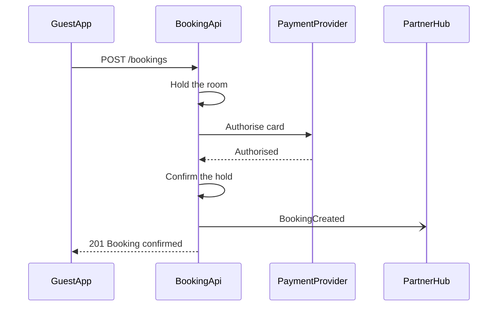
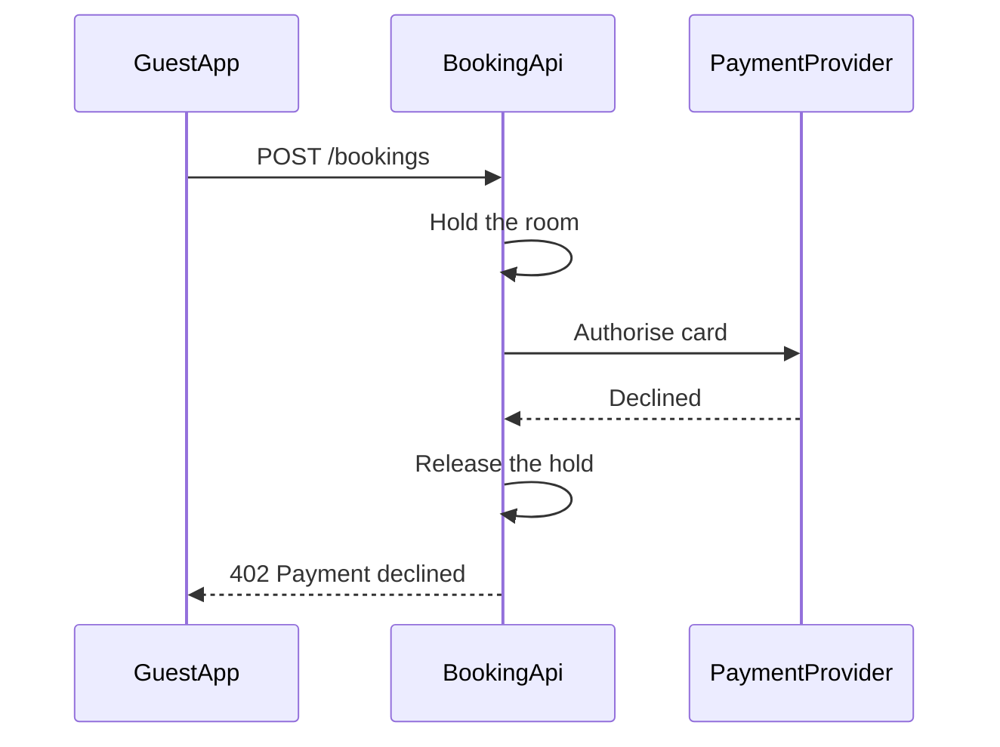

# FJ-025 turn 2 transcript

**User:** Yes, that reading is right.

**Assistant:**

The gate for the write, with the checked model:

Both diagrams pass `flow_check.py`. The gate:

**Question:** in what order do the guest app, the booking API, the payment provider and the partner hub exchange messages for a Roamstay checkout payment?

**Outcome:** the payments team can trace the checkout calls in order, with their status codes, for an authorised card and for a declined one.

**Board 1 glances:** first glance Authorise card, the call that decides the checkout. Second glance Authorised, the answer that lets the booking API confirm the hold and answer the app. Last glance BookingCreated, the partner hub notify that does not hold up the 201.

**Board 2 glances:** first glance Declined, the answer that turns the path into a release and a 402. Second glance Release the hold, the cleanup the decline triggers. Last glance 402 Payment declined, what the app gets back.

**Plan:** Roamstay Product (as named in the request). **File:** the existing FigJam file <test-file-key>. The two boards land to the right of everything already on the page.

**Writes:** two composed boards. Board 1 "1. Checkout payment, authorised card" with 4 participants and 7 numbered messages, board 2 "2. Checkout payment, declined card" with 3 participants and 6 numbered messages, each with a title, a subtitle, a key and a source line, at the Laptop reading distance.

**Extensions:** none.

**Calls:** two `use_figma` writes, then `get_figjam` read-backs. After the write I will ask separately whether to remove the earlier exact-titled pair (73:562, 74:954).

**Rollback:** delete the two new board sections, nothing else on the file is touched.

Write it?
