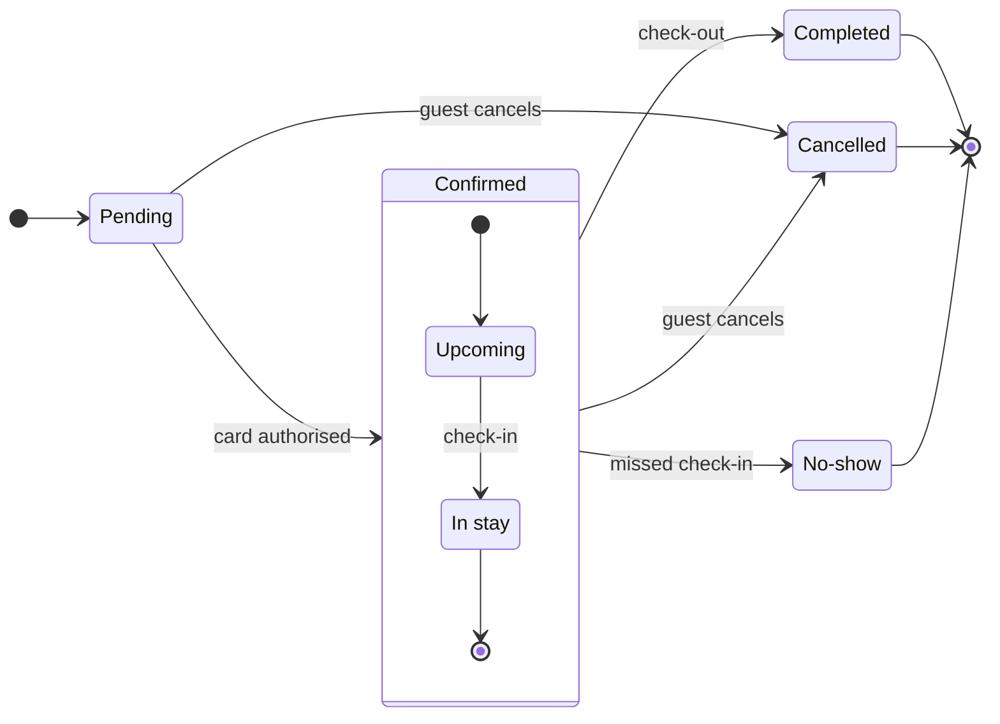

The gate:

Question: which statuses exist and what moves a booking between them?
Outcome: support can read every booking status and spot the statuses a booking ends in.
First glance: the end states Completed, Cancelled and No-show, drawn in light gray.
Second glance: the events that lead into them, check-out, guest cancels and missed check-in.
Last glance: Pending, where every booking starts.

Sketch, checked and passing:

Plan: Roamstay Product, as named in the request. File: the existing FigJam file `<test-file-key>`, no new file.
Writes: one composed board titled "Booking status", 7 states and 12 transitions, the three end states in light gray, with a title, subtitle, key and source line, at the Laptop reading distance, placed to the right of the boards already on the page.
Extensions: none.
Calls: one use_figma and one get_figjam read-back. The session is already open and no new file is created, so whoami and create_new_file are not spent.
Rollback: delete the one board section the write returns, and only after its own yes.
After the write I will ask whether to remove the two earlier "Booking status" boards, which is a separate question and a separate yes.

Write it?