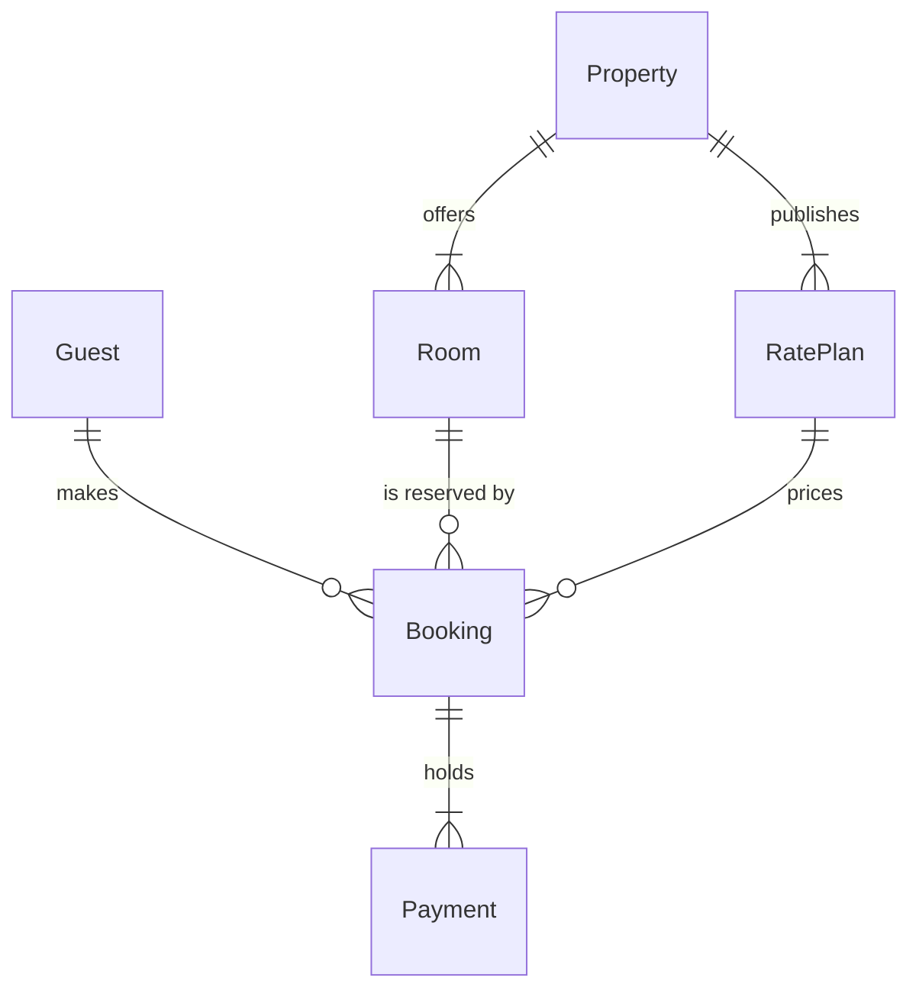

# FJ-027 turn 2 transcript

**User:** Yes, that reading is right.

**Assistant:**

Reading confirmed. Now I'll build the model, run the pre-write check, and compose the board code.

**Tool call:** `exec` `{"command": "mkdir -p /tmp/fj027-flow && cat > /tmp/fj027-flow/model.md <<'EOF'\n```mermaid\nerDiagram\n    %% title: Stays model\n    %% subtitle: The tables behind a stay, split into the guest side and the partner side\n    %% source: Sources: the stays schema note and Guest Support ticket 58213. Left out: the note's other columns.\n    %% zone: Guest side: Guest, Booking, Payment\n    %% zone: Partner side: Property, Room, RatePlan\n    %% focus: Booking\n    Guest ||--o{ Booking : makes\n    Booking ||--|{ Payment : holds\n    Room ||--o{ Booking : \"is reserved by\"\n    RatePlan ||--o{ B`

**Tool result:** `exec`

```text
Output from command in shell 7e5a4e:
  diagram 1, ER: ok, 6 entities and 6 relationships
PASSED 1 diagram(s) in model.md


Exit code: 0
```

**Assistant:**

Check passed. Now composing the board code.

**Tool call:** `exec` `{"command": "python3 /private/var/folders/3c/zfqcqsts0kn19cgblj82gqhm0000gn/T/devin-compare-bench/FJ-027/sk-create-figjam/scripts/compose_board.py /tmp/fj027-flow/model.md --diagram 1 --out /tmp/fj027-flow/board-code.js"}`

**Tool result:** `exec`

```text
Output from command in shell 27bd9b:
COMPOSED diagram 1, 6 entities and 6 relationships: 6 nodes and 6 connectors to read back, 49042 characters in /tmp/fj027-flow/board-code.js, drawn in the design FigJam default


Exit code: 0
```

**Assistant:**

Model checked and composed cleanly: 6 entities, 6 relationships, 26 attributes, no design warnings. Here is the sketch the check passed:



plus the field lists: Guest (id, email UK, country), Booking (id, guestId, roomId, ratePlanId, reference UK, checkIn, checkOut, status), Payment (id, bookingId, amount, status), Property (id, name, city), Room (id, propertyId, name, capacity), RatePlan (id, propertyId, refundable, paymentOption).

Question: which entities exist in the stays model, which fields join them and how do they relate?
Outcome: a reader can see the six stay tables, how they join and which sit on the guest side and which on the partner side.
First glance: Booking, the table every other stay table joins.
Second glance: the keys on Booking that tie it to the guest, the room and the rate plan.
Last glance: Property, the partner table that offers rooms and publishes rate plans.
Plan: Roamstay Product. File: existing FigJam file `<test-file-key>`, which already holds three earlier Stays model boards; the new board lands beside them as its own section.
Writes: one composed board, 6 entities and 6 relationships in two zones, Guest side and Partner side, with a title, a key and a source line, the accent on Booking, at the Laptop reading distance.
Extensions: none.
Calls: one `use_figma` and one `get_figjam` read-back.
Rollback: delete the new board section, on your yes.

Write it?
