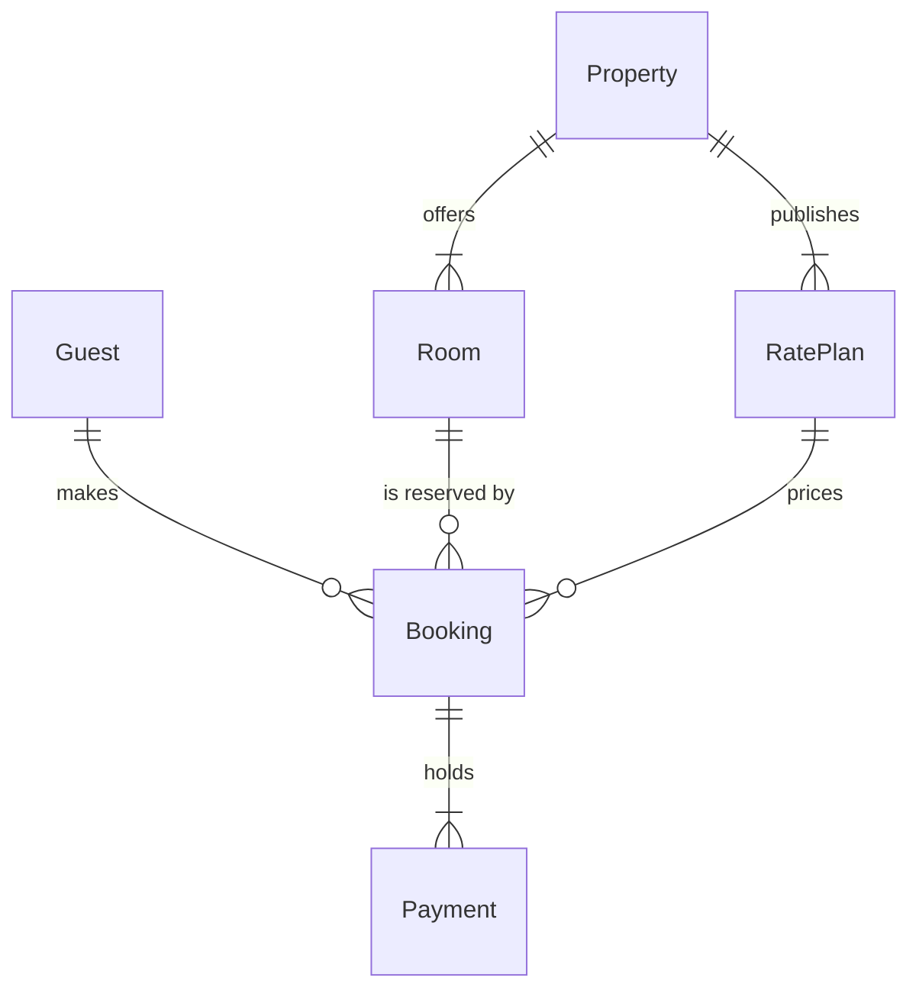

Model checked and composed cleanly: 6 entities, 6 relationships, 26 attributes, no design warnings. Here is the sketch the check passed:

plus the field lists: Guest (id, email UK, country), Booking (id, guestId, roomId, ratePlanId, reference UK, checkIn, checkOut, status), Payment (id, bookingId, amount, status), Property (id, name, city), Room (id, propertyId, name, capacity), RatePlan (id, propertyId, refundable, paymentOption).

Question: which entities exist in the stays model, which fields join them and how do they relate?
Outcome: a reader can see the six stay tables, how they join and which sit on the guest side and which on the partner side.
First glance: Booking, the table every other stay table joins.
Second glance: the keys on Booking that tie it to the guest, the room and the rate plan.
Last glance: Property, the partner table that offers rooms and publishes rate plans.
Plan: Roamstay Product. File: existing FigJam file `<test-file-key>`, which already holds three earlier Stays model boards; the new board lands beside them as its own section.
Writes: one composed board, 6 entities and 6 relationships in two zones, Guest side and Partner side, with a title, a key and a source line, the accent on Booking, at the Laptop reading distance.
Extensions: none.
Calls: one `use_figma` and one `get_figjam` read-back.
Rollback: delete the new board section, on your yes.

Write it?