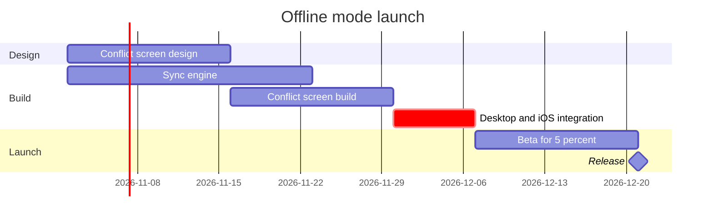

# FJ-028 turn 2 transcript

**User:** Yes, that reading is right.

**Assistant:**

Playback confirmed. Now I'll write the model to a temp file and run the pre-write check.

**Tool call:** `read` `{"file_path": "/private/var/folders/3c/zfqcqsts0kn19cgblj82gqhm0000gn/T/devin-compare-bench/FJ-028/sk-create-figjam/scripts/figjam_checks/gantt.py"}`

**Tool result:** `read`

```text
<file-view path="/private/var/folders/3c/zfqcqsts0kn19cgblj82gqhm0000gn/T/devin-compare-bench/FJ-028/sk-create-figjam/scripts/figjam_checks/gantt.py" start_line="1" end_line="183" total_lines="183">
  1|#!/usr/bin/env python3
  2|# ───────────────────────────────────────────────────────────────
  3|# COMPONENT: GANTT PROFILE
  4|# ───────────────────────────────────────────────────────────────
  5|
  6|"""A gantt chart, parsed here because the shared extractor refuses gantt.
  7|
  8|The generator draws sections as lanes, tasks as bars and milestones as points.
  9|It strips every colour and ignores the axis, weekend and marker settings, so a
 10|model holding one of those would promise what the board never shows. Colour
 11|and notes go on afterwards through the hybrid workflow.
 12|"""
 13|from __future__ import annotations
 14|
 15|import re
 16|from datetime import datetime, timedelta
 17|
 18|from .common import CAMEL_CASE_ID, content_lines, length_problems, raw_problems
 19|
 20|MAX_TASKS = 12
 21|MAX_PARALLEL = 5
 22|SECTIONS_FROM = 8
 23|FORMATS = {"YYYY-MM-DD": "%Y-%m-%d", "HH:mm": "%H:%M"}
 24|TAGS = {"done", "active", "crit", "milestone"}
 25|REFUSED_DIRECTIVES = {
 26|    "classdef", "class", "style", "click", "call", "tickinterval", "axisformat", "excludes", "includes",
 27|    "weekday", "weekend", "todaymarker", "displaymode", "inclusiveenddates", "topaxis",
 28|}
 29|DURATION = re.compile(r"^(\d+(?:\.\d+)?)(ms|[yMwdhms])$")
 30|# Units read in minutes. A month
```

**Tool call:** `grep` `{"pattern": "focus", "path": "/private/var/folders/3c/zfqcqsts0kn19cgblj82gqhm0000gn/T/devin-compare-bench/FJ-028/sk-create-figjam/scripts"}`

**Tool result:** `grep`

```text
Found 29 match(es) for pattern 'focus' in /private/var/folders/3c/zfqcqsts0kn19cgblj82gqhm0000gn/T/devin-compare-bench/FJ-028/sk-create-figjam/scripts:
-- 23 matches in /private/var/folders/3c/zfqcqsts0kn19cgblj82gqhm0000gn/T/devin-compare-bench/FJ-028/sk-create-figjam/scripts/compose_board.py
  27|- `%% focus: id` names the one thing the first glance lands on in a diagram
  94|DIRECTIVE = re.compile(r"^\s*%%\s*(title|subtitle|source|zone|focus)\s*:\s*(.+?)\s*$", re.I)
 151|FOCUS_LINE = re.compile(r"^\s*%%\s*focus\s*:", re.I | re.M)
 154|def focus_problems(model: dict, profile: str, target: str, lines: int) -> list[str]:
 155|    """Mark the one thing a `%% focus:` line names, or say why it names nothing."""
 157|        return ["%% focus on a user flow or a process: mark the first glance with a style line"]
 159|        return [f"{lines} %% focus lines, at most 1: the first glance is one thing"]
 171|        return [f"%% focus: {target or '(empty)'} names nothing: write {what}"]
 247|            kinds[node.id] = "focus"
 494|    if text.get("focus") or FOCUS_LINE.search(block.text):
 495|        found += focus_problems(model, profile, text.get("focus", ""), len(FOCUS_LINE.findall(block.text)))
 693|    """The node or task ids a model plans the accent on: a focus node, a flagged node or a flagged task."""
 696|    return {node["id"] for node in model["nodes"] if node.get("accent") or node["kind"] == "focus"}
 748|        if name == "focus":
1069|def focus_checks(work: Path, s
```

**Assistant:**

Writing the model to a temp file outside the repository, then running the pre-write check.

**Tool call:** `write` `{"file_path": "/tmp/loomlist-offline-gantt-model.md", "content": "```mermaid\ngantt\n    title Offline mode launch\n    %% subtitle: Which work runs when before the offline mode release, and what holds it\n    %% source: Source: the offline mode launch plan as stated. Left out: Android next quarter, a proposal not yet approved.\n    %% focus: integrate\n    dateFormat YYYY-MM-DD\n    section Design\n    Conflict screen design :design, 2026-11-02, 2w\n    section Build\n    Sync engine :engine, 2026-11-02, 3w\n    Conflict screen build :screen, after design, 2w\n    Desktop and iOS integration `

**Tool result:** `write`

```text
File created successfully at: /tmp/loomlist-offline-gantt-model.md
```

**Tool call:** `exec` `{"command": "cd \"/private/var/folders/3c/zfqcqsts0kn19cgblj82gqhm0000gn/T/devin-compare-bench/FJ-028\" && python3 sk-create-figjam/scripts/flow_check.py /tmp/loomlist-offline-gantt-model.md"}`

**Tool result:** `exec`

```text
Output from command in shell d0c3d2:
  diagram 1, gantt: ok, 6 tasks in 3 sections
PASSED 1 diagram(s) in loomlist-offline-gantt-model.md


Exit code: 0
```

**Assistant:**

Check passed. Running the composer to confirm the model composes (this writes only a code file outside the repo — no board write yet).

**Tool call:** `exec` `{"command": "cd \"/private/var/folders/3c/zfqcqsts0kn19cgblj82gqhm0000gn/T/devin-compare-bench/FJ-028\" && python3 sk-create-figjam/scripts/compose_board.py /tmp/loomlist-offline-gantt-model.md --diagram 1 --out /tmp/loomlist-offline-gantt-code.js"}`

**Tool result:** `exec`

```text
Output from command in shell 41b591:
COMPOSED diagram 1, 6 tasks in 3 sections: 6 nodes and 0 connectors to read back, 47468 characters in /tmp/loomlist-offline-gantt-code.js, drawn in the design FigJam default


Exit code: 0
```

**Assistant:**

Model checked and composed cleanly. The gate now — its own reply, asking about the write alone.

**Question the board answers:** which work runs when for the offline mode launch, and what holds the release?
**Outcome:** a reader can see the order of the work, the critical path and where the release lands

The sketch, checked and passed:



Glance lines:

*   First glance: Desktop and iOS integration — the `crit` bar carrying the focus mark, the task that holds the release
*   Second glance: Sync engine and Conflict screen build, the two tracks integration waits for
*   Last glance: Beta for 5 percent and the Release milestone at the end

**Plan:** Loomlist Product (as you named it — the file's own plan governs). **File:** the existing FigJam file `<test-file-key>`, no new file created
**Writes:** one composed board — 3 sections, 5 tasks and 1 milestone on one axis, with the title, a key and a source line that names the Android exclusion, at Laptop reading distance. The board lands beside existing content, to its right
**Extensions:** none
**Calls:** `create_session` on the file key, one `use_figma`, one `get_figjam` read-back
**Rollback:** delete the one board section the write returns, through `use_figma`, only after its own yes

Write it?
