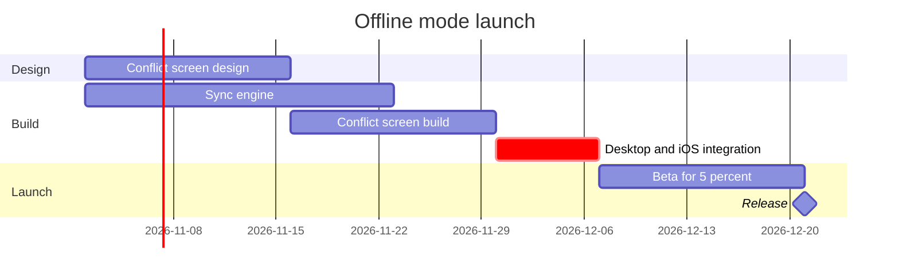

Model checked and composed cleanly. The gate now — its own reply, asking about the write alone.

**Question the board answers:** which work runs when for the offline mode launch, and what holds the release?
**Outcome:** a reader can see the order of the work, the critical path and where the release lands

The sketch, checked and passed:

Glance lines:

*   First glance: Desktop and iOS integration — the `crit` bar carrying the focus mark, the task that holds the release
*   Second glance: Sync engine and Conflict screen build, the two tracks integration waits for
*   Last glance: Beta for 5 percent and the Release milestone at the end

**Plan:** Loomlist Product (as you named it — the file's own plan governs). **File:** the existing FigJam file `<test-file-key>`, no new file created
**Writes:** one composed board — 3 sections, 5 tasks and 1 milestone on one axis, with the title, a key and a source line that names the Android exclusion, at Laptop reading distance. The board lands beside existing content, to its right
**Extensions:** none
**Calls:** `create_session` on the file key, one `use_figma`, one `get_figjam` read-back
**Rollback:** delete the one board section the write returns, through `use_figma`, only after its own yes

Write it?