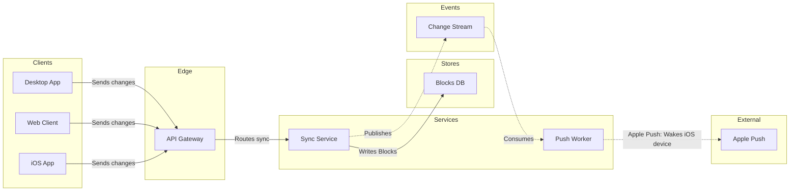

The model passed `flow_check.py`, and `compose_board.py` composed it. I deleted the temp files afterwards. Nothing has been written to Figma.



Check result:
```text
diagram 1, architecture: ok, 9 nodes and 8 connectors, widest rank 3 steps, longest path 6 steps, 0.9 connectors per step, labels average 10 characters, 0 crossing pairs
COMPOSED: 45401 characters, inside the 50,000 one call takes
```

Question: which parts take part in block sync, and how do they connect?

Outcome: the Sync team can see which parts a block change passes through, from a client to the other devices.

First glance: Sync Service, where every block change is written and published.

Second glance: the Change Stream, which carries each change on to the Push Worker.

Last glance: Apple Push, the outside hop that wakes sleeping iOS devices.

Plan: Loomlist Engineering, as you named it. I haven't confirmed that the file sits in that plan, and I won't create a file.

File: the existing FigJam file `<test-file-key>`.

Writes: one framed board in 6 lanes, with a title, a key and a source line, at the laptop reading distance. It lands 400 pixels to the right of what is already on the page, so existing content stays untouched.

Extensions: none.

Calls:
- `create_session` on the file
- One `use_figma` call
- One `get_figjam` read-back

I'll load Figma's `figma-use` and `figma-use-figjam` skills first. If the plan is a Starter plan or you hold a View or Collab seat, these calls count against the six a month.

Rollback: delete the one board section the write returns. I do that only after you say yes to the deletion separately.

Things that stay visible on the board:
- The eight calls are assumed, and the source line says so.
- Apple Push to the iOS device is not an edge, because the architecture rules allow no edge from an outside system back to a client. The label "Wakes iOS device" carries it.

Write it?