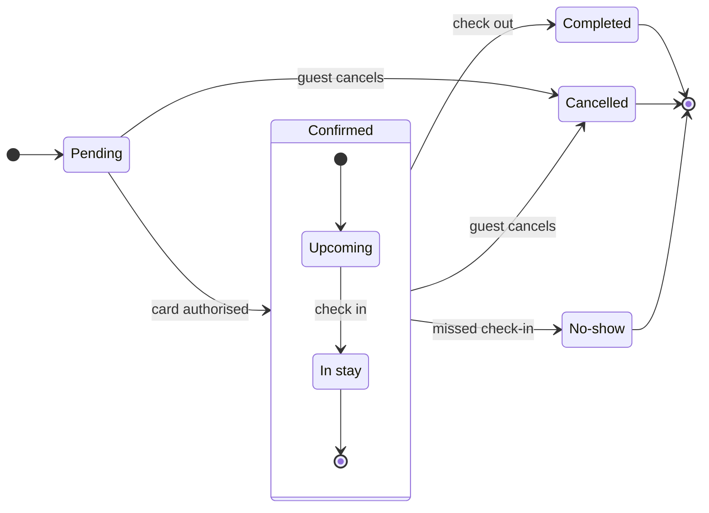

The model passed the pre-write check and composes cleanly. This is the gate, and nothing has been written to the board yet.



```text
Question: which statuses can a Roamstay booking have, and what moves it between them?
Outcome: the retro team can read every booking status and the event behind each move.
First glance: Pending, the light blue first state. The model names no focus node, so the layout decides.
Second glance: the six labelled events, card authorised, check in, check out, guest cancels twice and missed check-in.
Last glance: the end states Completed, Cancelled and No-show, drawn in light gray.
Plan and file: board <test-file-key>. You did not name its plan, so I am not stating one.
Writes: one new section called "Booking status", 7 states and 12 transitions, with a title, a key and a source line, at the Laptop reading distance. It lands 400 pixels to the right of everything on the page and touches no existing section. This is a third copy of the lifecycle, and the earlier two stay.
Extensions: none.
Calls: one use_figma and one get_figjam read-back. On a Starter plan or a View or Collab seat, Figma allows six tool calls a month, and my earlier board read already counted against that.
Rollback: delete the one new section the write returns, and only after you say yes to that deletion.
Write it? A no leaves the board unchanged.
```