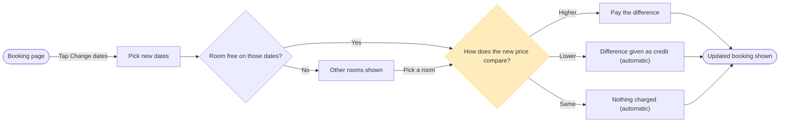

I've written the model to a temp folder outside the repo and the pre-write check passes. Nothing has been sent to Figma yet. This is the write gate.

The check printed `PASSED`: 9 nodes, 11 connectors, 0 crossing pairs, widest rank 3, longest path 7. The composer printed `COMPOSED` for the same counts. The check forced two changes to the model you approved:
* A board takes one accent, so the price comparison carries it. Updated booking is still green as the goal, but it has no outline.
* "Difference returned as credit (automatic)" ran to 41 characters, so it now reads "Difference given as credit (automatic)".

**Provenance re-read**
* The "Yes" exit from Room free is the only inferred edge. Your request states the No exit and then moves to price, so the Yes exit is medium confidence.
* "Pick a room" comes from your round 2 answer.
* Every node is assumed current behavior, as agreed in the playback.

**Critique of the sketch**
* The eye goes first to the pink-outlined price comparison, which is the node the question turns on.
* Cutting any node loses a step or an outcome you named.
* No connector restates what the layout already shows.
* The board reads in greyscale because decisions are diamonds and system steps say "automatic".

**Gate**
* Question: what does a guest see and pay when they change their dates?
* Outcome: the reader can check that every price outcome has a screen and spot any case the app doesn't cover.
* First glance: the price comparison, where the three outcomes split.
* Second glance: the Higher, Lower and Same exits that follow it.
* Last glance: the room detour through Other rooms shown.
* Plan: Roamstay Product, as you named it. For an existing file the plan only matters for a new file, so the write doesn't use it.
* File: `<test-file-key>`
* Writes: one composed board section with 9 nodes and 11 connectors in two zones, plus a title, subtitle, key and source line. It lands 400 pixels to the right of whatever is already on the page, at Laptop reading distance.
* Extensions: none
* Calls: `create_session`, one `use_figma` and one `get_figjam` read-back. That is three calls. On a Starter plan or a View or Collab seat, Figma allows six per month.
* Rollback: delete the one board section the write returns, through `use_figma`, and only after you say yes to that deletion.

Write this board into that file?