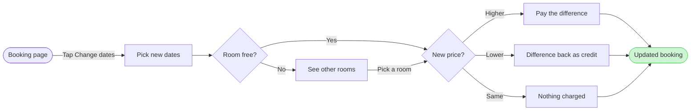

Nothing is written to the board. This is the third proposal, a sketch in chat. I also ran the pre-write check on it, and it passed: 9 nodes, 11 connectors, 0 crossing pairs, longest path 7 steps.

**How it should read on the board**

* The main line runs left to right: Booking page, Pick new dates, Room free?, New price?, then one outcome, then Updated booking
* `See other rooms` sits beside the main line and rejoins at `New price?`
* The three outcomes stack beside each other and all point to `Updated booking`, which is the green goal

**Is this sketch right?** I recommend yes, because it matches the outline and Framing 2 you approved. If it is, the next step is the look: which node the colour marks, the title, the subtitle and the source line. I'll propose each with a recommended answer. After that comes the gate, which is its own reply, and the write waits for your yes to it.