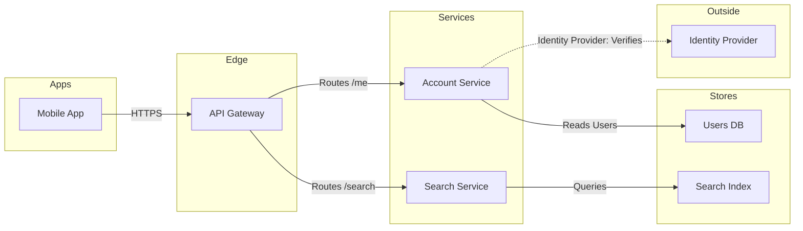
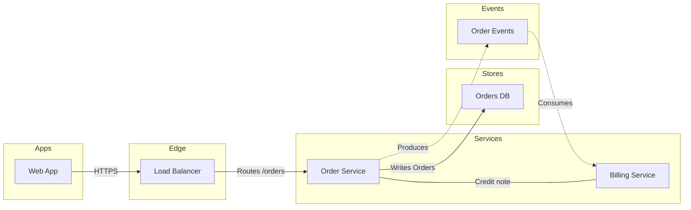

# Product Owner - Assets - Flow Templates - Architecture

Copy/apply patterns for an architecture model. Each pattern passes the rules, and Templates - Flow Type - Architecture holds the lanes and the allowed edges.

---

## 1. USAGE

- Keep the `%% type: architecture` line first, before any `%% title:` or other board line. On the generated fallback, pass `useArchitectureLayoutCode` as `"FIGMA_DIAGRAM_2026"` on the call
- Keep the six lane ids exactly and rename only the labels
- Drop a lane the system does not have. An empty lane is never filled with an invented part
- Label every edge from its source's side, and an external edge as `"Service: Purpose"`

---

## 2. PATTERNS

### Request path

The layout draws `users` and `index` as stores because they sit in the `datastore` lane, so neither needs a cylinder.

### Event-driven path with a backward edge

