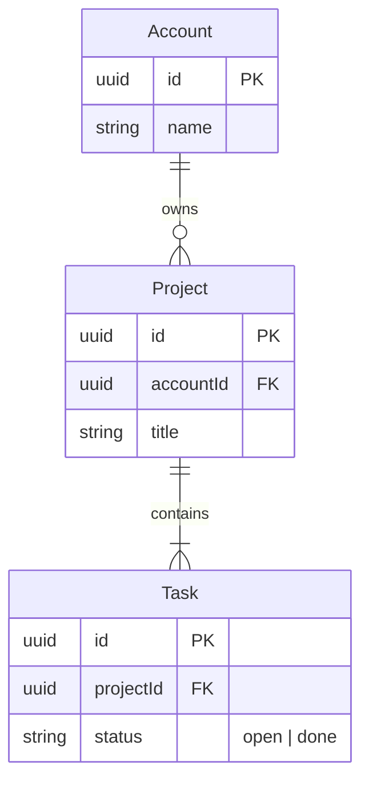
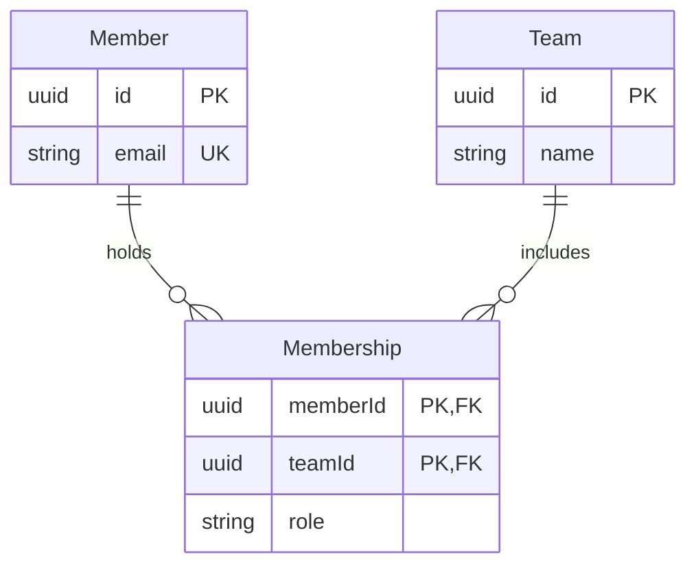
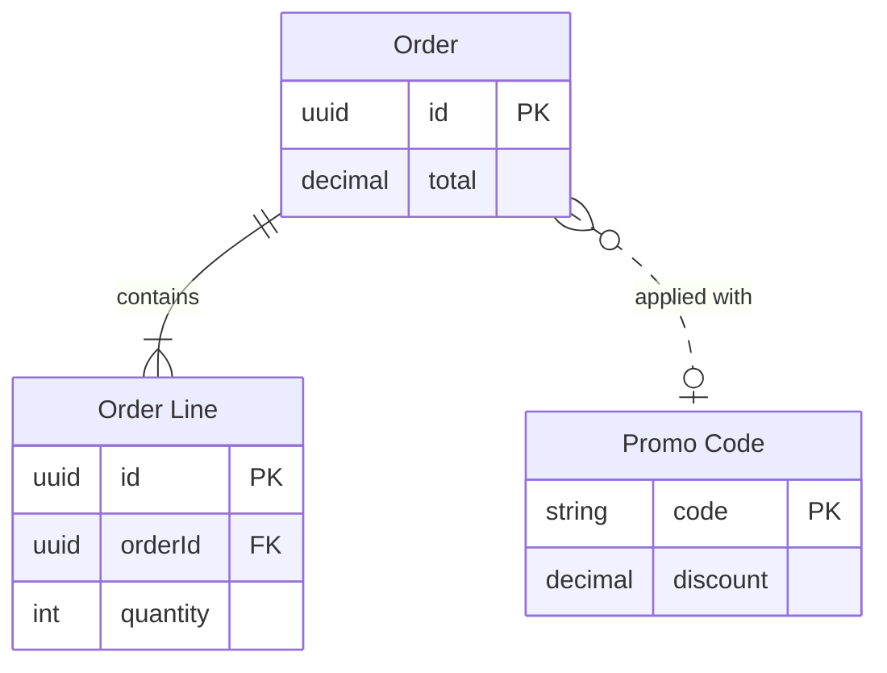

# Product Owner - Assets - Flow Templates - ER

Copy/apply patterns for an ER model. Each pattern passes the rules, and Templates - Flow Type - ER holds the rules.

---

## 1. USAGE

- Get the relationships and their cardinality right first, then add the 5 to 10 columns a reader needs
- Mark every `PK` and `FK`
- An alias goes on the entity block only, and relationships use the plain id

---

## 2. PATTERNS

### One-to-many core

### Many-to-many through a junction

### Aliased entity and a loose link

