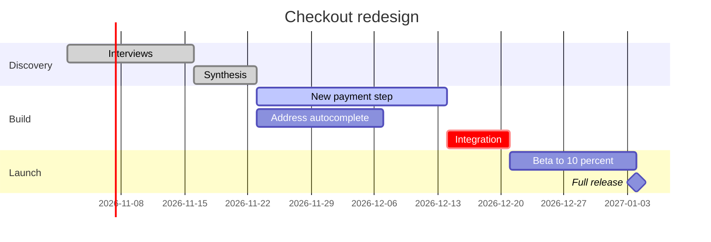

# Product Owner - Assets - Flow Templates - Gantt

Copy/apply patterns for a gantt model. Each pattern passes the rules, and Templates - Flow Type - Gantt holds the rules.

---

## 1. USAGE

- Anchor the first task on a date and chain the rest with `after`
- Months are `M`. A lowercase `m` is minutes
- `crit` only on the real critical path and `active` only on what runs now
- No colour and no axis settings, which the generator strips

---

## 2. PATTERNS

### Phased plan with dependencies and a milestone

### One-day run of show

```mermaid
gantt
    title Launch day
    dateFormat HH:mm
    section Morning
    Team check-in :checkin, 09:00, 30m
    Final checks :checks, after checkin, 90m
    section Afternoon
    Release :milestone, 13:00, 0m
    Watch the dashboards :watch, 13:00, 3h
```

