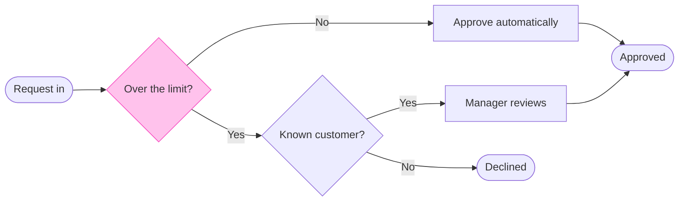
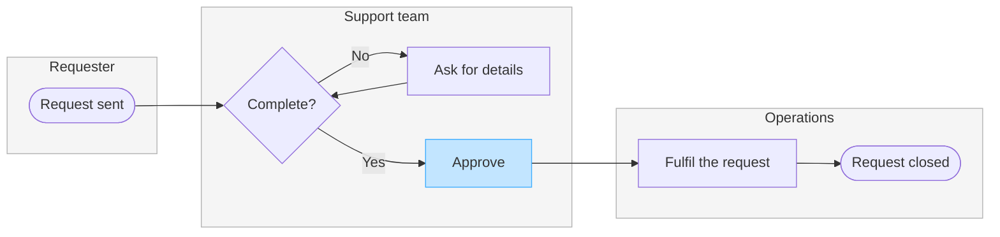
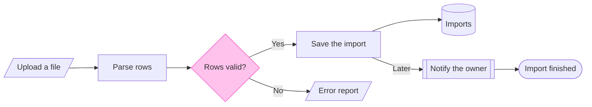

# Product Owner - Assets - Flow Templates - Process

Copy/apply patterns for a process model. Each pattern passes the rules, and Templates - Flow Type - Process holds the rules.

---

## 1. USAGE

- Keep the `%% type: process` line first, or the block reads as a user flow
- Name a lane after the actor, `subgraph agent ["CS agent"]`, and keep its id short and camelCase
- A lane takes the neutral pair or no style, and the one accent goes on the focal step, such as the step that hands work to the next lane. The composer draws that step in focus. A `linkStyle` changes nothing on a composed board
- `-.->` marks a step that is optional or proposed. A log write that runs today is drawn solid
- The patterns all run left to right, because every process in one file reads as one flow that runs one way

---

## 2. PATTERNS

### Decision tree

### Laned process with a handoff in focus

The step that hands work to operations is in focus, because that handoff adds the most delay.

### Pipeline with a store and data in and out

