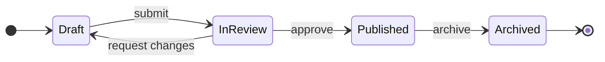
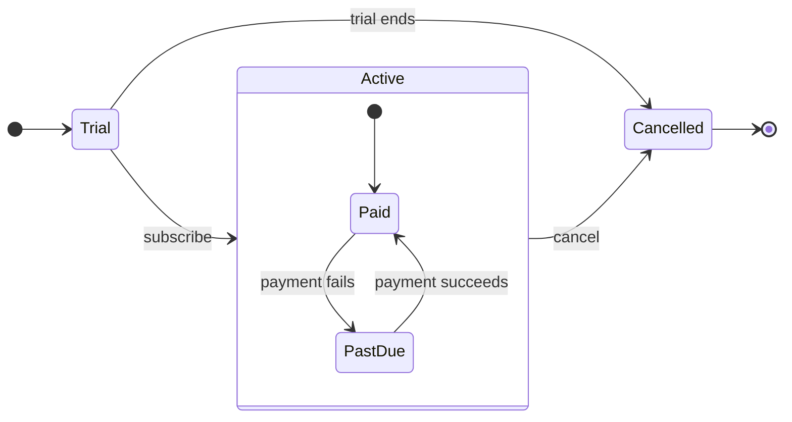
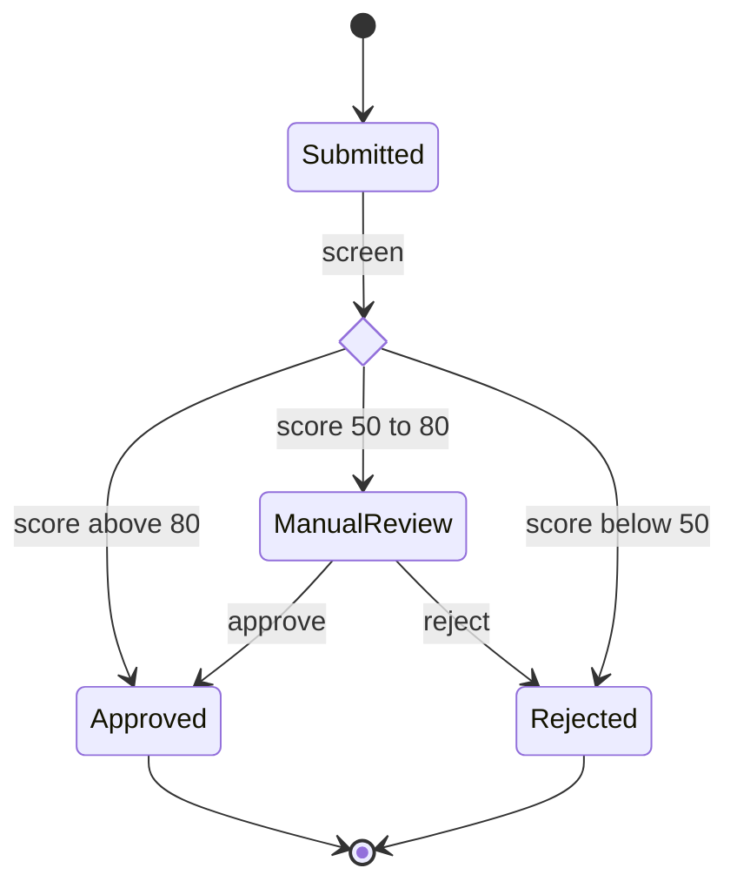

# Product Owner - Assets - Flow Templates - State

Copy/apply patterns for a state model. Each pattern passes the rules, and Templates - Flow Type - State holds the rules.

---

## 1. USAGE

- States are nouns or adjectives and labels are the events that move between them
- A long state name goes in a description, `Pending: Waiting for payment`, so the id stays one word
- No note and no style line, which would grow phantom states on the board

---

## 2. PATTERNS

### Lifecycle

### Composite with its own entry

### Guarded choice

