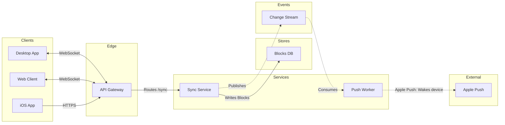

# Product Owner - Examples - Flow - Architecture

A worked architecture on the fictional Loomlist workspace app: an engineering doc turned into the sync path through Figma's six lanes, cut to budget with the cut named, a gate message and the reply.

---

# Example - Architecture - Loomlist Sync

Loomlist is a fictional workspace app used across the Product Owner fixtures. Every service and store here is invented for the example.

---

## 1. REQUEST

```text
$figjam the architecture behind block sync, from the sync-service doc, for the offline mode kickoff
```

The doc names these deployable parts: the desktop, web and iOS clients, an API gateway, sync-service, a push worker, the blocks database, file storage, a change stream and Apple's push service. It says clients hold a live socket to the gateway, sync-service writes every block change and publishes it to the change stream, and the push worker reads the stream and wakes sleeping iOS devices.

---

## 2. TYPE AND DIALS

- **Reader question:** which parts take part in sync and how do they connect? An architecture. A sequence would answer the order of one sync, which the kickoff did not ask for
- **Detail:** balanced. Ten parts is one over the budget, so file storage goes, because sync never touches it
- **Audience:** mixed, so `sync-service` reads `Sync Service`

---

## 3. MODEL



### Provenance

| Item | Source | Source class |
|---|---|---|
| Clients and their channels | Sync doc, Section 1 | current behavior |
| api, sync, blocks | Sync doc, Section 2 | current behavior |
| changes, push, apns | Sync doc, Section 3 | current behavior |

```text
Left out: file storage, off the sync path, cut at the balanced detail level
```

### Check

Every rule in Templates - Flow Type - Architecture holds, checked one by one: 9 nodes and 8 connectors, widest rank 3 steps, longest path 6 steps, 0.9 connectors per step, labels average 10 characters, 0 crossing pairs.

---

## 4. GATE

```text
Plan: Loomlist Engineering. File: a new FigJam file, which this call creates.
Writes: one architecture, 9 nodes and 8 connectors, named "Block sync", with useArchitectureLayoutCode.
Rollback: delete the new file.
Write it?
```

---

## 5. REPLY

```text
<board URL from generate_diagram>
Read-back: 9 of 9 nodes, 8 of 8 connectors, 6 of 6 lanes
Left out: file storage, off the sync path, cut at the balanced detail level
HVR self-scan: 0 hard blockers. Fixed: none. Kept with reason: none.
```
