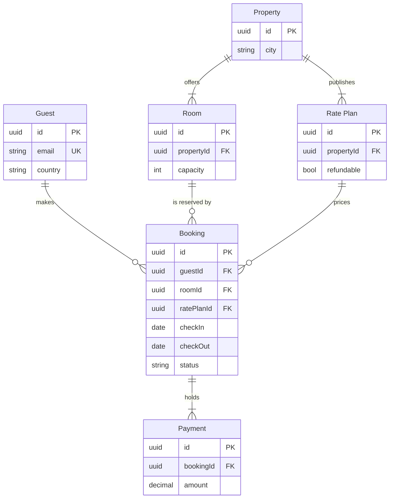

# Product Owner - Examples - Flow - ER

A worked ER diagram on the fictional Roamstay booking marketplace: a schema note turned into the stay model with keys and cardinalities, two domain tints planned, a gate message and the reply.

---

# Example - ER - Roamstay Stays

Roamstay is a fictional booking marketplace used across the Product Owner fixtures. Every table and field here is invented for the example.

---

## 1. REQUEST

```text
make a FigJam ER diagram of the stays model from the schema note, and group the partner tables apart from the guest tables
```

The schema note lists six tables: guests, bookings, payments, properties, rooms and rate plans. A guest makes bookings, a booking reserves one room under one rate plan and holds its payments, a property offers rooms and rate plans. The note marks keys and foreign keys and lists twenty more columns that the diagram does not need.

---

## 2. TYPE AND DIALS

- **Reader question:** which entities exist, which fields join them and how many of each? An ER diagram
- **Detail:** balanced, so each table keeps its keys and the columns a story about stays would cite
- **Extension:** colour by domain, which ER styling cannot do, so two status tints go behind the guest side and the partner side

---

## 3. MODEL



### Provenance

| Entity | Source | Source class |
|---|---|---|
| Every entity and relationship | Schema note, tables and keys | current behavior |

```text
Left out: 20 columns no stay story cites, cut at the balanced detail level
```

### Check

Every rule in Templates - Flow Type - ER holds, checked one by one: 6 entities and 6 relationships.

### Planned extension

Two status tints: light blue `#C2E5FF` with `#3DADFF` named `Guest side` behind Guest, Booking and Payment, and light violet `#DCCCFF` with `#874FFF` named `Partner side` behind Property, Room and RatePlan.

---

## 4. GATE

```text
Plan: Roamstay Product. File: a new FigJam file, which this call creates.
Writes: one ER diagram, 6 entities and 6 relationships, named "Stays model".
Then: two domain tints, guest side and partner side.
Rollback: delete the new file.
Write it?
```

---

## 5. REPLY

```text
<board URL from generate_diagram>
Read-back: 6 of 6 entities, 6 of 6 relationships, 21 of 21 attributes
Extensions: 2 of 2 status tints, 0 overlaps
Left out: 20 columns no stay story cites, cut at the balanced detail level
HVR self-scan: 0 hard blockers. Fixed: none. Kept with reason: none.
```
