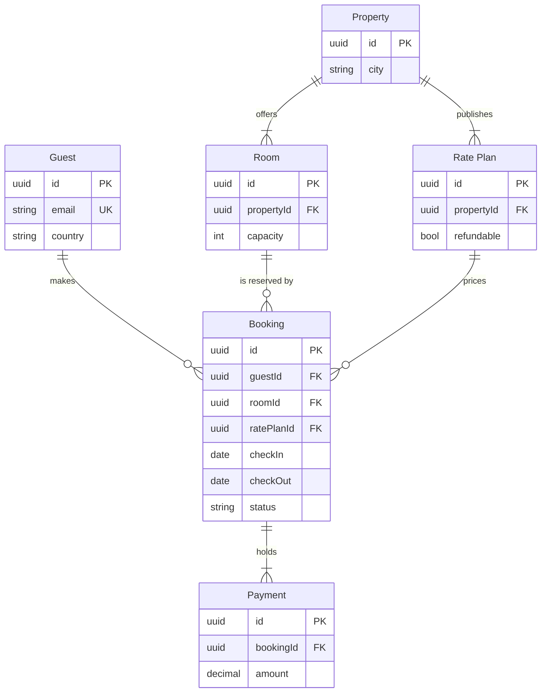

# Product Owner - Examples - Flow - ER

A worked ER diagram on the fictional Roamstay booking marketplace: a schema note turned into the stay model with keys and cardinalities, two domain zones, a playback, a gate message and the reply.

---

# Example - ER - Roamstay Stays

Roamstay is a fictional booking marketplace used across the Product Owner fixtures. Every table and field here is invented for the example.

---

## 1. REQUEST

```text
make a FigJam ER diagram of the stays model from the schema note, and group the partner tables apart from the guest tables
```

The schema note lists six tables: guests, bookings, payments, properties, rooms and rate plans. A guest makes bookings, a booking reserves one room under one rate plan and holds its payments, a property offers rooms and rate plans. The note marks keys and foreign keys and lists twenty more columns that the diagram does not need.

---

## 2. TYPE AND DIALS

- **Reader question:** which entities exist, which fields join them and how many of each? An ER diagram
- **Detail:** balanced, so each table keeps its keys and the columns a story about stays would cite
- **Grouping:** colour by domain, which ER styling cannot do, so two `%% zone:` lines put the guest side and the partner side in their own tinted sections

---

## 3. PLAYBACK

The playback is its own reply, sent before the model. It waits for its own answer, and a yes to it moves the work on to the model and writes nothing.

```text
Before I draw anything, this is how I read the request.
Question: which entities exist, which fields join them and how many of each?
Outcome: a reader can see the six stay tables, how they join and which tables sit on the guest side and which on the partner side.
Settled by the sources: the schema note gives six tables, their keys and how they join, and the request asks for the partner tables apart from the guest tables.
Left out: 20 columns no stay story cites.
Assumed: balanced detail, so each table keeps its keys and the columns a story about stays would cite.
Still open: none.
Is this the right reading of the board?
```

---

## 4. MODEL



### Provenance

| Entity | Source | Source class |
|---|---|---|
| Every entity and relationship | Schema note, tables and keys | current behavior |

```text
Left out: 20 columns no stay story cites, cut at the balanced detail level
```

### Check

Every rule in Templates - Flow Type - ER holds, checked one by one: 6 entities and 6 relationships.

---

## 5. GATE

The gate is its own reply, sent after the playback's answer. Its one question asks about the write alone.

```text
Question: which entities exist, which fields join them and how many of each?
Outcome: a reader can see the six stay tables, how they join and which tables sit on the guest side and which on the partner side.
First glance: Booking, the table every other stay table joins.
Second glance: the keys on Booking that tie it to the guest, the room and the rate plan.
Last glance: Property, the partner table that offers rooms and rate plans.
Sketch: the Section 4 model above in full, every `%%` and `style` line included, and it passed the check by hand.
Eye first: Booking, the table every other stay table joins, and it is the node the board most needs read.
Reads second: the keys on Booking that tie it to the guest, the room and the rate plan, which show what a booking needs.
Could miss: Payment, which would hide that one booking can carry many payments.
Remove next: Property, kept because it is where rooms and rate plans come from.
Plan: Roamstay Product. File: a new FigJam file named "Stays model", created in that plan.
Writes: one composed board, 6 entities and 6 relationships in two zones, guest side and partner side, with a title, a key and a source line, at the Laptop reading distance.
Left out: 20 columns no stay story cites, cut at the balanced detail level
Extensions: none.
Calls: whoami, create_new_file, one use_figma and one get_figjam read-back.
Rollback: delete the new file.
Write it?
```

---

## 6. REPLY

```text
<board URL>
Read-back: 6 of 6 entities, 6 of 6 relationships, 21 of 21 attributes, first glance: Booking
Left out: 20 columns no stay story cites, cut at the balanced detail level
HVR self-scan: 0 hard blockers. Fixed: none. Kept with reason: none.
```
