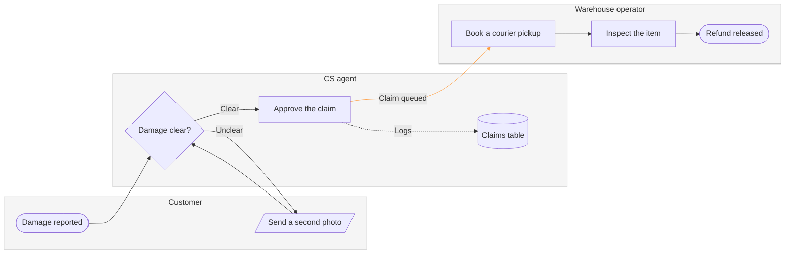

# Product Owner - Examples - Flow - Process

A worked laned process on the fictional Fernhouse store: a support runbook turned into a three-lane refund process with a handoff accent, a gate message and the reply.

---

# Example - Process - Fernhouse Refund

Fernhouse is a fictional store used across the Product Owner fixtures. Every name, step and rule here is invented for the example.

---

## 1. REQUEST

```text
make a FigJam process of how a damaged-item refund moves between the customer, CS and the warehouse, from the support runbook
```

| Runbook line | Says | Class |
|---|---|---|
| 3.1 | The customer reports damage with a photo through the help form | current behavior |
| 3.2 | A CS agent checks the photo. Clear damage is approved on the spot, unclear damage asks the customer for a second photo | current behavior |
| 3.3 | An approved claim goes to the warehouse queue, where an operator books a courier pickup | current behavior |
| 3.4 | The operator inspects the item on arrival and releases the refund | current behavior |
| 3.5 | Every decision is logged in the claims table | current behavior |
| 3.6 | Refunds under €20 skip the pickup. Pilot, not yet live | proposal |

---

## 2. TYPE AND DIALS

- **Reader question:** who does what, and where does the claim change hands? A process with three lanes
- **Detail:** balanced. **Audience:** mixed
- **Accent:** the handoff from CS to the warehouse, which the runbook names as the slowest step

---

## 3. MODEL



### Provenance

| Node | Source | Source class |
|---|---|---|
| report | Runbook 3.1 | current behavior |
| check, photo, approve | Runbook 3.2 | current behavior |
| pickup | Runbook 3.3 | current behavior |
| inspect, refund | Runbook 3.4 | current behavior |
| log | Runbook 3.5 | current behavior |

```text
Left out: pickup skipped under €20, a pilot that is not live
```

### Check

Every rule in Templates - Flow Type - Process holds, checked one by one: 8 nodes and 8 connectors, widest rank 2 steps, longest path 6 steps, 1.0 connectors per step, labels average 16 characters, 0 crossing pairs.

---

## 4. GATE

```text
Plan: Fernhouse Product. File: a new FigJam file, which this call creates.
Writes: one process, 3 lanes, 8 nodes and 8 connectors, named "Damaged-item refund".
Rollback: delete the new file.
Write it?
```

---

## 5. REPLY

```text
<board URL from generate_diagram>
Read-back: 8 of 8 nodes, 8 of 8 connectors, 2 of 2 decision exits labelled, 3 of 3 lanes
Left out: pickup skipped under €20, a pilot that is not live
HVR self-scan: 0 hard blockers. Fixed: none. Kept with reason: none.
```
