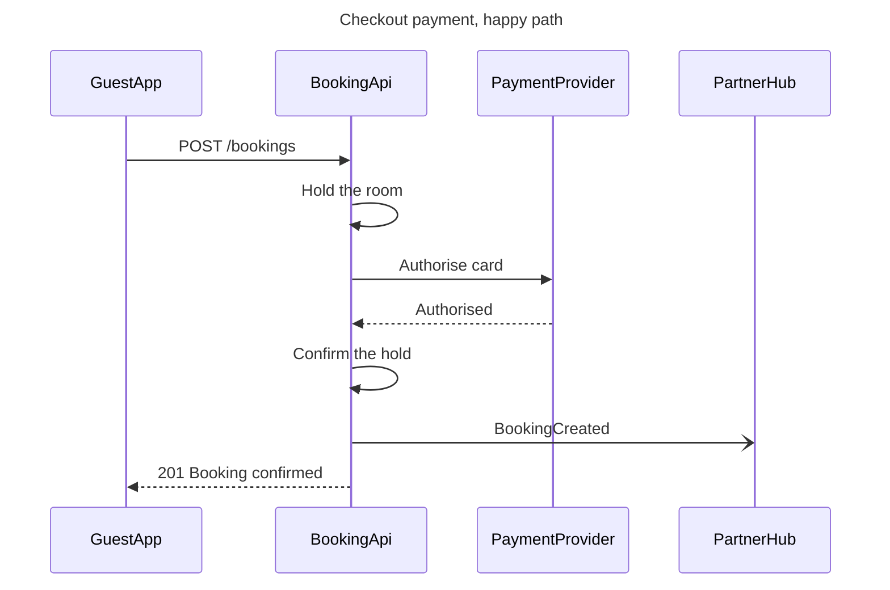

# Product Owner - Examples - Flow - Sequence

A worked sequence on the fictional Roamstay booking marketplace: an API brief turned into the checkout payment's happy path, with the decline path split out, a gate message and the reply.

---

# Example - Sequence - Roamstay Checkout

Roamstay is a fictional booking marketplace used across the Product Owner fixtures. Every service, path and status here is invented for the example.

---

## 1. REQUEST

```text
draw the checkout payment as a sequence diagram in FigJam, from the payments API brief
```

The brief lists the calls in order: the guest app posts the booking, the booking API holds the room, asks the payment provider to authorise the card, confirms the hold and tells the partner's hub, then answers the app. A declined card releases the hold and returns 402.

---

## 2. TYPE AND DIALS

- **Reader question:** in what order do the app, the booking API, the payment provider and the hub exchange messages? A sequence
- **Detail:** balanced. The decline is a second path, and `alt` renders flat, so it becomes its own diagram if asked for
- **Audience:** engineer, so paths and status codes stay in the labels

---

## 3. MODEL



### Provenance

| Message | Source | Source class |
|---|---|---|
| Every message | Payments API brief, Section 2 | current behavior |

```text
Left out: the declined-card path, 402 and the released hold, kept for a second diagram
```

### Check

Every rule in Templates - Flow Type - Sequence holds, checked one by one: 4 participants and 7 messages.

---

## 4. GATE

```text
Plan: Roamstay Product. File: a new FigJam file, which this call creates.
Writes: one sequence, 4 participants and 7 messages, named "Checkout payment, happy path".
Rollback: delete the new file.
Write it?
```

---

## 5. REPLY

```text
<board URL from generate_diagram>
Read-back: 4 of 4 participants, 7 of 7 messages
Left out: the declined-card path, 402 and the released hold, kept for a second diagram
HVR self-scan: 0 hard blockers. Fixed: none. Kept with reason: none.
```
