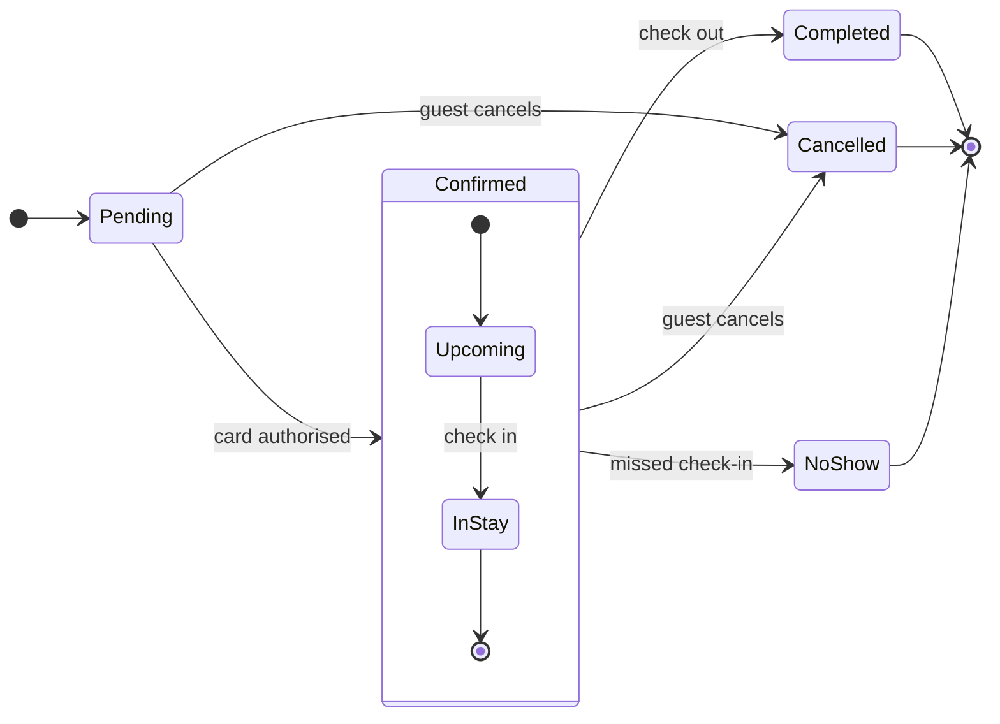

# Product Owner - Examples - Flow - State

A worked state diagram on the fictional Roamstay booking marketplace: a booking's status field drawn from a product doc, with a status tint added through the hybrid workflow, a gate message and the reply.

---

# Example - State - Roamstay Booking

Roamstay is a fictional booking marketplace used across the Product Owner fixtures. Every state and rule here is invented for the example.

---

## 1. REQUEST

```text
$figjam the booking status lifecycle from the bookings doc, and colour the end states so support can spot them
```

| Doc line | Says | Class |
|---|---|---|
| 2.1 | A booking starts as Pending until the card is authorised | current behavior |
| 2.2 | Confirmed covers Upcoming and In stay. Check-in moves Upcoming to In stay | current behavior |
| 2.3 | Check-out ends the stay as Completed | current behavior |
| 2.4 | A guest can cancel while Pending or Confirmed | current behavior |
| 2.5 | The hotel marks No-show the day after a missed check-in | current behavior |

---

## 2. TYPE AND DIALS

- **Reader question:** which statuses exist and what moves a booking between them? A state diagram
- **Detail:** balanced. **Audience:** mixed
- **Extension:** the request asks for colour on the end states, which Mermaid cannot set on a state diagram, so a status tint goes behind them through Templates - Flow Hybrid Workflow

---

## 3. MODEL



`NoShow` reads `NoShow` on the board. A description line, `NoShow: No-show`, would show the doc's own word.

### Provenance

| State | Source | Source class |
|---|---|---|
| Pending | Doc 2.1 | current behavior |
| Confirmed, Upcoming, InStay | Doc 2.2 | current behavior |
| Completed | Doc 2.3 | current behavior |
| Cancelled | Doc 2.4 | current behavior |
| NoShow | Doc 2.5 | current behavior |

### Check

Every rule in Templates - Flow Type - State holds, checked one by one: 7 states and 12 transitions.

### Planned extension

One status tint behind the three end states, light gray `#D9D9D9` with `#B3B3B3`, named `Ended`, as the status tint recipe draws it.

---

## 4. GATE

```text
Plan: Roamstay Product. File: a new FigJam file, which this call creates.
Writes: one state diagram, 7 states and 12 transitions, named "Booking status".
Then: one gray tint behind Completed, Cancelled and NoShow.
Rollback: delete the new file.
Write it?
```

---

## 5. REPLY

```text
<board URL from generate_diagram>
Read-back: 7 of 7 states, 12 of 12 transitions, 6 of 6 transitions labelled
Extensions: 1 of 1 status tint, 0 overlaps
HVR self-scan: 0 hard blockers. Fixed: none. Kept with reason: none.
```
