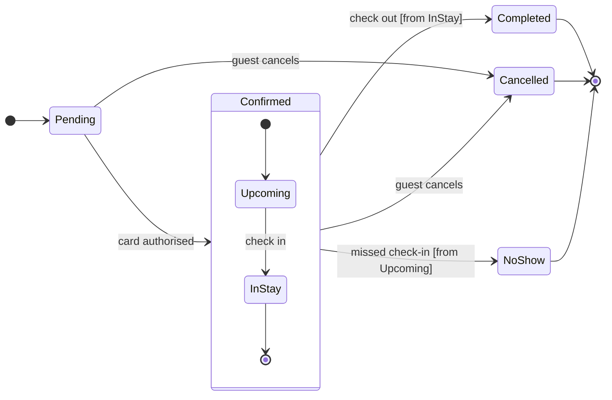

# Product Owner - Examples - Flow - State

A worked state diagram on the fictional Roamstay booking marketplace: a booking's status field drawn from a product doc, its end states coloured by the composer, a playback, a gate message and the reply.

---

# Example - State - Roamstay Booking

Roamstay is a fictional booking marketplace used across the Product Owner fixtures. Every state and rule here is invented for the example.

---

## 1. REQUEST

```text
$figjam the booking status lifecycle from the bookings doc, and colour the end states so support can spot them
```

| Doc line | Says | Class |
|---|---|---|
| 2.1 | A booking starts as Pending until the card is authorised | current behavior |
| 2.2 | Confirmed covers Upcoming and In stay. Check-in moves Upcoming to In stay | current behavior |
| 2.3 | Check-out ends the stay as Completed | current behavior |
| 2.4 | A guest can cancel while Pending or Confirmed | current behavior |
| 2.5 | The hotel marks No-show the day after a missed check-in | current behavior |

---

## 2. TYPE AND DIALS

- **Reader question:** which statuses exist and what moves a booking between them? A state diagram
- **Detail:** balanced. **Audience:** mixed
- **Colour:** the request asks for colour on the end states, which Mermaid cannot set on a state diagram. The composer already draws every state the machine ends from in light gray and names it `Final state` in the key, so the request needs no extension. States inside Confirmed stay white, because leaving the composite does not end the booking

---

## 3. PLAYBACK

The playback is its own reply, sent before the model. It waits for its own answer, and a yes to it moves the work on to the model and writes nothing.

```text
Before I draw anything, this is how I read the request.
Question: which statuses exist and what moves a booking between them?
Outcome: support can read every booking status and spot the statuses a booking ends in.
Settled by the sources: lines 2.1 to 2.5 of the bookings doc give the statuses and what moves a booking between them, and the composer already draws the end states in light gray.
Left out: nothing.
Assumed: balanced detail and a mixed audience.
Still open: none.
Is this the right reading of the board?
```

---

## 4. MODEL



`NoShow` reads `NoShow` on the board. A description line, `NoShow: No-show`, would show the doc's own word.

### Provenance

| State | Source | Source class |
|---|---|---|
| Pending | Doc 2.1 | current behavior |
| Confirmed, Upcoming, InStay | Doc 2.2 | current behavior |
| Completed | Doc 2.3 | current behavior |
| Cancelled | Doc 2.4 | current behavior |
| NoShow | Doc 2.5 | current behavior |

### Check

Every rule in Templates - Flow Type - State holds, checked one by one: 7 states and 12 transitions.

---

## 5. GATE

The gate is its own reply, sent after the playback's answer. Its one question asks about the write alone.

```text
Question: which statuses exist and what moves a booking between them?
Outcome: support can read every booking status and spot the statuses a booking ends in.
First glance: Pending, the light blue first state where every booking starts.
Second glance: Upcoming and InStay, the states inside Confirmed, read with the section that frames them.
Last glance: Cancelled, the end state support most needs to spot, marked by the focus line where it is drawn, then Completed and NoShow, the other end states, each in light gray with its heavy outline.
Plan: Roamstay Product. File: a new FigJam file named "Booking status", created in that plan.
Writes: one composed board, 7 states and 12 transitions, the end states in light gray, with a title, a key and a source line, at the Laptop reading distance.
Extensions: none.
Calls: whoami, create_new_file, one use_figma and one get_figjam read-back.
Rollback: delete the new file.
Write it?
```

---

## 6. REPLY

```text
<board URL>
Read-back: 7 of 7 states, 12 of 12 transitions, 6 of 6 transitions labelled, first glance: Pending
HVR self-scan: 0 hard blockers. Fixed: none. Kept with reason: none.
```
