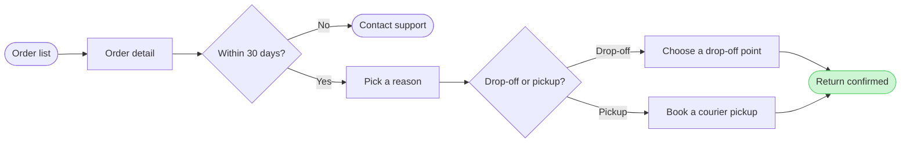

# Product Owner - Examples - Flow - User Flow

A worked user flow on the fictional Fernhouse store: app screenshots and a returns doc turned into a checked model with its board lines and zones, a playback, a gate message and the reply.

---

# Example - User Flow - Fernhouse Return

Fernhouse is a fictional store used across the Product Owner fixtures. Every name, screen and rule here is invented for the example.

---

## 1. REQUEST

```text
$flow how a customer starts a return in the app, from these screenshots and the returns doc
```

Sources: five app screenshots and a returns doc.

| Source | Says |
|---|---|
| `Orders - Tap_ Order row.png` | The order list, a row under the finger |
| `Order detail - Tap_ Start a return.png` | The order page with a Start a return button |
| `Return reason - Select_ Reason.png` | A list of reasons |
| `Return method - Select_ Drop-off or pickup.png` | Two choices: a drop-off point or a courier pickup |
| `Return confirmed.png` | A confirmation with a QR code |
| Returns doc, Section 2 | Returns are open for 30 days after delivery. After that the app shows Contact support. Current behavior |
| Returns doc, Section 4 | A free pickup for orders over €100. Proposal, under review |

---

## 2. TYPE AND DIALS

- **Reader question:** which screens does a customer pass through to start a return, and where do they choose? A user flow
- **Detail:** balanced. **Audience:** mixed, so the labels use the app's own words
- **Look:** left to right in three zones, finding the order, requesting the return and done. The confirmation is styled as the goal, so the main line runs from the order list to it and Contact support sits below as an exit

---

## 3. PLAYBACK

The playback is its own reply, sent before the model. It waits for its own answer, and a yes to it moves the work on to the model and writes nothing.

```text
Before I draw anything, this is how I read the request.
Question: which screens does a customer pass through to start a return, and where do they choose?
Outcome: a reader can follow a return from the order list to a confirmed return and see where the 30 day window ends it.
Settled by the sources: the five screenshots give the screens and the returns doc, Section 2, gives the 30 day window and its Contact support exit.
Left out: the free pickup over €100, a proposal under review in Section 4 of the returns doc.
Assumed: balanced detail and a mixed audience, so the labels use the app's own words.
Still open: none.
Is this the right reading of the board?
```

---

## 4. MODEL

The first draft, kept as text because it breaks a rule:

```text
flowchart LR
    orders([Order list]) --> detail[Order detail]
    detail --> window{Within 30 days?}
    window -->|No| support([Contact support])
    window -->|Yes| reason[Pick a reason]
    reason --> method{Drop-off or pickup?}
    method -->|Drop-off| dropoff[Choose a drop-off point]
    method -->|Pickup| pickup[Book a courier pickup]
    dropoff --> merge((.))
    pickup --> merge
    merge --> confirmed([Return confirmed])
    style confirmed fill:#CDF4D3,stroke:#66D575
```

That is ten nodes, one over the budget:

```text
  diagram 1, user flow: 10 nodes, at most 9: split the flow
```

The merge dot goes: both methods lead straight to the confirmation, which says the same thing with one node less. The model that goes forward carries the board lines the composer reads:



### Provenance

| Node | Source | Source class |
|---|---|---|
| orders | `Orders - Tap_ Order row.png` | current behavior |
| detail | `Order detail - Tap_ Start a return.png` | current behavior |
| window | Returns doc, Section 2 | current behavior |
| support | Returns doc, Section 2 | current behavior |
| reason | `Return reason - Select_ Reason.png` | current behavior |
| method, dropoff, pickup | `Return method - Select_ Drop-off or pickup.png` | current behavior |
| confirmed | `Return confirmed.png` | current behavior |

```text
Left out: free pickup over €100, a proposal under review
```

### Check

Every rule in Templates - Flow Type - User Flow holds, checked one by one: 9 nodes and 9 connectors, widest rank 2 steps, longest path 7 steps, 1.0 connectors per step, labels average 16 characters, 0 crossing pairs.

---

## 5. GATE

The gate is its own reply, sent after the playback's answer. Its one question asks about the write alone.

```text
Question: which screens does a customer pass through to start a return, and where do they choose?
Outcome: a reader can follow a return from the order list to a confirmed return and see where the 30 day window ends it.
First glance: the confirmed return, the goal the flow reaches.
Second glance: Order list, the light blue entry where the return starts, then Order detail, Within 30 days?, Pick a reason, the drop-off or pickup choice and Choose a drop-off point, the main row the composer draws, in path order up to the goal.
Last glance: Contact support, the exit after 30 days, then Book a courier pickup, the second way to the goal, drawn below the row.
Plan: Fernhouse Product. File: a new FigJam file named "Start a return", created in that plan.
Writes: one composed board, 9 nodes and 9 connectors in three zones, with a title, a key and a source line, at the Laptop reading distance.
Left out: free pickup over €100, a proposal under review
Extensions: none.
Calls: whoami, create_new_file, one use_figma and one get_figjam read-back.
Rollback: delete the new file.
Write it?
```

---

## 6. REPLY

```text
<board URL>
Read-back: 9 of 9 nodes, 9 of 9 connectors, 4 of 4 decision exits labelled, first glance: the confirmed return
Left out: free pickup over €100, a proposal under review
HVR self-scan: 0 hard blockers. Fixed: none. Kept with reason: none.
```
