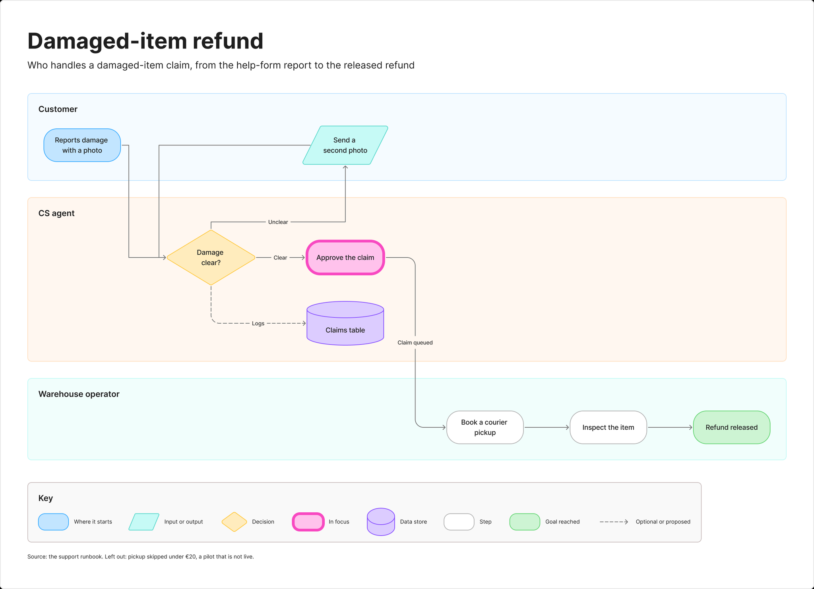
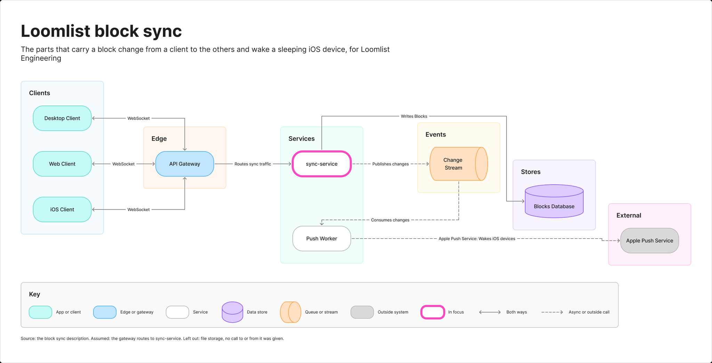
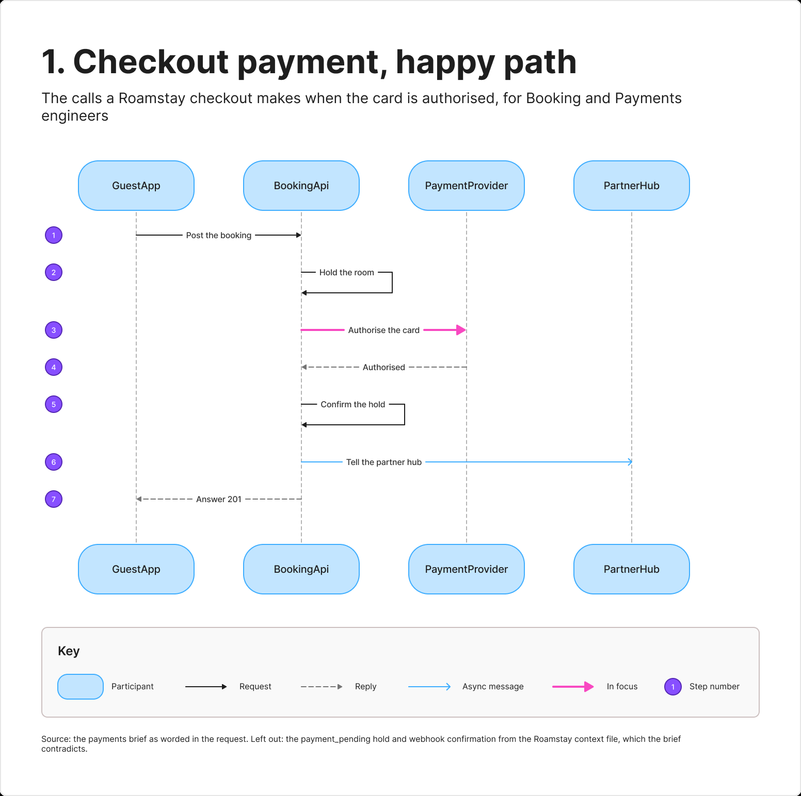
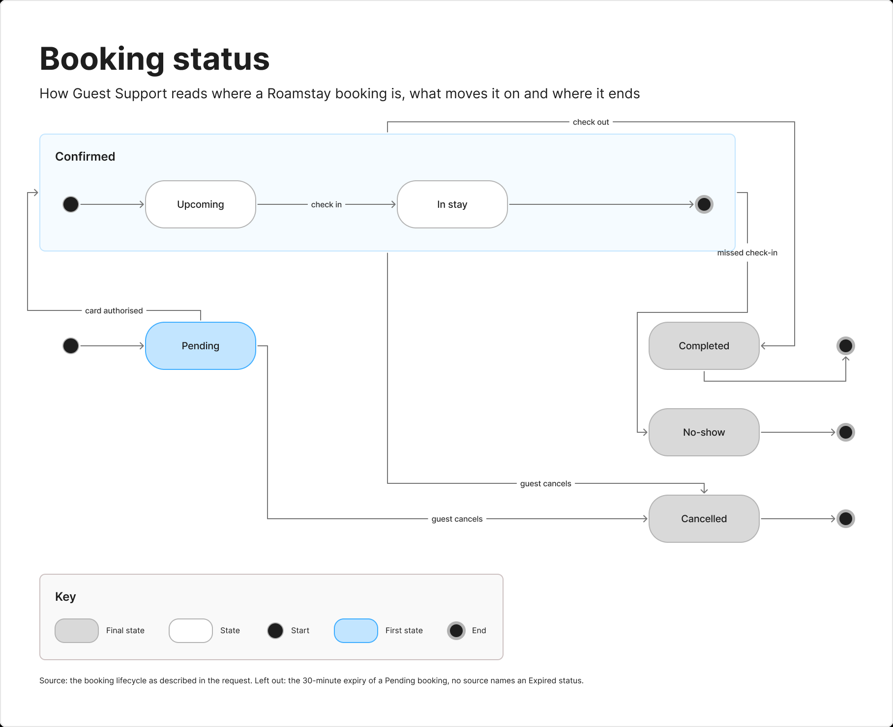
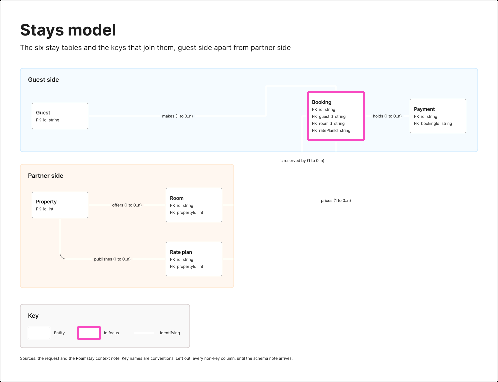
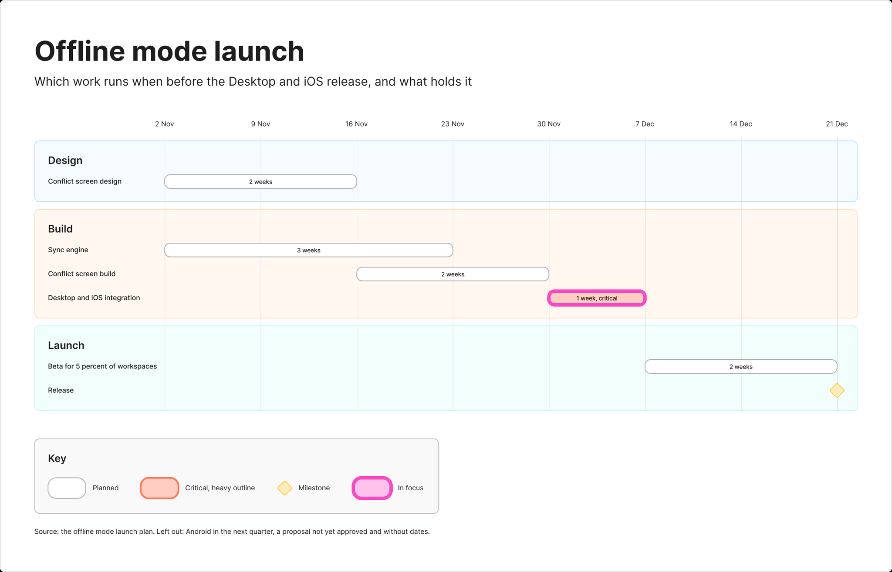
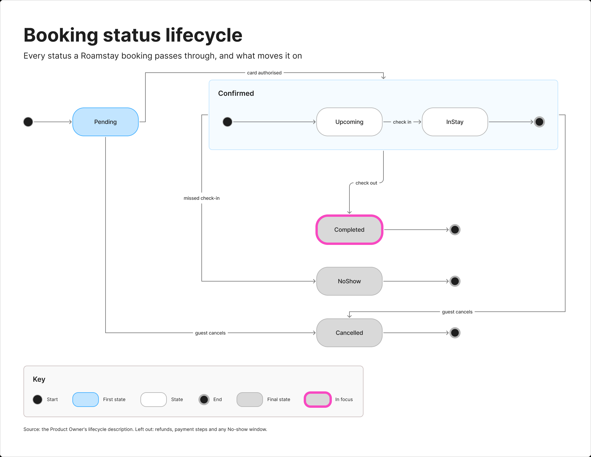
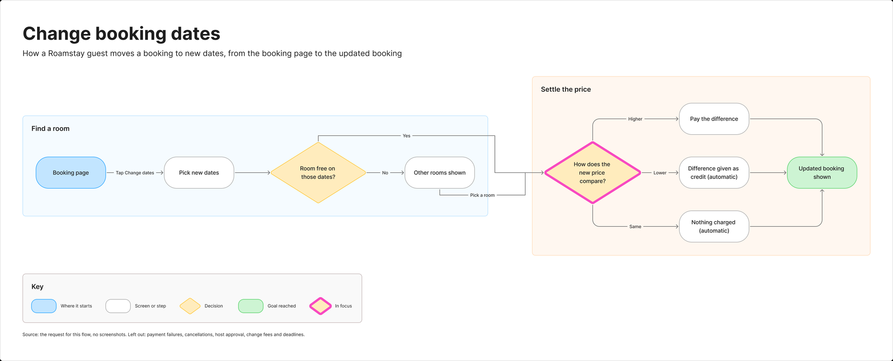

# sk-create-figjam

> Draws a FigJam diagram of the type the reader's question needs, from screenshots, a Figma flow, a product doc, a schema or a plan, and composes the checked model into a framed board with a title, zones, colour by kind and a key.

---

## 1. OVERVIEW

This packet is Flow Mode, the one Product Owner mode whose deliverable is a board rather than a file. The hub `../SKILL.md` picks it for `$flow`, `$figjam` and FigJam output wording. The hub `../ROUTER.md` maps a Flow request to this packet's pair, and `SKILL.md` adds the files for the chosen type.

It draws seven types, each answering one reader question: a user flow, a laned process, an architecture, a sequence, a state diagram, an ER diagram and a gantt chart. Before any model it interviews the user in rounds until a nine-row Brief is ready to draw: every question carries the AI's reading of the input and a recommended answer, and an unanswered one proceeds on that recommendation, marked assumed and named in the playback before the gate. A diagram is written as a Mermaid model with a provenance table that ties every item to its source. `scripts/flow_check.py` holds the model to its type's rules before anything is written, `references/quality-rubric.md` asks what a script cannot, and the write waits for a yes naming the plan, the file, any extension and the rollback. `scripts/compose_board.py` then fills `assets/compose-board.js` from the checked model, and one `use_figma` call draws the board: a title and subtitle, the diagram on an 8 pixel grid with every node coloured by its kind, tinted zones, routed connectors, a key and a source line. Notes the model cannot carry go on afterwards as numbered pins or stickies through `references/hybrid-workflow.md`. The reply is the board URL, a read-back line measured on the board, an `Extensions:` line when there are any, a `Left out:` line when items were left out, a `Finding:` line for each finding or question and the HVR self-scan line last. Nothing is saved to `../export/`.

---

## 2. GALLERY

Real boards this packet composed on a fictional test file and rendered through the Figma REST API. [`assets/screenshots/README.md`](assets/screenshots/README.md) names the playbook scenario and scorecard result behind each one.

**User flow.** The pink outline on the green Return confirmed goal is the first glance. Three zones run left to right, each decision is a yellow diamond with labelled exits and the orange Contact support pill shows where the flow leaves.


**Process.** One lane per role, Customer, CS agent and Warehouse operator. Approve the claim carries the pink fill and outline, the claims table is a violet cylinder and the dashed Logs edge matches the dashed entry in the key.



**Architecture.** Six zones run left to right from Clients through Edge, Services, Events and Stores to External. sync-service carries the pink outline, the change stream is an orange queue and the blocks database a violet cylinder. Dashed edges mark the async and outside calls, the same as the key.



**Sequence.** The four participants repeat at the top and the bottom, and numbered circles mark the seven steps. The pink heavy arrow on step 3 is the focus, replies are dashed and the async message is blue. The source line says what was left out and why.



**State.** Pending is the blue first state and Confirmed is a zone holding its own start dot, Upcoming, In stay and end dot. Every transition carries its trigger and each gray final state runs to an end dot.



**ER.** A Guest side zone and a Partner side zone keep the two halves apart. Each entity lists its PK and FK columns with types, each line names the relationship with its cardinality and Booking carries the pink outline.



**Gantt.** A weekly date axis runs across the top and Design, Build and Launch are tinted zones. Each bar shows its length, the critical integration week carries the pink outline and a yellow diamond marks the release. The source line names the platform left out.



**Written onto an existing board.** This state diagram was added to a board that already held content, which the write left in place. The overview shows the new section only. Completed carries the pink outline as the first glance this time, because the gate planned it first.



**Dense flow at the node budget.** Nine nodes and two decisions with five labelled exits, No, Yes, Higher, Lower and Same, and no connector crossing another. The pink outline sits on the three-way price decision and the key shows the same diamond.



---

## 3. QUICK START

```text
$flow the location change from these screenshots
make a FigJam flow from the signup doc
$figjam the booking status lifecycle from the bookings doc
put the launch plan on a FigJam gantt chart
```

Check a model by hand:

```bash
python3 sk-create-figjam/scripts/flow_check.py model.md
python3 sk-create-figjam/scripts/flow_check.py --self-test
python3 sk-create-figjam/scripts/compose_board.py model.md --diagram 1 --out board.js
python3 sk-create-figjam/scripts/compose_board.py --self-test
```

A flowchart that is not a user flow starts with `%% type: process` or `%% type: architecture`. The check exits 0 when every diagram passes, 1 when a rule fails and 2 when the file cannot be read. For a user flow, a process or an architecture it also prints five layout measures, the widest rank, the longest path, connectors per step, the average label length and the crossing pairs, and fails a model outside their budgets. The composer exits 0 with the code written and a `COMPOSED` line naming the counts the read-back will look for, 1 when the model fails the check or the code would not fit one `use_figma` call, and 2 when the file or the diagram cannot be read. Its self-test needs `node` on the path to syntax-check the code it fills.

---

## 4. STRUCTURE

[`SKILL.md`](SKILL.md) Section 3 holds the packet's file map, one line per path, so this README does not restate it.

---

## 5. HOW IT FITS

The packet shares the Product Owner bootstrap in `../AGENTS.md`, so the persona and the self-scan apply here. It reads `hvr-core.md` and `conciseness.md` from `../sk-product-owner/references/` instead of keeping its own copy. The `fj` write route uses the vendored `../mcp-figma/` packet for `figma-ds-cli` mechanics.

The Product Owner router still knows both commands. A conflict such as `$task $flow` stays there and asks one question, and a Flow route that reaches it hands off here.

The claude.ai Project has no hub, so it keeps Flow Mode as a mode of the one kernel. Its Flow Knowledge files mirror this packet's references and assets where they apply inside a Project, as `../SYNC.md` records.

---

## 6. RELATED DOCUMENTS

| Document | Purpose |
|---|---|
| [`../SKILL.md`](../SKILL.md) | The hub, stage one routing |
| [`../ROUTER.md`](../ROUTER.md) | The hub stage two leaf map |
| [`../sk-product-owner/SKILL.md`](../sk-product-owner/SKILL.md) | The Product Owner packet |
| [`../mcp-figma/SKILL.md`](../mcp-figma/SKILL.md) | The vendored Figma transport packet |
| [`../SYNC.md`](../SYNC.md) | The parity note for the Claude Project package |
