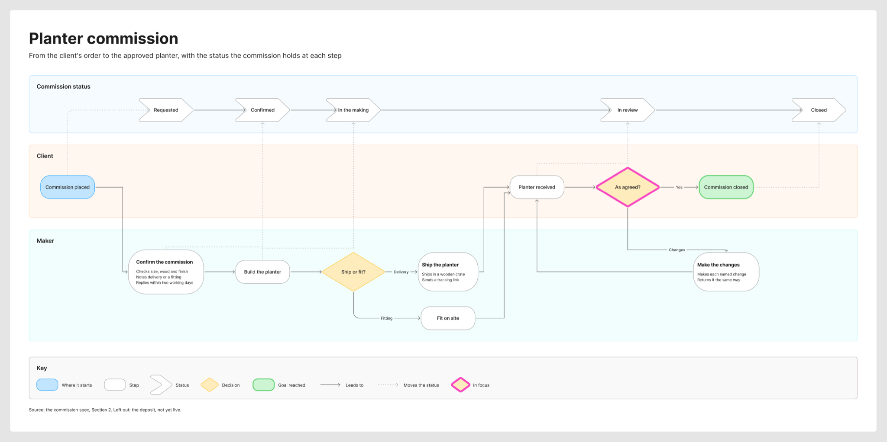

# sk-create-figjam

> Draws a FigJam diagram of the type the reader's question needs, from screenshots, a Figma flow, a product doc, a schema or a plan, and composes the checked model into a framed board with a title, zones, colour by kind and a key.

---

## 1. OVERVIEW

This packet is Flow Mode, the one Product Owner mode whose deliverable is a board rather than a file. The hub `../SKILL.md` picks it for `$flow`, `$figjam` and FigJam output wording. The hub `../ROUTER.md` maps a Flow request to this packet's pair, and `SKILL.md` adds the files for the chosen type.

It draws seven types, each answering one reader question: a user flow, a laned process, an architecture, a sequence, a state diagram, an ER diagram and a gantt chart. Before any model it interviews the user in rounds until a nine-row Brief is ready to draw: every question carries the AI's reading of the input and a recommended answer, and an unanswered one proceeds on that recommendation, marked assumed and named in the playback before the gate. A diagram is written as a Mermaid model with a provenance table that ties every item to its source. `scripts/flow_check.py` holds the model to its type's rules before anything is written, `references/quality-rubric.md` asks what a script cannot, and the write waits for a yes naming the plan, the file, any extension and the rollback. `scripts/compose_board.py` then fills `assets/compose-board.js` from the checked model, and one `use_figma` call draws the board: a title and subtitle, the diagram on an 8 pixel grid with every node coloured by its kind, tinted zones, routed connectors, a key and a source line. Every board is drawn in the design `assets/figjam-design.md` holds: what each colour means, the first-glance accent, the type sizes, the lines, the zone tints and the key's words. A team edits that one file to restyle every board, and a token that would break a contrast or hue floor falls back to its shipped value with a `DESIGN` line that the reply turns into a finding. Notes the model cannot carry go on afterwards as numbered pins or stickies through `references/hybrid-workflow.md`. The reply is the board URL on its first line, a read-back line measured on the board, an `Extensions:` line when there are any, a `Left out:` line whenever the board leaves out a cut, a split, a later board or a point the sources left open, a `Finding:` line for each finding or question and the HVR self-scan line last. Nothing is saved to `../export/`.

---

## 2. GALLERY

Real boards this packet composed on a fictional test file and rendered through the Figma REST API. On 2026-10-30 Claude Sonnet 5.5 medium ran the gallery scenarios again on v1.0.17.0, each with a source excerpt, and every image but the status lane comes from that run, whatever it scored, so the gallery shows what the skill draws now: zone and lane notes, detail cards on four types, a one-band key and a reason for every accent. The status lane image stays from v1.0.16.0, because the graded rerun of its scenario drew no lane. [`assets/screenshots/README.md`](assets/screenshots/README.md) names the playbook scenario, the model and the scorecard result behind each one.

**User flow.** Three zones run left to right, Find the order, Check and choose and Hand over, and each carries notes under its title saying where it starts, where it ends and what is good to know. Order detail, Return reason and the two hand-over steps are detail cards, so the board lists the four reasons, the map of the 5 nearest points and the 3 working day pickup window. The pink outline sits on the 30-day decision and the key gives the reason, late returns go to support. It comes from FJ-022, Claude Sonnet 5.5 medium on v1.0.17.0, 22 of 24, FAIL on Composition: both readers took the green goal, the orange Contact support exit and the second decision before the plan reached them.


**Process.** One lane per role, Customer, CS agent and Warehouse operator, each with a note under its title: the help form's fields, the one working day CS answer and the 5 working day refund. Book courier pickup and Inspect on arrival are detail cards. The pink outline sits on Approve the claim, which hands the claim to the warehouse on the Claim queued line, and every decision is logged to the violet Claims table. It comes from FJ-023, Claude Sonnet 5.5 medium on v1.0.17.0, 24 of 24, PASS.


**Process with a status lane.** The Claim status lane runs across the top as white chevrons, Reported to Closed, and each step that moves the claim draws a dotted gray line into its status, which the key names Moves the status. Report damage, Send claim to guest and Review dispute are detail cards, a Bold label over the policy's lines. The pink outline sits on the guest's Accept within 7 days? decision. It comes from FJ-049, Claude Sonnet 5.5 medium on v1.0.16.0, 19 of 22, FAIL: both readers took the green Claim closed goal and the orange Card charged exit early, so Composition scores 0, and `days?` stands alone on the decision's last line. The dotted moves into With the guest and Under review cross the Hotel lane, and an accepted claim ends on Card charged without reaching Closed.



**Architecture.** Six zones run left to right from Clients through Edge, Services, Events and Stores to External. The gateway, sync-service, the push worker, the change stream and the blocks database are detail cards, so the board says what each part does and keeps: the session check, the merge rule, one wake-up per device per minute, 7 days of events and 30 days of block history. sync-service carries the pink outline because every change is written there. It comes from FJ-024, Claude Sonnet 5.5 medium on v1.0.17.0, 22 of 24, FAIL on Composition, because the glance plan left out the clients and the database that both readers read early.


**Sequence.** The checkout splits into two boards side by side, the authorised card and the declined card, as the skill splits a failure path. The message labels carry what the brief says, the 15 minute room hold and the room, dates and card token on the booking post. Numbered pins mark each step, replies are dashed and the async hub message is blue. It comes from FJ-025, Claude Sonnet 5.5 medium on v1.0.17.0, 22 of 24, FAIL on Composition, scored by hand because a sequence prints no plan line.


**State.** Pending is the blue first state and card authorised moves it into Confirmed, a composite holding Upcoming and In stay. Every state with a rule is a detail card: Pending lasts at most 15 minutes, a guest can still change dates while Upcoming, the hotel can add charges In stay and mark a No-show from 6 hours after check-in, and a cancel within 48 hours keeps the first night's price. Cancelled carries the pink outline. It comes from FJ-026, Claude Sonnet 5.5 medium on v1.0.17.0, 22 of 24, FAIL on Composition, because the plan put Cancelled last and both readers read it first.


**ER.** A Guest side zone and a Partner side zone keep the two halves apart. Each entity lists its columns with PK and FK marks, and each line names its relationship with its cardinality and the matching crow's-foot ends. Booking carries the pink outline because every other table joins it. It comes from FJ-027, Claude Sonnet 5.5 medium on v1.0.17.0, 22 of 24, FAIL on Substance: the three payment statuses the source names sat in a column comment, which the board does not draw, so neither reader could say which statuses a payment has.


**Gantt.** A weekly date axis runs across the top and Build and Launch are tinted zones. The task names carry who owns the sync engine and which platforms integration covers, the critical bars carry a heavy outline and integration takes the pink one, because both builds must finish first. It comes from FJ-028, Claude Sonnet 5.5 medium on v1.0.17.0, 22 of 24, PASS. It loses a Shared trunks point where two arrows meet the integration bar and a Clarity point where the critical marking widened beyond the one task the plan names.


**Written onto an existing board.** In FJ-032 this state diagram was added to a board that already held a Sprint retro section of six stickies, which the write left in place and clear of the new section. The page view shows both. Pending, No-show and Cancelled are detail cards with the 15 minute limit, the 6 hour no-show rule and the first night kept on a late cancel. It comes from Claude Sonnet 5.5 medium on v1.0.17.0, 24 of 24, PASS.


**Dense flow at the node budget.** Nine nodes and two decisions with five labelled exits, and no connector crossing another. Pick new dates, See other rooms, Pay the difference and Get credit are detail cards, so the board says the picker shows only open nights, the guest sees up to 3 other rooms, a higher price goes to the card on file and a credit is kept for 12 months. The pink outline sits on the three-way New price? decision. It comes from FJ-036, Claude Sonnet 5.5 medium on v1.0.17.0, 22 of 24, FAIL on Composition, because both readers read the green goal early.


---

## 3. QUICK START

```text
$flow the location change from these screenshots
make a FigJam flow from the signup doc
$figjam the booking status lifecycle from the bookings doc
put the launch plan on a FigJam gantt chart
```

Check a model by hand:

```bash
python3 sk-create-figjam/scripts/flow_check.py model.md
python3 sk-create-figjam/scripts/flow_check.py --self-test
python3 sk-create-figjam/scripts/compose_board.py model.md --diagram 1 --out board.js
python3 sk-create-figjam/scripts/compose_board.py --design-check
python3 sk-create-figjam/scripts/compose_board.py --self-test
```

A flowchart that is not a user flow starts with `%% type: process` or `%% type: architecture`. The check exits 0 when every diagram passes, 1 when a rule fails and 2 when the file cannot be read. For a user flow, a process or an architecture it also prints five layout measures, the widest rank, the longest path, connectors per step, the average label length and the crossing pairs, and fails a model outside their budgets. When `node` is on the path it also prints a `Label:` line for each node label the board would wrap with one word alone on its last line, or one `Label: skipped` line when it could not trace the board, and a label stranded at only one of the two widths FigJam wraps at reads `may leave`. On a user flow or a process it prints a `Glance:` line, the order a reader meets the nodes, and a `Row:` line for a main-row line that bends off its row. With `--notes <id>,<id>` it prints a `Sides:` line per noted node with the side and alignment its sticky takes. None of these lines fails the check. The composer exits 0 with the code written and a `COMPOSED` line naming the counts the read-back will look for, 1 when the model fails the check or the code would not fit one `use_figma` call, and 2 when the file or the diagram cannot be read. `--design-check` prints the design a board is drawn in with its measured contrast and exits 1 on any design warning. The self-test needs `node` on the path to syntax-check the code it fills.

---

## 4. STRUCTURE

[`SKILL.md`](SKILL.md) Section 3 holds the packet's file map, one line per path, so this README does not restate it.

---

## 5. HOW IT FITS

The packet shares the Product Owner bootstrap in `../AGENTS.md`, so the persona and the self-scan apply here. It reads `hvr-core.md` and `conciseness.md` from `../sk-product-owner/references/` instead of keeping its own copy. The `fj` write route uses the vendored `../mcp-figma/` packet for `figma-ds-cli` mechanics.

The Product Owner router still knows both commands. A conflict such as `$task $flow` stays there and asks one question, and a Flow route that reaches it hands off here.

The claude.ai Project has no hub, so it keeps Flow Mode as a mode of the one kernel. Its Flow Knowledge files mirror this packet's references and assets where they apply inside a Project, as `../SYNC.md` records.

---

## 6. RELATED DOCUMENTS

| Document | Purpose |
|---|---|
| [`../SKILL.md`](../SKILL.md) | The hub, stage one routing |
| [`../ROUTER.md`](../ROUTER.md) | The hub stage two leaf map |
| [`../sk-product-owner/SKILL.md`](../sk-product-owner/SKILL.md) | The Product Owner packet |
| [`../mcp-figma/SKILL.md`](../mcp-figma/SKILL.md) | The vendored Figma transport packet |
| [`../SYNC.md`](../SYNC.md) | The parity note for the Claude Project package |
