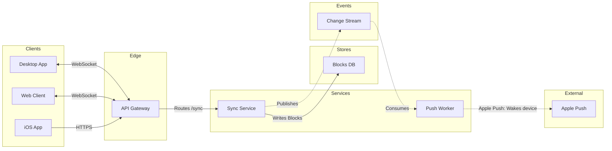

# Example - Architecture - Loomlist Sync

Loomlist is a fictional workspace app used across the Product Owner fixtures. Every service and store here is invented for the example.

---

## 1. REQUEST

```text
$figjam the architecture behind block sync, from the sync-service doc, for the offline mode kickoff
```

The doc names these deployable parts: the desktop, web and iOS clients, an API gateway, sync-service, a push worker, the blocks database, file storage, a change stream and Apple's push service. It says clients hold a live socket to the gateway, sync-service writes every block change and publishes it to the change stream, and the push worker reads the stream and wakes sleeping iOS devices.

---

## 2. TYPE AND DIALS

- **Reader question:** which parts take part in sync and how do they connect? An architecture. A sequence would answer the order of one sync, which the kickoff did not ask for
- **Detail:** balanced. Ten parts is one over the budget, so file storage goes, because sync never touches it
- **Audience:** mixed, so `sync-service` reads `Sync Service`

---

## 3. PLAYBACK

The playback is its own reply, sent before the model. It waits for its own answer, and a yes to it moves the work on to the model and writes nothing.

```text
Before I draw anything, this is how I read the request.
Question: which parts take part in sync and how do they connect?
Outcome: the offline mode kickoff group can see which parts carry a block change from one client to the others.
Settled by the sources: the sync-service doc gives ten deployable parts and the calls between them.
Left out: file storage, because sync never touches it and ten parts is one over the budget.
Assumed: balanced detail and a mixed audience, so `sync-service` reads `Sync Service`.
Still open: none.
Is this the right reading of the board?
```

---

## 4. MODEL



### Provenance

| Item | Source | Source class |
|---|---|---|
| Clients and their channels | Sync doc, Section 1 | current behavior |
| api, sync, blocks | Sync doc, Section 2 | current behavior |
| changes, push, apns | Sync doc, Section 3 | current behavior |

```text
Left out: file storage, off the sync path, cut at the balanced detail level
```

### Check

```text
  diagram 1, architecture: ok, 9 nodes and 8 connectors, widest rank 3 steps, longest path 6 steps, 0.9 connectors per step, labels average 10 characters, 0 crossing pairs
PASSED 1 diagram(s) in model.md
```

---

## 5. GATE

The gate is its own reply, sent after the playback's answer. Its one question asks about the write alone.

```text
Question: which parts take part in sync and how do they connect?
Outcome: the offline mode kickoff group can see which parts carry a block change from one client to the others.
First glance: Sync Service, where every block change is written and published.
Second glance: the API Gateway, the edge every client socket enters through, and the Change Stream that carries each change on to the Push Worker.
Last glance: Apple Push, the external hop that wakes sleeping iOS devices.
Sketch: the Section 4 model above, and the check printed PASSED for it.
Eye first: Sync Service, where every block change is written and published, and it is the node the board most needs read.
Reads second: the API Gateway and the Change Stream, which show how a change enters and how it leaves.
Could miss: Apple Push in the external lane, which would hide how a sleeping iOS device hears of a change.
Remove next: the Web Client, kept because it is one of the three clients the sources name.
Plan: Loomlist Engineering. File: a new FigJam file named "Block sync", created in that plan.
Writes: one composed board, 9 nodes and 8 connectors in 6 lanes, with a title, a key and a source line, at the Laptop reading distance.
Left out: file storage, off the sync path, cut at the balanced detail level
Extensions: none.
Calls: whoami, create_new_file, one use_figma and one get_figjam read-back.
Rollback: delete the new file.
Write it?
```

---

## 6. REPLY

```text
<board URL>
Read-back: 9 of 9 nodes, 8 of 8 connectors, 6 of 6 lanes, first glance: Sync Service
Left out: file storage, off the sync path, cut at the balanced detail level
HVR self-scan: 0 hard blockers. Fixed: none. Kept with reason: none.
```
